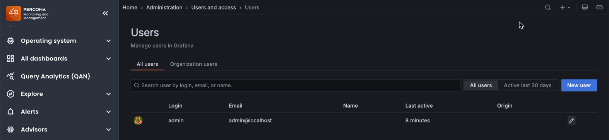

# Assign access roles

You can assign access roles to users and to service accounts. The roles limit the metrics and Query Analytics data that a user, or a request made with a service account token, can see.

## Assign access roles to users

To assign access roles to users:
{.power-number}

1. From the [main menu](../../../reference/ui/ui_components.md), go to **Configuration > Settings > Advanced Settings** and enable the **Access control** option.
2. Go to **Users and access > Users**.
3. Click on the user you want to assign roles to.
4. From the **Roles** drop-down select the appropriate roles.
5. Verify the assigned roles appear in the **Access Role** column.

    

## Assign access roles to service accounts

Access roles apply to service account tokens the same way they apply to users. When access control is enabled, a request made with a token returns only the metrics and Query Analytics data that the roles of the token's service account allow. A service account that has no role gets the [default role](manage_roles.md#set-a-role-as-default) when one of its tokens first reads metrics or Query Analytics data while access control is enabled. Until then, the service account holds no role.

The **Service accounts** page has no access role selector, so you assign roles to a service account with the PMM API. The calls in this section need the credentials of an Admin user or a token of an Admin service account. The `curl` examples use `-k` to accept PMM Server's self-signed certificate; remove it if your PMM Server has a trusted certificate.

To assign access roles to a service account:
{.power-number}

1. Find the ID of the service account. The `id` field of the matching entry holds it:

    ```sh
    curl -k -u admin:<PASSWORD> "https://<PMM_SERVER>/graph/api/serviceaccounts/search?query=<SERVICE_ACCOUNT_NAME>"
    ```

2. Find the IDs of the roles that you want to assign. The `role_id` field of each role holds it:

    ```sh
    curl -k -u admin:<PASSWORD> https://<PMM_SERVER>/v1/accesscontrol/roles
    ```

3. Assign the roles to the service account. Put the service account ID in `user_id` and the role IDs in `role_ids`:

    ```sh
    curl -k -u admin:<PASSWORD> -X POST https://<PMM_SERVER>/v1/accesscontrol/roles:assign \
      -H 'Content-Type: application/json' \
      -d '{"user_id": <SERVICE_ACCOUNT_ID>, "role_ids": [<ROLE_ID>]}'
    ```

    The roles that you assign replace the roles the service account had.

4. Check the assignment. The entry whose `user_id` is the service account ID lists the assigned roles in `role_ids`:

    ```sh
    curl -k -u admin:<PASSWORD> https://<PMM_SERVER>/v1/users
    ```

!!! note ""
    When you register a node, PMM creates an Admin service account for it, named `pmm-agent-sa-<node name>`. Access roles don't change what PMM Client does with this account. Reading the inventory, sending metrics and Query Analytics data, removing services, and unregistering the node work whatever the default role is.

For more on service accounts and tokens, see [Service accounts authentication](../../../api/authentication.md).
