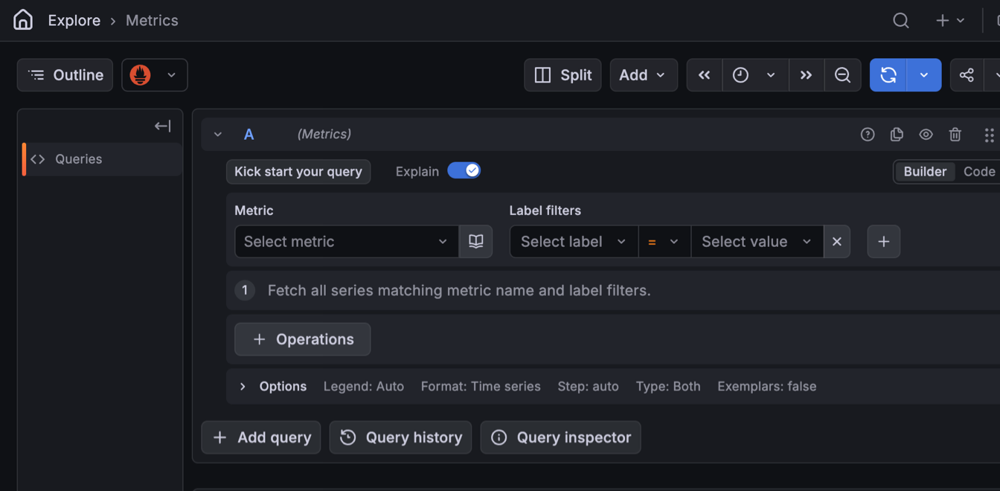

# Alert rules and alert templates

Alert rules describe the circumstances under which you want to be alerted. The evaluation criteria that you define determine whether an alert will fire. 

An alert rule consists of one or more queries and expressions, a condition, the frequency of evaluation, and the duration over which the condition is met. For example, you might configure an alert to fire and trigger a notification when MongoDB is down.

During evaluation, an alert rule moves through the following states:

- **Normal**: Everything is working correctly, and the conditions specified in the rule have not been met. This is the default state for newly created rules.
- **Pending**: The conditions specified in the alert rule have been met, but for less time than the configured duration.
- **Firing**: Both the alert condition and the configured duration have been met.
- **Recovering**: The alert conditions are no longer met, but the alert remains active until the metric is stable below the threshold. This prevents alerts from repeatedly flipping between **Firing** and **Normal** when metrics briefly cross a threshold.

It takes at least one evaluation cycle for an alert rule to transition from one state to another (e.g., from `Normal` to `Pending`).

## Alert rule templates

PMM provides a set of Alert Rule templates with common events and expressions for alerting. These templates can be used as a basis for creating Alert Rules. You can also create your own templates if you need custom expressions.

You can check the alert templates available for your account under **Alerting > Alert rule templates** tab. PMM lists here the following types of templates:

- Built-in templates, available out-of-the-box with PMM.
- Custom templates created or uploaded on the **Alerting page > Alert Templates** tab. You can also store your custom template files in your ``/srv/alerting/templates`` directory and PMM will load them during startup.

## Accessing alert templates

To check the alert templates for your PMM instance, go to **Alerts > Alert templates** tab.

To check the full list of available PMM templates, see the [List of available alert templates topic](../alert/templates_list.md)

### Create alert rules from alert rule templates

This section focuses on creating an alert rule based on PMM templates. For information on working with the other alert types, check the Grafana documentation on [Grafana Labs](https://grafana.com/docs/grafana/latest/alerting/).

### Provision alert resources

Before creating PMM alert rules, configure the required alert resources:
{.power-number}

1. Go to **Configuration > Settings > Advanced settings** and ensure that the **Percona Alerting** option is enabled. When this is disabled, the **Alerting** page displays only Grafana-managed alert rules. This means that you will not be able to create alerts based on PMM templates.
2. Go to **All dashboards > Browse all dashboards** and check the folders available for storing alert rules. If none of the available folders are relevant for your future alert rules, click **New > New folder** and create a custom one.
3. Go to **Alerts > Alert rule templates** and check the default PMM templates. If none of the templates include a relevant expression for the type of alerts that you want to create, click **Add template** to create a custom template instead.

### Configure alert templates

Alert templates are YAML files that provide the source framework for alert rules. Alert templates contain general template details and alert queries defined in [MetricsQL](https://docs.victoriametrics.com/MetricsQL.html). This query language is backward compatible with PromQL. Starting with PMM 3.11.0, a template query can also be an SQL query on the ClickHouse database that stores Query Analytics (QAN) data. For details, see [Alert on Query Analytics data](#alert-on-query-analytics-data).

### Create custom templates

If none of the default PMM templates contain a relevant expression for the alert rule that you need, you can create a custom template instead.

You can base multiple alert rules on the same template. For example, you can create a `pmm_node_high_cpu_load` template that can be used as the source for alert rules for production versus staging, warning versus critical, etc.

### Template format

When creating custom templates, make sure to use the required template format below:

- **name** (required): uniquely identifies template. Spaces and special characters are not allowed.
- **version** (required): defines the template format version.
- **summary** (required): a template description.
- **expr** (required unless you use **queries** and **expressions**): a MetricsQL query string with parameter placeholders.
- **queries** (optional): a list of queries. Use them with **expressions** and **condition** instead of **expr**. Each query has these fields:
    - **ref_id** (required): the step ID. It must start with a letter or underscore and contain only letters, digits, and underscores.
    - **expr** (required): a MetricsQL query, or SQL for a ClickHouse query.
    - **datasource** (optional): `metrics` (the default) for a MetricsQL query, or `clickhouse` for an SQL query on Query Analytics data.
- **expressions** (optional): a list of expressions over the queries, each with a `ref_id`, a `type`, and an `expression` that references other steps by `$ref_id`. Each `ref_id` follows the same rules as for queries. The supported types are:
    - **type: math**: a calculation or comparison, for example `$A > [[ .threshold ]]`.
    - **type: reduce**: reduces one query or expression to a single value for each series. Set `expression` to that step, for example `$A`, and `reducer` to `sum`, `mean`, `min`, `max`, `count`, `last`, or `median`.
- **condition** (required with **queries**): the `ref_id` of the query or expression that fires the alert. The condition can't be a ClickHouse query.
- **params**: contains parameter definitions required for the query. Each parameter has a name, type, and summary. It also may have a unit, available range, and default value.
    - **name** (required): the name of the parameter. Spaces and special characters are not allowed.
    - **summary** (required): a short description of what this parameter represents.
    - **unit** (optional): PMM currently supports either s (seconds) or % (percentage).
    - **type** (required): PMM currently supports the `float` type. `string`, `bool`, and other types will be available in a future release.
    - **range** (optional): defines the boundaries for the value of a  float parameter
    - **value** (optional): default parameter value. Value strings must not include any of these special characters: `< > ! @ # $ % ^ & * ( ) _ / \ ' + - = (space)`
    - **overridable** (optional): set to `true` to enable per-node overrides of this threshold without editing the alert rule. The template must use **queries** and **expressions**, and the parameter must be the whole right-hand side of a comparison, for example `$A > [[ .threshold ]]`. For details, see [per-node threshold overrides](alert-thresholds.md).
    - **override_scopes** (optional): the scopes at which you can override this parameter. Defaults to `[node]`. Only `node` is currently supported. Requires `overridable: true`.
- **for** (required): specifies the duration of time that the expression must be met before the alert will be fired
- **severity** (required): specifies default alert severity level
- **labels** (optional): are additional labels to be added to generated alerts
- **annotations** (optional): are additional annotations to be added to generated alerts.

??? info "Template example"

    ```yaml
    
    ---
    templates:
      - name: pmm_node_high_cpu_load
        version: 1
        summary: Node high CPU load
        queries:
          - ref_id: A
            expr: |-
              (1 - avg by(node_name) (rate(node_cpu_seconds_total{mode="idle"}[5m]))) * 100
        expressions:
          - ref_id: C
            type: math
            expression: "$A > [[ .threshold ]]"
        condition: C
        params:
          - name: threshold
            summary: A percentage from configured maximum
            unit: "%"
            type: float
            range: [0, 100]
            value: 80
            overridable: true
        for: 5m
        severity: warning
        annotations:
          summary: Node high CPU load ({{ $labels.node_name }})
          description: |-
            {{ $labels.node_name }} CPU load is more than [[ .threshold ]]%.
    
    ```

### Alert on Query Analytics data

Starting with PMM 3.11.0, an alert template can run SQL on the ClickHouse database where Query Analytics stores query metrics. Use this to alert on query performance, for example when queries on a service run longer than a threshold. The built-in [`pmm_qan_slow_queries`](templates_list.md#qan_alerts) template is an example.

A ClickHouse query in a template must meet these requirements:

- sets `datasource: clickhouse`
- returns a `DateTime` time column and exactly one numeric value column
- returns the label columns that you want on the alert, such as `service_name`, `node_name`, `environment`, and `cluster`
- passes through a `reduce` expression before a `math` expression or the condition uses it, because alerts need one value for each series
- uses only `float` parameters
- reads the reduce expression, not the query, through `$values` in annotations and labels, for example `$values.B.Value`

Every string column that the query returns becomes an alert label. Each combination of label values becomes a separate alert. Don't return high-cardinality columns such as `queryid` or `fingerprint`. Query Analytics data is in the `pmm.metrics` table.

??? info "Example: alert on slow queries"

    ```yaml
    
    ---
    templates:
      - name: custom_qan_slow_queries
        version: 1
        summary: Slow queries
        queries:
          - ref_id: A
            datasource: clickhouse
            expr: |-
              SELECT $__toTime AS time, service_name, node_name, max(m_query_time_max) AS query_time
              FROM pmm.metrics
              WHERE period_start >= $__fromTime AND period_start <= $__toTime
              GROUP BY service_name, node_name
        expressions:
          - ref_id: B
            type: reduce
            reducer: max
            expression: $A
          - ref_id: C
            type: math
            expression: "$B > [[ .threshold ]]"
        condition: C
        params:
          - name: threshold
            summary: Query execution time
            unit: s
            type: float
            value: 10
        for: 1m
        severity: warning
        annotations:
          summary: Slow queries on {{ $labels.service_name }}
          description: |-
            A query on {{ $labels.service_name }} took {{ printf "%.2f" $values.B.Value }}s, more than [[ .threshold ]]s.
    
    ```

The example uses `m_query_time_max`, which only MySQL slow log and MongoDB report. For PostgreSQL and MySQL Performance Schema, use the average run time, as the built-in `pmm_qan_slow_queries` template does.

Alerts on Query Analytics data have the following limitations:

- PMM supports the ClickHouse time series format only.
- Each evaluation reads the last 5 minutes of Query Analytics data. Query Analytics data arrives in one-minute buckets, about one to two minutes late. As a result, these alerts fire and resolve a few minutes later than metric alerts.
- A single slow query keeps the alert active until the slow query leaves the 5-minute window.
- Rule filters apply to the columns that the query returns. A filter on a label that the query doesn't return makes the rule fail to evaluate. Filters apply after any `LIMIT` in the query.
- `[[` starts a template parameter, so it can't appear in the SQL, for example in nested array literals.
- Each rule queries ClickHouse separately. To alert on many services, create one rule and route the alerts by the `service_name` label in your notification policies.
- If ClickHouse is unavailable, rules with ClickHouse queries report a data source error in addition to the **PMM ClickHouse is down** alert.

### Test alert expressions

If you want to create custom templates, you can test the MetricsQL expressions for your custom template in the **Explore** section of PMM. Here you can also query any PMM internal database.

To test expressions for custom templates:
{.power-number}

1. On the main menu in PMM, choose **Explore > PromQL builder**.
2. Enter your expression in the **Metrics** field and click **Run query**.

For example, to check the CPU usage, Go to **Explore > PromQL builder** and run the query expression below:
```
(1 - avg by(node_name) (rate(node_cpu_seconds_total{mode="idle"}[5m]))) * 100
```


Note that to paste the query above, **Explore** must be in `Code` mode, and not in `Builder` mode.

To test an SQL query for a ClickHouse template:
{.power-number}

1. In **Explore**, select the **ClickHouse** data source.
2. Select **SQL Editor**, and set **Query Type** to **Time Series**.
3. Set the time range to **Last 5 minutes** to match what the alert rule reads.
4. Enter the query and click **Run query**.

### Add an alert rule based on a template

After provisioning the resources required for creating Percona templated alerts, you are now ready to create your alert rule based on a Percona template. 

If you want to learn about creating Grafana alerts instead, check out [Grafana's documentation](https://grafana.com/docs/grafana/latest/alerting/):
{.power-number}

1. Go to **Alerting > Alert Rules**, and click **New alert rule from template**.
2. On the **Create alert rule from template** page, choose the template on which you want to base the new alert rule. This automatically populates the **Name**, **Duration**, and **Severity** fields with information from the template. You can change these values if you want to override the default specifications in the template.
3. From the **Folder** drop-down menu, select the location where you want to store the rule.
4. In the **Filters** section, specify if you want the alert rule to apply only to specific services or nodes. For example: `service_name=ps5.7`. When creating alert rule filters, consider the following:
   
    - Filters use conjunction semantics. This means that if you add more than one filter, PMM will combine their conditions to search for matches: filter 1 AND filter 2 AND filter 3.
    - **Label** must be an exact match. You can find a complete list of labels using the :material-compass-outline: **Explore** menu in PMM, or see [Labels reference](../reference/labels-reference.md).
    - For templates with ClickHouse queries, filters apply to the columns that the query returns. For details, see [Alert on Query Analytics data](#alert-on-query-analytics-data).

5. Click **Save and Exit** to close the page and go to the **Alert Rules** tab where you can review, edit and silence your new alert.

If the template has a **Dynamic** badge, you can later change the threshold of the new alert rule for individual nodes. For details, see [per-node threshold overrides](alert-thresholds.md).

## Recording rules

Record an alert rules to pre-compute a query on a schedule and store the result as a new metric, which you can then reference in alert rules. This is useful when the same query powers multiple alert rules, for example, average CPU load across all nodes or replication lag across a cluster.

To create a recording rule, click **Alerts > Alert rules** + New recording rule**. For full instructions, see [Create recording rules](https://grafana.com/docs/grafana/latest/alerting/alerting-rules/create-recording-rules/) in the Grafana documentation.