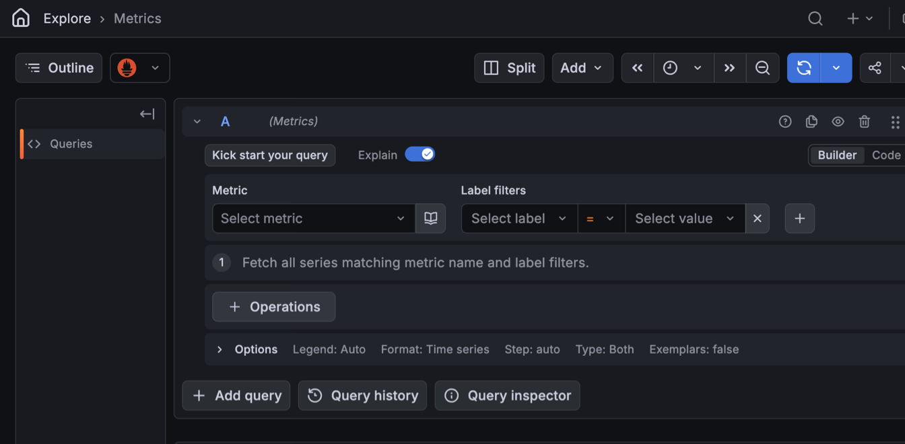

# Alert rules and alert templates

Alert rules tell PMM when to notify you about a problem. Each rule is based on an alert template, which defines what PMM checks and when it alerts, and applies it to the services or nodes that you choose. For example, you might configure an alert to fire and trigger a notification when MongoDB is down.

Rules created from templates are called Percona templated alerts. They fall into two categories, based on what they watch:

- **[Server and database health alerts](#set-up-server-and-database-health-alerts)**: based on metrics, the health data that PMM collects from your nodes and services, such as CPU load or connections. All built-in templates except **QAN slow queries** belong to this category.
- **[Query performance alerts](#set-up-query-performance-alerts)**: based on Query Analytics data, how individual queries perform, as you see it in Query Analytics (QAN). Starting with PMM 3.11.0, the built-in **QAN slow queries** template and your own templates can alert on query performance.

You create alert rules the same way for both categories, from a built-in template or from a custom template that you write. The section for each category explains what is specific to it, including how to write your own template.

If Percona templated alerts don't cover what you need, for example a condition that combines data from several data sources, [use Grafana managed alerts](#create-grafana-managed-alerts) instead.

## Create an alert rule

The steps are the same for both categories: you pick a built-in or custom template, adjust its values, such as the threshold, and choose which services or nodes the rule applies to.

You can pick a built-in template, described in the [list of available alert templates](templates_list.md), or a custom template that you wrote. The **Alerts > Templates** page lists both. To add a custom template, upload it on that page, or store the file in the `/srv/alerting/templates` directory, where PMM loads it at startup.

### Prerequisites

Before you create alert rules, make sure that:

- **Percona Alerting** is enabled in **Configuration > Settings > Advanced settings**. When it's disabled, the **Alerting** page shows only Grafana-managed alert rules, and you can't create alerts from PMM templates.
- You have a folder to store your alert rules in. To check your folders, go to **All dashboards > Browse all dashboards**. To add one, click **New > New folder**.

### Create the rule

To create an alert rule from a template:
{.power-number}

1. Go to **Alerts > Alert rules**, and click **New alert rule from template**.
2. On the **Create alert rule from template** page, choose the template on which you want to base the new alert rule. This automatically populates the **Name**, **Duration**, and **Severity** fields with information from the template. You can change these values if you want to override the default specifications in the template.
3. From the **Folder** drop-down menu, select the location where you want to store the rule.
4. In the **Filters** section, specify if you want the alert rule to apply only to specific services or nodes. For example: `service_name=ps5.7`. When creating alert rule filters, consider the following:
   
    - If you add more than one filter, the rule applies only where all of them match.
    - **Label** must be an exact match. To find the labels you can use, open the :material-compass-outline: **Explore** menu in PMM, or check the [labels reference](../reference/labels-reference.md).
    - For query performance templates, filters apply to the [columns that the query returns](#filter-and-route-query-performance-alerts).

5. Click **Save and Exit** to close the page and go to the **Alert Rules** tab where you can review, edit and silence your new alert.

If the template has a **Dynamic** badge, you can later [change the threshold of the new alert rule for individual nodes](alert-thresholds.md).

### Alert rule states

During evaluation, an alert rule moves through the following states:

- **Normal**: Everything is working correctly, and the conditions specified in the rule have not been met. This is the default state for newly created rules.
- **Pending**: The conditions specified in the alert rule have been met, but for less time than the configured duration.
- **Firing**: Both the alert condition and the configured duration have been met.
- **Recovering**: The alert conditions are no longer met, but the alert remains active until the metric is stable below the threshold. This prevents alerts from repeatedly flipping between **Firing** and **Normal** when metrics briefly cross a threshold.

It takes at least one evaluation cycle for an alert rule to transition from one state to another (for example, from **Normal** to **Pending**).

## Set up server and database health alerts

These alerts are based on metrics, the health data that PMM collects from your nodes and services, such as CPU load, memory, or connections. PMM includes built-in templates for operating systems, databases, and PMM itself, such as **Node high CPU load** or **MySQL restarted**. To use one, [create an alert rule](#create-an-alert-rule) from it. If none fits, write your own.

### Write a server and database health template

Write your own template with a [MetricsQL](https://docs.victoriametrics.com/MetricsQL.html) query, in `expr` or in `queries`, using the [custom template fields](#define-a-custom-template). Before you add the query to the template, test it in the **Explore** section of PMM, where you can also query any PMM internal database.

To test a MetricsQL query:
{.power-number}

1. On the main menu in PMM, choose **Explore > PromQL builder**.
2. Switch to **Code** mode, enter your expression in the **Metrics** field, and click **Run query**. MetricsQL is backward compatible with PromQL, so PromQL expressions work too.

For example, to check the CPU usage, run this expression:
```
(1 - avg by(node_name) (rate(node_cpu_seconds_total{mode="idle"}[5m]))) * 100
```


When the template is ready, add it on the **Alerts > Templates** page by clicking **Add template**, then [create an alert rule from it](#create-an-alert-rule).

## Set up query performance alerts

These alerts are based on Query Analytics data, the query performance data that PMM collects from your services, such as query time. Starting with PMM 3.11.0, PMM includes the built-in [**QAN slow queries**](templates_list.md#qan_alerts) template. To use it, [create an alert rule](#create-an-alert-rule) from it and set the threshold that fits your services. If it doesn't fit, write your own.

Query performance alerts work like server and database health alerts, with a few differences in timing and filtering.

### What to expect from query performance alerts

Query Analytics data reaches PMM later than metrics, which affects how these alerts behave:

- Each evaluation reads the last 5 minutes of Query Analytics data. The data arrives in one-minute buckets, about one to two minutes late, so these alerts fire and resolve a few minutes later than server and database health alerts.
- A single slow query keeps the alert active until the slow query leaves the 5-minute window.
- If ClickHouse is unavailable, rules based on Query Analytics data report a data source error in addition to the **PMM ClickHouse is down** alert.

### Filter and route query performance alerts

When you create a rule from a query performance template, filters apply to the columns that the query returns:

- A label that the query doesn't return counts as empty, as with metrics. A match filter on that label keeps every row. A mismatch filter on that label keeps every row, unless its regular expression matches an empty value.
- Filters apply after any `LIMIT` in the query.
- Custom labels that you add to nodes and services aren't available to these queries, so a filter on a custom label doesn't narrow Query Analytics alerts.

Each rule queries ClickHouse separately. To alert on many services, create one rule and route the alerts by the `service_name` label in your notification policies.

### Write a query performance template

Write your own template with an SQL query on Query Analytics data, using the [custom template fields](#define-a-custom-template).

#### Write the query

Query Analytics stores its data in the `pmm.metrics` table of the ClickHouse database. Write an SQL query on this table that:

- returns a `DateTime` time column and exactly one numeric value column
- returns the label columns that you want to filter on, route by, or show on the alert, such as `service_name`, `node_name`, `region`, and `environment`
- works in the **Time Series** query format
- uses only `float` parameters
- doesn't contain `[[`, for example in nested array literals, because `[[` starts a template parameter

Every string column that the query returns becomes an alert label, and each combination of label values becomes a separate alert. To avoid an alert for every single query, don't return high-cardinality columns such as `queryid` or `fingerprint`.

To cover every database type, don't rely on `m_query_time_max` alone, because only MySQL slow log and MongoDB report it. For PostgreSQL and MySQL Performance Schema, use the average query time, as the built-in **QAN slow queries** template does.

#### Test the query

Before you add the query to a template, check its results in **Explore**:
{.power-number}

1. In **Explore**, select the **ClickHouse** data source.
2. Select **SQL Editor**, and set **Query Type** to **Time Series**.
3. Set the time range to **Last 5 minutes** to match what the alert rule reads.
4. Enter the query and click **Run query**.

#### Build the template

Alerts need one value for each series, so a template on Query Analytics data has three steps: the query, a `reduce` expression that turns its results into one value, and a `math` expression that compares that value with the threshold. In the template:

- set `datasource: clickhouse` on the query
- add a `reduce` expression over the query, for example `reducer: max` with `expression: $A`
- compare the reduce expression, not the query, with the threshold in a `math` expression, for example `$B > [[ .threshold ]]`, and set that expression as the `condition`
- read values in annotations and labels from the reduce expression, for example `$values.B.Value`

??? info "Example: alert on slow queries"

    ```yaml
    
    ---
    templates:
      - name: custom_qan_slow_queries
        version: 1
        summary: Slow queries
        queries:
          - ref_id: A
            datasource: clickhouse
            expr: |-
              SELECT $__toTime AS time, service_name, node_name, max(m_query_time_max) AS query_time
              FROM pmm.metrics
              WHERE period_start >= $__fromTime AND period_start <= $__toTime
              GROUP BY service_name, node_name
        expressions:
          - ref_id: B
            type: reduce
            reducer: max
            expression: $A
          - ref_id: C
            type: math
            expression: "$B > [[ .threshold ]]"
        condition: C
        params:
          - name: threshold
            summary: Query execution time
            unit: s
            type: float
            value: 10
        for: 1m
        severity: warning
        annotations:
          summary: Slow queries on {{ $labels.service_name }}
          description: |-
            The slowest query on {{ $labels.service_name }} took {{ printf "%.2f" $values.B.Value }}s. The alert threshold is [[ .threshold ]]s.
    
    ```

When the template is ready, add it on the **Alerts > Templates** page by clicking **Add template**, then [create an alert rule from it](#create-an-alert-rule).

## Define a custom template

Custom templates are YAML files that contain general template details and the queries that PMM runs to decide whether to alert. Templates for both categories use the fields below. You can base multiple alert rules on the same template. For example, one `pmm_node_high_cpu_load` template can be the source for separate rules for production and staging, or for warning and critical severities.

- **name** (required): the template's unique name. Spaces and special characters are not allowed.
- **version** (required): the template format version.
- **summary** (required): the template description.
- **expr** (required unless you use **queries** and **expressions**): a MetricsQL query string with parameter placeholders.
- **queries** (optional): a list of queries. Use them with **expressions** and **condition** instead of **expr**. Each query has these fields:
    - **ref_id** (required): the step ID. It must start with a letter or underscore and contain only letters, digits, and underscores.
    - **expr** (required): a MetricsQL query, or SQL for a ClickHouse query.
    - **datasource** (optional): `metrics` for a MetricsQL query, which is the default, or `clickhouse` for an SQL query on Query Analytics data.
- **expressions** (optional): a list of expressions over the queries, each with a `ref_id`, a `type`, and an `expression` that references other steps by `$ref_id`. Each `ref_id` follows the same rules as for queries. The supported types are:
    - **type: math**: a calculation or comparison, for example `$A > [[ .threshold ]]`.
    - **type: reduce**: reduces one query or expression to a single value for each series. Set `expression` to that step, for example `$A`, and `reducer` to `sum`, `mean`, `min`, `max`, `count`, `last`, or `median`.
- **condition** (required with **queries**): the `ref_id` of the query or expression that fires the alert. The condition can't be a ClickHouse query.
- **params**: the parameters that the query uses. Each parameter has a name, type, and summary. It also may have a unit, available range, and default value.
    - **name** (required): the name of the parameter. Spaces and special characters are not allowed.
    - **summary** (required): a short description of what this parameter represents.
    - **unit** (optional): PMM currently supports either s (seconds) or % (percentage).
    - **type** (required): the parameter type. PMM supports `float`.
    - **range** (optional): the minimum and maximum value of a float parameter.
    - **value** (optional): the default parameter value. Value strings must not include any of these special characters: `< > ! @ # $ % ^ & * ( ) _ / \ ' + - = (space)`
    - **overridable** (optional): set to `true` to enable per-node overrides of this threshold without editing the alert rule. The template must use **queries** and **expressions**, and the parameter must be the whole right-hand side of a comparison, for example `$A > [[ .threshold ]]`. Users can then [set per-node threshold overrides](alert-thresholds.md).
    - **override_scopes** (optional): the scopes at which you can override this parameter. Defaults to `[node]`. Only `node` is currently supported. Requires `overridable: true`.
- **for** (required): how long the condition must be met before the alert fires.
- **severity** (required): the default alert severity level.

    The **Alerts > Status** page groups severities into four bands: `emergency`, `alert` and `critical` show as **Critical**; `notice`, `info`, `informational` and `debug` show as **Info**. `error` and `warning` keep their names. The alert label keeps the level you set. An alert with no severity, or with a value outside these levels, shows that value without an icon and is listed under **Unknown** in the **Severity** filter.

- **labels** (optional): labels to add to generated alerts.
- **annotations** (optional): annotations to add to generated alerts.

??? info "Template example"

    ```yaml
    
    ---
    templates:
      - name: pmm_node_high_cpu_load
        version: 1
        summary: Node high CPU load
        queries:
          - ref_id: A
            expr: |-
              (1 - avg by(node_name) (rate(node_cpu_seconds_total{mode="idle"}[5m]))) * 100
        expressions:
          - ref_id: C
            type: math
            expression: "$A > [[ .threshold ]]"
        condition: C
        params:
          - name: threshold
            summary: A percentage from configured maximum
            unit: "%"
            type: float
            range: [0, 100]
            value: 80
            overridable: true
        for: 5m
        severity: warning
        annotations:
          summary: Node high CPU load ({{ $labels.node_name }})
          description: |-
            {{ $labels.node_name }} CPU load is more than [[ .threshold ]]%.
    
    ```

## Create Grafana managed alerts

Use Grafana managed alerts for conditions that a template can't express, such as a query across several data sources. 

Unlike Percona templated alerts, they don't start from a template: you define their queries and conditions yourself, and Grafana stores and runs them. 

To create one, follow the [Grafana alerting documentation](https://grafana.com/docs/grafana/latest/alerting/).

## Create recording rules

Use a recording rule to pre-compute a query on a schedule and store the result as a new metric, which you can then reference in alert rules. This is useful when the same query powers multiple alert rules, for example, average CPU load across all nodes or replication lag across a cluster.

To create a recording rule, go to **Alerts > Alert rules** and click **New recording rule**, then follow the [Grafana instructions for recording rules](https://grafana.com/docs/grafana/latest/alerting/alerting-rules/create-recording-rules/).
