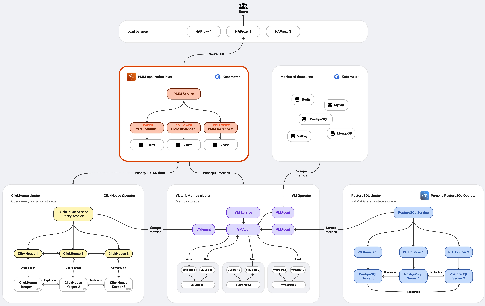

# Understand PMM High Availability Cluster

!!! danger "VictoriaMetrics limitations"
    PMM HA Cluster does not support:
    
    - **Prometheus data imports**: Cannot import existing Prometheus files
    - **Metrics downsampling**: No automatic historical data optimization
    
    If your strategy requires these features, evaluate carefully before testing.
 
Standard PMM monitoring goes offline for minutes during server failures. PMM HA Cluster keeps monitoring running by immediately switching to secondary servers when failures occur.

PMM HA Cluster keeps your database monitoring running continuously, even when servers fail or during maintenance windows.

Unlike a [Kubernetes single instance](../install-pmm/kubernetes-single-instance.md), where a server failure means minutes of monitoring downtime, PMM HA Cluster immediately fails over to secondary servers, keeping your monitoring online.

Whether a server crashes, you're upgrading software, or scaling your infrastructure, your monitoring stays active with no blind spots or missed incidents.

### Key benefits

- **Continuous monitoring**: Three PMM server replicas ensure monitoring never stops, even during failures
- **Fast automatic failover**: Traffic immediately switches to healthy servers with no data loss
- **Automatic traffic routing**: HAProxy routes traffic to the active leader and handles failover transparently
- **Resilient data storage**: Distributed databases (ClickHouse, VictoriaMetrics, PostgreSQL) eliminate single points of failure
- **Scales with your needs**: Add more capacity as your database infrastructure grows

### Choose your Kubernetes deployment type

| Consideration | Kubernetes single instance | HA Cluster |
|--------------|----------------------|-----------------------------|
| **Production status** | ✅ Production-ready | ✅ Production-ready |
| **Failover time** | 2-5 minutes | Immediate |
| **Setup complexity** | ● Low | ●●● Medium |
| **Resource overhead** | 1x baseline | 3-5x baseline |
| **Setup time** | ~5 minutes | ~20 minutes |
| **PMM instances** | 1 pod | 3 pods with leader election |
| **Automatic failover routing** | No | Yes (HAProxy routes to active leader) |
| **Databases** | Built-in | External clusters |
| **Anti-affinity** | No | Yes (pods distributed across nodes) |

## Before you begin

### Check prerequisites

- **Kubernetes**: 1.32 or higher, because the Helm chart doesn't install on earlier versions. The [supported versions](#check-if-your-platform-is-supported) depend on your platform.
- **Helm**: 3.17.0 or higher
- **kubectl**: configured to access your cluster
- **Persistent Volume Provisioner**: available in your cluster

### Check if your platform is supported

You can deploy PMM as an HA Cluster on Amazon EKS and Red Hat OpenShift, including ROSA with hosted control planes. The Amazon EKS and OpenShift versions you can use depend on your `pmm-ha` Helm chart version, because each chart ships its own database operators.

To check that your platform version is supported, before you install or upgrade:
{.power-number}

1. Find your `pmm-ha` chart version. For a new installation, use the chart version you plan to install. For an existing installation, run `helm list -n <namespace>`.

2. In the following table, find the row for your chart version and check that your Amazon EKS or OpenShift version is between the versions listed for it. For example, chart 1.8.0 supports Amazon EKS 1.33, 1.34, 1.35 and 1.36:

    | `pmm-ha` chart version | PMM version | Amazon EKS | OpenShift |
    |------------------------|-------------|------------|-----------|
    | 1.8.0 | 3.10.0 | 1.33 to 1.36 | 4.18 to 4.22 |

    If your version is supported, continue with [Plan your resources](#plan-your-resources). If it isn't, upgrade your Amazon EKS or OpenShift cluster to a supported version, or use a chart version that supports your current version.

Other platforms, such as GKE, AKS or on-premises Kubernetes, might work but aren't tested. VMware Tanzu isn't supported.

## Plan your resources

Choose the size of your Kubernetes cluster based on how many nodes you plan to monitor. Count each host that runs one database service with Query Analytics turned on as one node.

If you run three Kubernetes worker nodes and keep data for the default 30 days, use the following sizes. Each size handles the number of monitored nodes in its row:

| Monitored nodes | Helm values to use | Each of the 3 worker nodes | Total storage |
|-----------------|--------------------|----------------------------|---------------|
| Up to 100 | The chart's default values | 16 CPUs, 32 GB memory | About 0.5 TB |
| Up to 500 | `examples/values-500-nodes.yaml` | 32 CPUs, 64 GB memory | About 1.6 TB |
| Up to 1,000 | `examples/values-1000-nodes.yaml` | 48 CPUs, 96 GB memory | About 3.2 TB |

If you monitor fewer than 100 nodes, plan for the 100-node size anyway. The chart's default values request about 17 CPUs, 40 GB of memory and 465 GB of storage, whatever the number of nodes.

For more than 100 nodes, pass the matching values file from the [`pmm-ha` chart](https://github.com/percona/percona-helm-charts/tree/main/charts/pmm-ha) when you install, for example `helm install pmm-ha percona/pmm-ha --namespace pmm -f values-500-nodes.yaml`. These sizes also need a storage class that allows volume expansion (`allowVolumeExpansion: true`).

Choose a larger size than your node count suggests if:

- you monitor MySQL with per-table statistics, or MongoDB with many collections. These produce two to three times more metrics per node. To reduce them, [turn off table statistics](install-pmm-client/connect-database/mysql/improve_perf.md#disable-table-statistics).
- you keep data for longer than 30 days. Storage grows with retention, for example 90 days needs about three times the metrics storage.

### Understand where the resources go

To see which component to watch as you add nodes or keep data longer, check what each one does, what it requests with the chart's default values and what makes it grow:

| Component | What it does | Each pod requests by default | What makes it grow |
|-----------|--------------|------------------------------|--------------------|
| PMM Server (3 pods) | Serves the PMM UI, the API and all traffic from PMM Clients. Only the leader pod does this work. The other two are on standby. | 2 CPUs, 4 GB memory, 40 GB storage | More monitored nodes, because one pod handles all of them |
| HAProxy (3 pods) | Sends every request to the PMM Server leader | 0.25 CPU, 128 MB memory | PMM Clients sending buffered data all at once after a failover or an upgrade |
| VictoriaMetrics storage (3 pods) | Stores metrics. Other VictoriaMetrics pods receive, route and query them. | 0.5 CPU, 2 GB memory, 50 GB storage | More monitored nodes and a longer retention period |
| ClickHouse (3 pods) | Stores Query Analytics data. Each pod holds a full copy. | 1 CPU, 4 GB memory, 50 GB storage | More database services with Query Analytics and a longer retention period |
| PostgreSQL (3 pods) | Stores PMM Server and Grafana data, such as your inventory, settings and alert rules | 0.5 CPU, 1 GB memory, 10 GB storage | More PMM Server connections as you add monitored nodes |

The `values-500-nodes.yaml` and `values-1000-nodes.yaml` files raise these values for larger deployments.

## Learn the architecture

The PMM HA architecture diagram below shows how components interact and communicate. 

The architecture consists of:

- three PMM server replicas with automatic leader election
- HAProxy for routing traffic to the active leader and handling failover
- operator-managed database clusters (ClickHouse, VictoriaMetrics, and PostgreSQL) for resilient data storage

### How operators manage databases

PMM HA requires three Kubernetes operators to manage distributed databases:

- VictoriaMetrics Operator: Manages metrics storage
- Altinity ClickHouse Operator: Manages query analytics data
- Percona PostgreSQL Operator: Manages Grafana metadata

These operators handle scaling, failover, and replication automatically. 

When you deploy PMM HA, the operators keep the databases healthy and available, which is how PMM survives node failures and recovers immediately.

You'll need to install these operators before deploying PMM HA.

### Learn high availability mechanisms
PMM HA uses several mechanisms to ensure continuous operation:

- **Leader election**: PMM servers use Raft consensus protocol for leader election (ports 9096, 9097)
- **Automatic failover**: HAProxy detects when the active leader becomes unhealthy and routes traffic to the new leader
- **Pod anti-affinity**: Kubernetes scheduler distributes components across different nodes
- **Health checks**: Comprehensive readiness and liveness probes on all components
- **Rolling updates**: Upgrades restart each pod sequentially. Expect a brief interruption (around 5-10 seconds) when the active leader pod restarts and a new leader is elected.

## Known issues

- Exporters in pull mode get no metrics, because nothing in the HA deployment scrapes them. Exporters on PMM Client nodes use push mode by default, so this affects only those set to pull mode, for example with `--metrics-mode=pull`. To switch an exporter to push mode, run `pmm-admin inventory change agent <AGENT_TYPE> <AGENT_ID> --push-metrics` (see [`pmm-admin inventory change agent`](../use/commands/pmm-admin/inventory.md#pmm-admin-inventory-change-agent)).

## Ready to deploy?

Now that you understand how PMM HA Cluster works, you can deploy it on your Kubernetes cluster. 

The installation process uses Helm to set up all three replicas, configure HAProxy load balancing, and deploy the distributed databases automatically.

[Install PMM HA Cluster →](../install-pmm/install-HA-clustered.md){.md-button}

## Need to upgrade?

When a new PMM release is available, see [Upgrade PMM HA Cluster using Helm](../pmm-upgrade/upgrade_helm_ha.md) for the step-by-step procedure.
