# Connect Amazon RDS instance

You can monitor [Amazon RDS](https://aws.amazon.com/rds/) instances with PMM without installing PMM Client on the database host. Give PMM an IAM user access key or an IAM role, and PMM finds the RDS instances you can monitor so you can add them from the PMM web interface.

## Prepare PMM Server and your RDS instances

Before you add RDS instances to PMM:
{.power-number}

1. Run PMM Server on AWS, in the same availability zone as your RDS instances. PMM collects metrics every second, so high network latency between PMM Server and RDS can cause it to miss metrics.

2. Turn on **Enable Enhanced Monitoring** in the settings of each RDS instance you want to monitor. PMM needs Enhanced Monitoring to show operating system metrics for the instance.

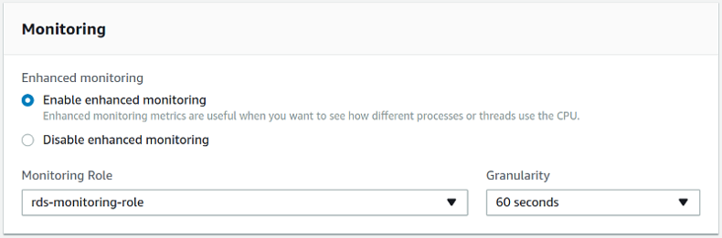

## Create an IAM user with permission to access Amazon RDS DB instances

It is recommended that you use an IAM user account to access Amazon RDS DB instances instead of using your AWS account. This measure improves security as the permissions of an IAM user account can be limited so that this account only grants access to your Amazon RDS DB instances. On the other hand, you use your AWS account to access all AWS services.

The procedure for creating IAM user accounts is well described in the Amazon RDS documentation. This section only goes through the essential steps and points out the steps required for using Amazon RDS with Percona Monitoring and Management.

The first step is to define a policy which will hold all the necessary permissions. Then, you need to associate this policy with the IAM user or group. In this section, we will create a new user for this purpose.

## Create a policy

A policy defines how AWS services can be accessed. Once defined it can be associated with an existing user or group.
{.power-number}

1. Select the **Policies** option on the navigation panel and click the **Create policy** button.

    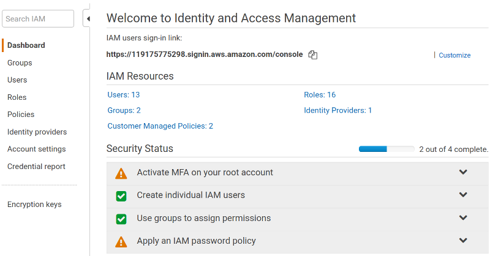

2. On the **Create policy** page, select the JSON tab and replace the existing contents with the following JSON document.

    ??? info "JSON"

        ```json
        { "Version": "2012-10-17",
        "Statement": [{ "Sid": "Stmt1508404837000",
                    "Effect": "Allow",
                    "Action": [ "rds:DescribeDBInstances",
                                "cloudwatch:GetMetricStatistics",
                                "cloudwatch:ListMetrics"],
                                "Resource": ["*"] },
                    { "Sid": "Stmt1508410723001",
                    "Effect": "Allow",
                    "Action": [ "logs:DescribeLogStreams",
                                "logs:GetLogEvents",
                                "logs:FilterLogEvents" ],
                                "Resource": [ "arn:aws:logs:*:*:log-group:RDSOSMetrics:*" ]}
                ]
        }
        ```

3. Click **Review policy** and set a name to your policy, such as `AmazonRDSforPMMPolicy`. Then, click the **Create policy** button.

    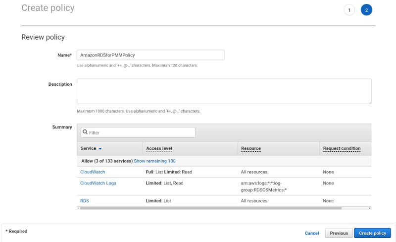

## Create an IAM user

Policies are attached to existing IAM users or groups. To create a new IAM user, select *Users* on the Identity and Access Management page at AWS. Then click *Add user* and complete the following steps:
{.power-number}

1. On the **Add user** page, set the user name and select the **Programmatic access** option under **Select AWS access type**. Set a custom password and then proceed to permissions by clicking the **Permissions** button.

    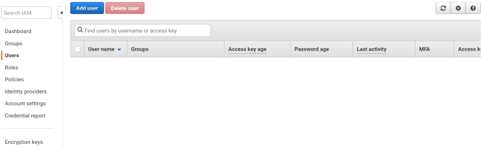

2. On the **Set permissions** page, add the new user to one or more groups if necessary. Then, click *Review*.

3. On the **Add user** page, click **Create user**.

## Create an access key for an IAM user

To discover an Amazon RDS DB instance in PMM, you either need to use the access key and secret access key of an existing IAM user or an IAM role. To create an access key for use with PMM, open the IAM console and click **Users** on the navigation pane. Then, select your IAM user.

To create the access key, open the **Security credentials** tab and click the **Create access key** button. The system automatically generates a new access key ID and a secret access key that you can provide on the **PMM Add Instance** dashboard to have your Amazon RDS DB instances discovered.

In case, the PMM Server and Amazon RDS DB instance were created by using the same AWS account, you do not need create the access key ID and secret access key manually. PMM retrieves this information automatically and attempts to discover your Amazon RDS DB instances.

## Attach a policy to an IAM user

The last step before you are ready to create an Amazon RDS DB instance is to attach the policy with the required permissions to the IAM user.

First, make sure that the Identity and Access Management page is open and open *Users*. Then, locate and open the IAM user that you plan to use with Amazon RDS DB instances. Complete the following steps, to apply the policy:
{.power-number}

1. On the **Permissions** tab, click the **Add permissions** button.

2. On the **Add permissions** page, click **Attach existing policies directly**.

3. Using the **Filter**, locate the policy with the required permissions (such as `AmazonRDSforPMMPolicy`).

4. Select a check-box next to the name of the policy and click **Review**.

5. The selected policy appears on the **Permissions summary** page. Click **Add permissions**.

The `AmazonRDSforPMMPolicy` is now added to your IAM user.

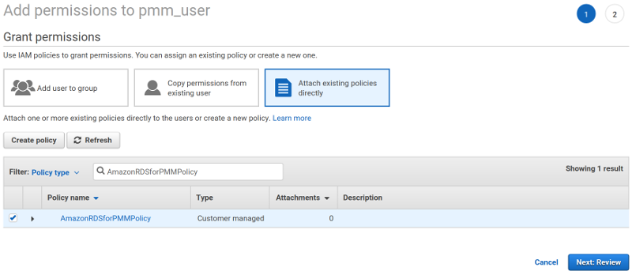

## Create an IAM role

If PMM Server runs on Amazon EC2 in the same AWS account as your RDS instances, you can give it an IAM role instead of creating an IAM user. PMM then discovers your RDS instances with the role's permissions, so you don't need to create or store an access key and secret key. If PMM runs outside AWS, or your RDS instances are in a different AWS account, [assume an IAM role](#assume-an-iam-role) instead.

To create an IAM role open the IAM console and click **Roles** on the navigation pane.
{.power-number}

1. Click the **Create role** button.

2. Select **AWS service** and select **EC2** for the use case.

3. Click the **Next: Permissions** button.

4. Find the [policy you created](#create-a-policy) and select it.

5. Click the **Next: Tags** button.

6. (Optional) Add a metadata tag to the role.

7. Click the **Next: Review** button.

8. Fill the role name and description.

9. Click the **Create role** button.

10. [Attach the role to the EC2 instance](https://docs.aws.amazon.com/AWSEC2/latest/UserGuide/attach-iam-role.html) that runs PMM Server, so PMM can discover your RDS instances.

You can also [use IAM roles in other ways](https://docs.aws.amazon.com/IAM/latest/UserGuide/id_roles_create.html), for example to give an IAM user extra permissions.

## Assume an IAM role

If you monitor Amazon RDS instances in a different AWS account, or your security policy doesn't allow long-lived access keys, PMM can assume an IAM role instead. 

You give PMM the role's ARN, and PMM assumes the role with the AWS identity of the machine it runs on, such as its EC2 instance profile. PMM refreshes the temporary credentials automatically and never stores an access key.

Two parts of PMM assume the role, each with the identity of the machine it runs on:

| Operation | Runs on | Identity that assumes the role |
|-----------|---------|--------------------------------|
| Discovering RDS instances (from the **Add Instance** page or the PMM API) | PMM Server | The identity of the PMM Server machine |
| Collecting metrics (`rds_exporter`) | The PMM Client host where you registered the instance | The identity of that host |

If PMM Server and PMM Client run on the same machine, or under the same AWS identity, you only need to trust one identity. Otherwise, trust both.

Assuming a role requires pmm-agent 3.4.0 or later. PMM rejects a role ARN for an older agent.

To assume a role:
{.power-number}

1. In the AWS account that owns the RDS instances, attach the [`AmazonRDSforPMMPolicy` policy](#create-a-policy) to the role you want PMM to assume.

2. Add a trust policy to that role that allows the identities from the previous table to assume it:

    ```json
    {
        "Version": "2012-10-17",
        "Statement": [{
            "Effect": "Allow",
            "Principal": {
                "AWS": [
                    "arn:aws:iam::<pmm-account-id>:role/<pmm-server-role>",
                    "arn:aws:iam::<pmm-account-id>:role/<pmm-agent-host-role>"
                ]
            },
            "Action": "sts:AssumeRole"
        }]
    }
    ```

3. Allow the same identities to call `sts:AssumeRole` on that role:

    ```json
    {
        "Version": "2012-10-17",
        "Statement": [{
            "Effect": "Allow",
            "Action": "sts:AssumeRole",
            "Resource": "arn:aws:iam::<rds-account-id>:role/<role-to-assume>"
        }]
    }
    ```

4. Add the instance with the role ARN. Use the role ARN instead of an access key and secret key, because PMM rejects both together:

    === "PMM web UI"

        On the **Add Instance** page, enter the role ARN in the **AWS IAM role ARN** field of the Amazon RDS discovery form. Discovery fills in the other details.

    === "Command line"

        1. Register the RDS instance as a node. For `--instance-id`, use the DB instance identifier exactly as it appears in the AWS console, for example `my-database`, not the endpoint hostname:

            ```sh
            pmm-admin inventory add node remote-rds <node-name> \
                --instance-id=<db-instance-identifier> \
                --address=<endpoint-hostname> \
                --region=<aws-region> \
                --az=<availability-zone>
            ```

            Without the right identifier, the exporter starts and reports `RUNNING` but collects no metrics. For all options, see [pmm-admin inventory add node remote-rds](../../../use/commands/pmm-admin/inventory.md#pmm-admin-inventory-add-node-remote-rds).

        2. Add the exporter to the node that the previous command returned, with the role ARN:

            ```sh
            pmm-admin inventory add agent rds-exporter \
                --aws-role-arn=arn:aws:iam::<rds-account-id>:role/<role-to-assume> \
                <pmm-agent-id> <node-id>
            ```

If PMM already monitors the instance with an access key, [migrate it to the role](#migrate-an-existing-instance-to-an-iam-role) instead of adding it again.

### Set the STS region for discovery

To discover RDS instances, PMM Server assumes the role through one AWS Security Token Service (STS) endpoint. By default, this is the endpoint in the home region of the role's partition, `us-east-1` for standard AWS. PMM Server needs outbound HTTPS access to it, even if your RDS instances are in other regions.

If PMM Server can only reach one region, set `AWS_REGION` (or `AWS_DEFAULT_REGION`) to that region on PMM Server. For example, add `-e AWS_REGION=eu-west-1` to `docker run`, or add the variable to `pmmEnv` for every replica in the Helm chart. PMM Server then uses the STS endpoint in that region.

The region must belong to the role's partition, and its STS endpoint must be active for your account. All regions are active by default. If discovery reports `RegionDisabledException`, check **Account settings** in the IAM console. If you set a region from a different partition, PMM rejects it with a message that names the variable.

This setting doesn't affect metrics collection: `rds_exporter` always assumes the role through the region of the instance it monitors.

## Migrate an existing instance to an IAM role

If PMM already monitors an Amazon RDS instance with an access key, you can switch it to an IAM role without removing and adding the service again. The service keeps its ID, labels and metrics history.

Before you start, [prepare the role](#assume-an-iam-role): attach the RDS policy, add a trust policy for PMM's identities, and allow them to call `sts:AssumeRole`.

PMM doesn't accept a role ARN and an access key at the same time, so you must set the role and remove the key in one change. Otherwise, PMM rejects the change with this message:

```
Both AWS role ARN and AWS access key/secret key are set; they are mutually exclusive.
```

=== "PMM web interface"

    To switch an instance to a role from the web interface:
    {.power-number}

    1. Go to **Inventory > Services** and select **Edit** from the row menu of the service.

    2. In the **Amazon RDS credentials** section, select **IAM role** under **Authenticate with**, and enter the role ARN. The section appears only for services monitored by an `rds_exporter`.

    3. Select **Save Changes**, then **Confirm and save changes**. PMM removes the stored access key and secret key.

=== "Command line"

    To switch an instance to a role with `pmm-admin`:
    {.power-number}

    1. Find the `rds_exporter` agent that monitors the instance:

        ```sh
        pmm-admin inventory list agents --agent-type=rds-exporter
        ```

    2. Set the role ARN and remove the stored key pair in the same command. The empty `--aws-access-key` and `--aws-secret-key` values remove the keys:

        ```sh
        pmm-admin inventory change agent rds-exporter <agent-id> \
            --aws-role-arn=arn:aws:iam::<rds-account-id>:role/<role-to-assume> \
            --aws-access-key= \
            --aws-secret-key=
        ```

        The output lists what changed:

        ```
        Configuration changes applied:
          - updated AWS access key
          - updated AWS secret key
          - updated AWS role ARN
        ```

PMM restarts the RDS exporter to use the new credentials, so expect a short gap in the CloudWatch metrics for that service. Metrics resume automatically.

### Verify the migration

To check that the exporter uses the role, go to **Inventory > Nodes**, select the node of the instance, open the **Agents** tab, and expand the `rds_exporter` row. **Properties** lists `aws_role_arn` with your role, and no `aws_access_key`.

To check from the command line, run:

```sh
curl -u <user>:<password> https://<pmm-server>/v1/inventory/agents/<agent-id>
```

In the `rds_exporter` object, `aws_role_arn` shows your role and `aws_access_key` is empty.

### Switch back to an access key or host credentials

To go back to an access key, set the key pair and remove the role in one command:

```sh
pmm-admin inventory change agent rds-exporter <agent-id> \
    --aws-access-key=<key> \
    --aws-secret-key=<secret> \
    --aws-role-arn=
```

In the web interface, select **Access key** under **Authenticate with** and enter the key pair. To keep the secret key that PMM already stores, leave the secret key field empty. If you change the access key, you must also enter its secret key.

To stop PMM from storing any AWS credentials for the service, select **Host credentials**, or set all three values to empty from the command line. The exporter then uses the credentials that the PMM Client host provides, such as an EC2 instance profile, environment variables or a credentials file. If the host provides none, monitoring for the service stops.

## Set up the Amazon RDS DB instance

Query Analytics requires Configuring Performance Schema as the query source, because the slow query log is stored on the AWS (Amazon Web Services) side, and QAN agent is not able to read it.  Enable the `performance_schema` option under `Parameter Groups` in Amazon RDS.

!!! caution alert alert-warning "Important"
    Enabling Performance Schema on T2 instances is not recommended because it can easily run the T2 instance out of memory.

When adding a monitoring instance for Amazon RDS, specify a unique name to distinguish it from the local instance.  If you do not specify a name, it will use the client’s host name.

Create the `pmm` user with the following privileges on the Amazon RDS instance that you want to monitor:

```sql
CREATE USER 'pmm'@'%' IDENTIFIED BY 'pass';
GRANT SELECT, PROCESS, REPLICATION CLIENT ON *.* TO 'pmm'@'%';
ALTER USER 'pmm'@'%' WITH MAX_USER_CONNECTIONS 10;
GRANT SELECT ON performance_schema.* TO 'pmm'@'%';
```
### Connect to Amazon RDS for MySQL over TLS

Amazon RDS MySQL instances support TLS connections using the RDS CA certificate bundle.

!!! note "Partial certificate support"
    Amazon RDS MySQL requires only the CA certificate for TLS connections. Client certificate and key are optional and only needed if you've explicitly configured client certificate authentication.

To configure TLS for your RDS instance:
{.power-number}

1. Download the RDS CA certificate bundle from the [AWS RDS SSL/TLS documentation](https://docs.aws.amazon.com/AmazonRDS/latest/UserGuide/UsingWithRDS.SSL.html).

2. Store the certificate file on the server where PMM Client or PMM Server is installed.

3. When adding the RDS instance to PMM, enable TLS and provide the CA certificate.

## Add an Amazon RDS, Aurora or remote instance

!!! caution alert alert-warning "Important"
    It may take longer for PMM to discover Amazon RDS instances in the `creating` state. You must wait a bit longer until PMM discovers these instances.


The preferred method of adding an Amazon RDS database instance to PMM is via the :material-cog: **Inventory > Add service** menu option.

This method supports Amazon RDS database instances that use Amazon Aurora, MySQL, or MariaDB engines, as well as any remote PostgreSQL, ProxySQL, MySQL and MongoDB instances.

The following steps are needed to add an Amazon RDS database instance to PMM:
{.power-number}

1. In the PMM web interface, go to **Inventory > Add service > Amazon RDS**.

    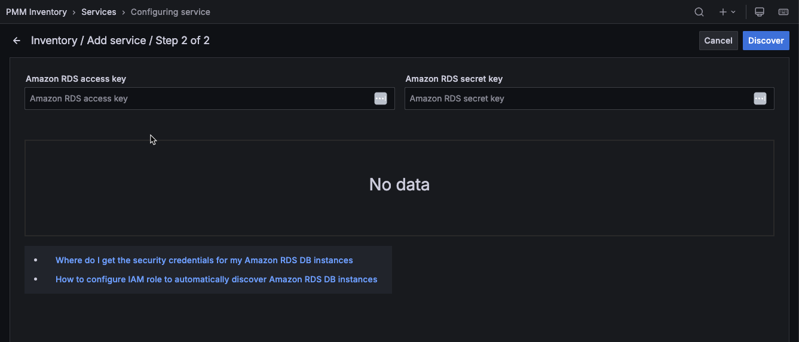

2. Enter the access key ID and the secret access key of your IAM user or leave these fields empty if an IAM role was created.

3. Click the **Discover** button for PMM to retrieve the available Amazon RDS
instances.

    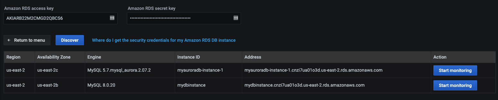

4. For the instance that you would like to monitor, select the **Start monitoring** button.

5. You will see a new page with the number of fields. The list is divided into the following groups: **Main details**, **RDS database**, **Labels**, and **Additional options**. Some already known data, such as already entered **AWS access key**, are filled in automatically, and some fields are optional.

    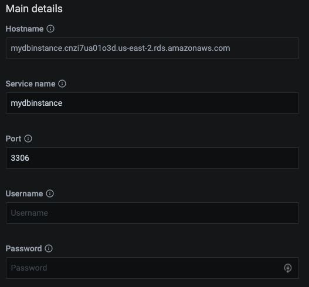

    The **Main details** section allows you to specify the DNS hostname of your instance, the service name to use within PMM, the port your service is listening on, the database user name and password, and optionally the **Instance ID** to match your RDS instance between PMM and the AWS console.    

    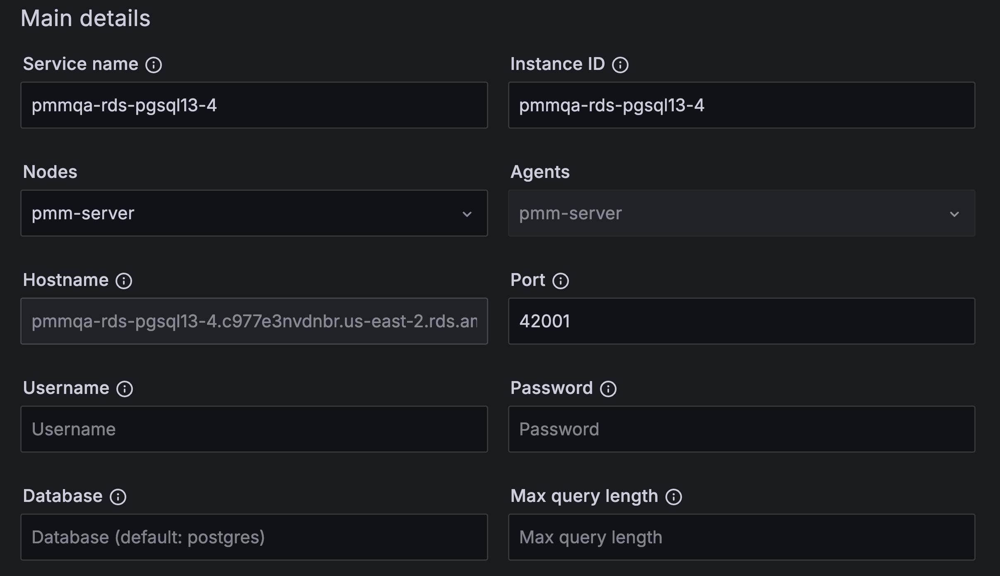

    The **Labels** section allows you to specify labels for the environment, the AWS region and availability zone to be used, the Replication set and Cluster names and also it allows you to set the list of custom labels in a key:value format.

    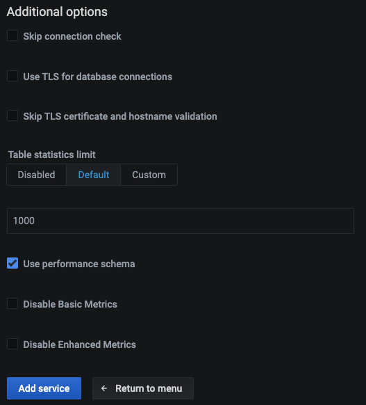

    The **Additional options** section contains flags that let you tune RDS monitoring:

    - Skip connection check.
    - Use TLS for the database connection.
    - Skip TLS certificate and hostname validation.
    - Disable basic and/or enhanced metrics collection for the RDS instance to reduce costs.
    - Set **Connection timeout** to control how long PMM waits when connecting to the instance. Leave empty to use the default of 5s.

    Also this section contains a database-specific flag, which would allow Query Analytics for the selected remote database:

    - when adding some remote MySQL, AWS RDS MySQL or Aurora MySQL instance, you will be able to choose using performance schema for the database monitoring;

    - when adding a PostgreSQL instance, you will be able to activate using `pg_stat_statements` extension;

    - when adding a MongoDB instance, you will be able to choose using Query Analytics MongoDB profiler.

6. Finally press the **Add service** button to start monitoring your instance.

### Add an RDS instance via command line

You can also add Amazon RDS MySQL instances using the `pmm-admin` command line tool.

=== "With TLS (CA certificate only - recommended)"

    This is the recommended approach for Amazon RDS instances. Provide only the CA certificate to establish encrypted connections:
    
    ```sh
    pmm-admin add mysql \
      --username=pmm \
      --password=secure \
      --host=mydb.123456.us-east-1.rds.amazonaws.com \
      --port=3306 \
      --service-name=RDS-MySQL \
      --query-source=perfschema \
      --tls \
      --tls-ca=/path/to/rds-combined-ca-bundle.pem
    ```

=== "With TLS and client authentication (if configured)"

    Use this option only if you've configured client certificate authentication on your RDS instance:
    
    ```sh
    pmm-admin add mysql \
      --username=pmm \
      --password=secure \
      --host=mydb.123456.us-east-1.rds.amazonaws.com \
      --port=3306 \
      --service-name=RDS-MySQL \
      --query-source=perfschema \
      --tls \
      --tls-ca=/path/to/rds-combined-ca-bundle.pem \
      --tls-cert=/path/to/client-cert.pem \
      --tls-key=/path/to/client-key.pem
    ```

=== "Without TLS"

    Use this option only if TLS is not required for your connection:
    ```sh
    pmm-admin add mysql \
      --username=pmm \
      --password=secure \
      --host=mydb.123456.us-east-1.rds.amazonaws.com \
      --port=3306 \
      --service-name=RDS-MySQL \
      --query-source=perfschema
    ```

#### Provide the RDS CA certificate to pmm-admin

To connect to Amazon RDS for MySQL over TLS from the command line:

- Download the [RDS CA certificate bundle](https://docs.aws.amazon.com/AmazonRDS/latest/UserGuide/UsingWithRDS.SSL.html) to the server where PMM Client is installed.
- Pass the full path to the certificate in `--tls-ca`.
- Use `--tls-skip-verify` only in development or test environments.

## Add an Amazon RDS PostgreSQL instance

For PostgreSQL, use the same method described above.
{.power-number}

1. In the PMM web interface, go to **Inventory > Add service > Amazon RDS**.

    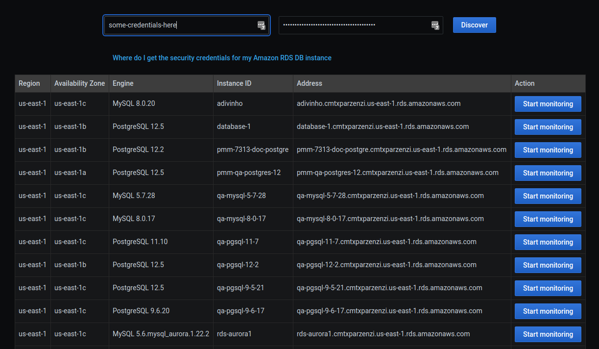

2. Follow steps 4 to 6 as in the previous section. Fill the form and remember to select `PG Stat Statement` to enable Query Analytics.

    To get queries for Query Analytics, you need to enable `pg_stat_statements` in `postgres` database of your instance by running:

    ```sql
    CREATE EXTENSION pg_stat_statements SCHEMA public;
    ```

    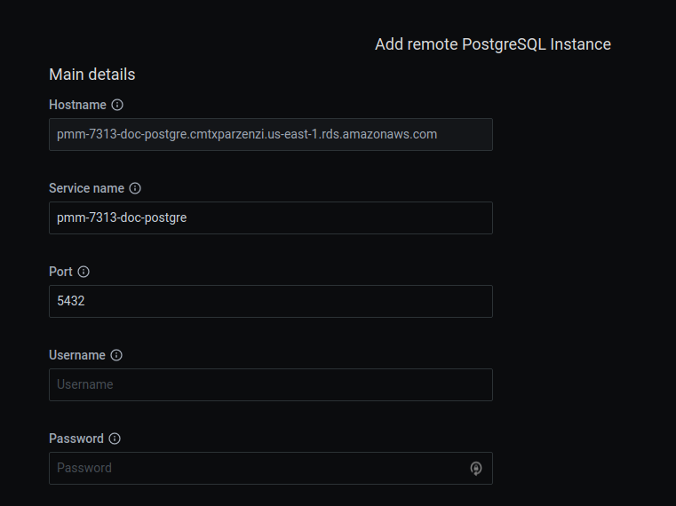
    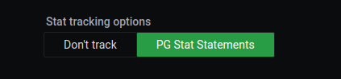
