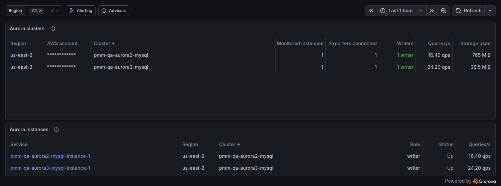

# Amazon Aurora Overview

This dashboard lists the Amazon Aurora MySQL clusters and instances that PMM monitors, so you can see which instances belong to which cluster and whether they are up. Open it from **MySQL > Amazon Aurora**.

Use the **Region** list to limit both tables to one or more AWS regions.

## Aurora clusters

This table has one row per Aurora MySQL cluster, identified by AWS region, AWS account and cluster ID. The columns are:

* **Cluster**: the DB cluster identifier, which `rds_exporter` reads from AWS when it starts. A cluster shown as *AWS cluster unknown* groups the instances that have no `rds_exporter`, so PMM can't tell their cluster. This happens for instances added with `pmm-admin add mysql`, and for instances discovered through a pmm-agent older than PMM Server. If you added the instances through **Inventory > Add service > Amazon RDS**, upgrade PMM Server. For instances attached to another pmm-agent, upgrade that pmm-client. Instances also show here for a few seconds when `rds_exporter` restarts, for example when an RDS instance is added or removed on the same agent. The row can lump instances of several clusters, so **Writers** there reads **changing**.

* **Monitored instances**: the number of Aurora MySQL services that PMM monitors in the cluster. A service whose exporter stopped reporting is still counted for one hour.

* **Exporters connected**: how many of the monitored instances have their MySQL exporter connected to the database.

* **Writers**: shows **1 writer** when exactly one instance in the cluster is a writer. During a failover, or when no instance reports its role, it shows **changing**. The value is sampled every minute.

* **Queries/s**: the queries per second across the instances of the cluster.

* **Storage used**: the cluster volume in use, from CloudWatch `VolumeBytesUsed`, counted once per cluster. AWS publishes this value irregularly, so it can be up to about 3 hours old. It shows **-** when CloudWatch has no value for the cluster in the last 3 hours, or when the instance has no `rds_exporter` or cluster.

## Aurora instances

This table has one row per Aurora MySQL service. Click a service name to open [MySQL Amazon Aurora Details](dashboard-mysql-amazon-aurora-details.md) for it. The columns are:

* **Service**: the service name.

* **Region** and **Cluster**: the AWS region and cluster of the instance.

* **Role**: **writer** or **reader**, based on `innodb_read_only`. It shows **unknown** when the exporter doesn't report the role. The value is sampled every minute.

* **Status**: **Up** when the MySQL exporter is connected to the database, and **Down** when it isn't. An exporter that stopped reporting shows as **Down** for one hour, and then the row disappears.

* **Queries/s**: the queries per second on the instance.
