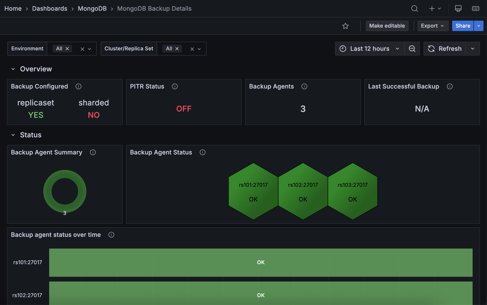

# MongoDB Backup Details dashboard

This dashboard helps you monitor your Percona Backup for MongoDB (PBM) environment directly within PMM. 

It brings together backup configuration, agent health, and backup history in one place, so you don't need to switch between tools.

The dashboard works with both replica sets and sharded clusters. 

Use the filters at the top to narrow down to specific environments, clusters, or replica sets.

!!! note
    This dashboard requires MongoDB services to be added with the `--cluster` parameter. If panels show no data, see [Add MongoDB service to PMM](../../install-pmm/install-pmm-client/connect-database/mongodb.md#step-3-add-mongodb-service-to-pmm).

## Overview 

### Backup Configured

Shows whether PBM has a remote storage location configured. A green **YES** means backup storage is set up while a red **NO** means it isn't.

Check this first when opening the dashboard. If it shows **NO**, no backups are running regardless of what other panels show. Configure a remote storage location (S3, Azure Blob, or filesystem) in PBM before relying on this dashboard for backup monitoring. 

See [Configure backup storage](https://docs.percona.com/percona-backup-mongodb/latest/install/backup-storage.html).

### PITR Status

Shows whether Point-in-Time Recovery (PITR) oplog streaming is enabled. A green **ON** means PITR is active; a red **OFF** means it isn't.

PITR lets you restore to any moment in time, not just to the nearest backup snapshot. If your recovery objectives require granular restores, and this shows **OFF**, enable PITR in your PBM configuration.

### Backup Agents

Shows the total number of PBM agents currently monitored by PMM.

Compare this against the number of nodes you expect to be covered. A lower count means some agents have gone offline or failed to register. Any node without a running agent won't be backed up, so investigate immediately if the count doesn't match.

### Last Successful Backup

Shows the name of the most recent backup that completed successfully.

Use this as your quick recovery point check: it tells you exactly how far back you'd need to restore if something went wrong right now. 

If it shows an old backup or **N/A**, investigate why backups stopped completing.

## Status

### Backup Agent Summary

Shows the distribution of PBM agent statuses across your environment as a donut chart. Green represents agents with **OK** status; red represents agents that need attention (**CHECK**).

A predominantly green chart means your backup infrastructure is healthy. Any red segments mean some agents have issues and backups on those nodes are at risk. 

When you see red, move to the **Backup Agent Status** panel to find out which specific hosts are affected.

### Backup Agent Status

Shows the current status of each individual PBM agent as a hexagon grid, with one hexagon per host. Green means **OK**; red means **CHECK**.

Use this to pinpoint exactly which nodes have agent problems after the **Backup Agent Summary** flags an issue. Hover over a hexagon to see the hostname.

Arbiter nodes always show **CHECK** here. This is expected, because the PBM agent can't run on arbiters.

### Backup Agent Status Over Time

Shows each agent's status history over the selected time range as a color-coded timeline. Green bars indicate **OK**; red bars indicate **FAIL** or **DOWN**.

Use this to tell the difference between a one-off failure and a recurring problem. Repeated red bars on the same node point to an underlying issue rather than a transient blip. 

You can also use the timeline to correlate failures with events like deployments, network changes, or maintenance windows, and to confirm that a previously failing agent has fully recovered.

### Failing Backup Agents

Shows only the PBM agents that are failing right now, one row per agent, with the agent's host, replica set, cluster, and environment. Available starting with PMM 3.11.0.

Use this to find the agents that need attention without scanning hundreds of healthy ones. Arbiters aren't listed, because the PBM agent can't run on arbiters.

The **Status** column shows why each agent is listed:

- **FAIL**: The PBM agent can't connect to PBM, `mongod`, or the backup storage, or no PBM agent is registered on the node.
- **DOWN**: PBM hasn't had a heartbeat from the agent for more than 30 seconds, usually because the agent is stopped or unreachable.

To see the exact reason for a failure, run `pbm status` on the affected node.

**Failing for** shows how long the agent has been failing, within the last 24 hours:

- the time since the agent last reported **OK**
- the time since PMM first saw the agent, if the agent has never reported **OK**
- **> 24h** if the agent has been failing for the whole 24 hours
- **N/A** if PMM doesn't monitor the node itself

To look into a failing node, open its [MongoDB Instance Summary](dashboard-mongodb-instance-summary.md) dashboard from the **PMM service** column. If the column is empty, PMM can't match the agent to its node's own service. This happens when the node is down, when PMM doesn't monitor it, or when it runs PMM Client older than 3.1.

After you fix an agent, check that its row disappears from the table. When all your agents are back to **OK**, the table shows **No failing backup agents**.

## Details

### Backup History

Shows a record of backup operations across your MongoDB infrastructure, including environment, cluster, backup name, size, and duration.

Use this to verify your backup schedule is running and to catch failures before they affect your recovery options. 

Watch for two things: unusually small backups can mean data wasn't fully captured, and longer-than-normal durations can point to storage or network problems.

Note that status reporting here may not cover all PBM error states, such as "stuck" or "incompatible" backups. Use PBM's native tools for a complete picture until this is improved in a future release.

### Backup Sizes

Shows the size of each backup as a bar chart.

Use this to track storage consumption over time and plan capacity. A sudden drop in size can mean a backup didn't capture all your data; a sudden increase may signal unexpected data growth that needs storage planning.

### Backup Duration

Shows how long each backup operation took to complete, in seconds.

Use this to catch performance problems early. If a backup that normally takes a few minutes suddenly takes much longer, something changed: your dataset may have grown, storage may be slower, or there may be a network issue worth investigating. 

Tracking duration trends also helps you schedule maintenance windows accurately.

## PBM metrics

PMM reads the `mongodb_pbm_*` metrics from the collections that PBM keeps in the `admin` database of your cluster. Use these metrics in **Explore**, in your own dashboards, and in your own alert rules.

The following table lists the metrics behind this dashboard:

| Metric | Labels | Description |
|--------|--------|-------------|
| `mongodb_pbm_cluster_backup_configured` | – | `1` if PBM has a configuration, `0` if it doesn't. |
| `mongodb_pbm_cluster_pitr_backup_enabled` | – | `1` if PITR is enabled, `0` if it isn't. |
| `mongodb_pbm_agent_status` | `host`, `replica_set`, `role`, `self` | Status of the PBM agent of each replica set member: `0` is OK, `1` is failing or not registered, `2` is lost, which means no heartbeat for more than 30 seconds. |
| `mongodb_pbm_backup_size_bytes` | `name`, `type`, `status`, `opid`, `host`, `replica_set`, `self` | Size of each backup. |
| `mongodb_pbm_backup_duration_seconds` | `name`, `type`, `status`, `opid`, `host`, `replica_set`, `self` | Duration of each backup. For a backup in progress, the time since it started. |
| `mongodb_pbm_backup_last_transition_ts` | `name`, `type`, `status`, `opid`, `host`, `replica_set`, `self` | Time when each backup last changed its status, in seconds since the epoch. |

The following table lists the metrics that are available starting with PMM Client 3.11.0. No dashboard panel or alert template uses them yet:

| Metric | Labels | Description |
|--------|--------|-------------|
| `mongodb_pbm_cluster_backup_failures_since_last_success` | `type` | Number of backups of this type that failed after the last successful one. It counts the backups that PBM marked as failed and the unfinished backups whose agents stopped. It returns to `0` with the next successful backup of this type. |
| `mongodb_pbm_cluster_pitr_recovery_point_ts` | – | Latest time that you can restore the whole cluster to with PITR, in seconds since the epoch. It is the oldest of the `mongodb_pbm_pitr_last_write_ts` values and matches the end of the PITR range in `pbm list`. |
| `mongodb_pbm_pitr_last_write_ts` | `replica_set` | Time of the last oplog write that PBM saved for the replica set, in seconds since the epoch. |
| `mongodb_pbm_restore_status` | – | Status of the most recent restore: `0` is no restore recorded, `1` is running, `2` is failed, `3` is completed. |
| `mongodb_pbm_restore_duration_seconds` | `name`, `backup`, `type`, `status`, `opid` | Duration of each of the 10 most recent restores. |
| `mongodb_pbm_restore_last_transition_ts` | `name`, `backup`, `type`, `status`, `opid` | Time when each of the 10 most recent restores last changed its status, in seconds since the epoch. |
| `mongodb_pbm_agent_version_info` | `host`, `replica_set`, `self`, `version` | Version of the PBM agent of the monitored node. Through `mongos`, the version of every agent in the cluster. The value is always `1`. |

When you read the new metrics, keep the following in mind:

- The PITR metrics exist only while PITR is enabled. They advance once per oplog slice, every 10 minutes by default (`pitr.oplogSpanMin`), and pause while PBM runs a logical backup or a restore.
- The restore metrics cover logical restores as they run. A physical, incremental, or external restore appears only after you run `pbm config --force-resync`, and a restore that failed on some nodes counts as failed.
- Every monitored node of a cluster reports the same cluster-wide values, so aggregate them, for example with `max by (cluster)`.

### Required privileges

The restore and PITR metrics need the `find` action on the `admin.pbmRestores` and `admin.pbmPITRChunks` collections. The `pmmMonitor` role from [Set up MongoDB monitoring permissions](../../install-pmm/install-pmm-client/connect-database/mongodb.md#step-1-set-up-mongodb-monitoring-permissions) already grants it.

If your monitoring user has a custom role that grants `find` only on specific PBM collections, add these two collections to the role. Without them, the restore and PITR metrics are missing and `mongodb_exporter` logs a warning. The other PBM metrics aren't affected.

### Example queries

Use the following queries as a starting point for your own panels and alert rules:

- Backups that keep failing: `max by (cluster, type) (mongodb_pbm_cluster_backup_failures_since_last_success) > 0`
- PITR recovery point more than 30 minutes behind: `time() - max by (cluster) (mongodb_pbm_cluster_pitr_recovery_point_ts) > 1800`
- Most recent restore failed: `max by (cluster) (mongodb_pbm_restore_status) == 2`
- PBM agents of different versions in one cluster: `count by (cluster) (count by (cluster, version) (mongodb_pbm_agent_version_info)) > 1`
