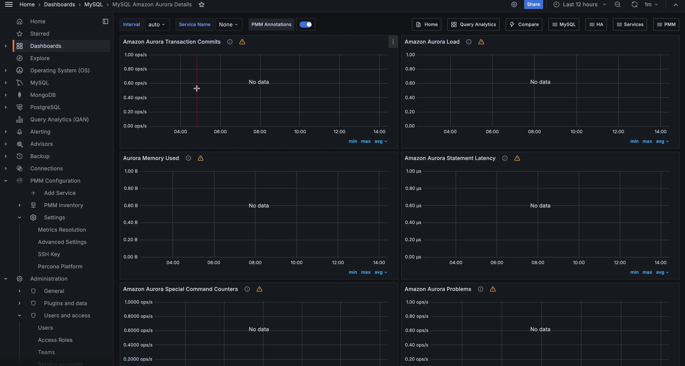

# MySQL Amazon Aurora Details

This dashboard shows the performance of one Amazon Aurora MySQL instance. The **Service Name** and **Node Name** lists contain only Aurora MySQL services. To see all the instances of a cluster first, open the [Amazon Aurora Overview](dashboard-amazon-aurora-overview.md) and click a service to open it here.

Panels that read Amazon CloudWatch metrics need the instance to be added to PMM through **Inventory > Add service > Amazon RDS**. See [Connect an Amazon RDS or Aurora instance](../../install-pmm/install-pmm-client/connect-database/aws.md).

## Amazon Aurora Transaction Commits

This graph shows the number of Commits which Amazon Aurora engine performed as well as average commit latency. Graph Latency does not always correlate with the number of performed commits and can be quite high in certain situations.

* **Number of Amazon Aurora Commits**: The average number of commit operations per second.

* **Amazon Aurora Commit avg Latency**: The average amount of latency for commit operations

## Amazon Aurora Load

This graph shows us what statements contribute most load on the system as well as what load corresponds to Amazon Aurora transaction commit.

* **Write Transaction Commit Load**: Load in Average Active Sessions per second for COMMIT operations

* **UPDATE load**: Load in Average Active Sessions per second for UPDATE queries

* **SELECT load**: Load in Average Active Sessions per second for SELECT queries

* **DELETE load**: Load in Average Active Sessions per second for DELETE queries

* **INSERT load**: Load in Average Active Sessions per second for INSERT queries

An *active session* is a connection that has submitted work to the database engine and is waiting for a response from it. For example, if you submit an SQL query to the database engine, the database session is active while the database engine is processing that query.

## Aurora Memory Used

This graph shows how much memory the Amazon Aurora lock manager uses, and how much RAM Aurora allocates to in-memory temporary tables.

* **Aurora Lock Manager Memory**: the amount of memory used by the Lock Manager, the module responsible for handling row lock requests for concurrent transactions.

* **Temp table RAM**: the amount of memory currently allocated to in-memory temporary tables.

## Amazon Aurora Statement Latency

This graph shows average latency for the most important types of statements. Latency spikes are often indicative of the instance overload.

* **DDL Latency:** Average time to execute DDL queries

* **DELETE Latency**: Average time to execute DELETE queries

* **UPDATE Latency**: Average time to execute UPDATE queries

* **SELECT Latency**: Average time to execute SELECT queries

* **INSERT Latency**: Average time to execute INSERT queries

A statement type that the instance didn't run during an interval shows a latency of 0.

## Amazon Aurora Special Command Counters

Amazon Aurora MySQL allows a number of commands which are not available in standard MySQL. This graph shows usage of such commands.  Regular `unit_test` calls can be seen in default Amazon Aurora install, the rest will depend on your workload.

* `show_volume_status`: The number of executions per second of the command SHOW VOLUME STATUS. The SHOW VOLUME STATUS query returns two server status variables, Disks and Nodes. These variables represent the total number of logical blocks of data and storage nodes, respectively, for the DB cluster volume.

* `awslambda`: The number of AWS Lambda calls per second. AWS Lambda is an event-drive, server-less computing platform provided by AWS. It is a compute service that run codes in response to an event. You can run any kind of code from Aurora invoking Lambda from a stored procedure or a trigger.

* `alter_system`: The number of executions per second of the special query ALTER SYSTEM, that is a special query to simulate an instance crash, a disk failure, a disk congestion or a replica failure. It’s a useful query for testing the system.

## Amazon Aurora Problems

This graph shows internal Amazon Aurora MySQL problems, which should be zero in normal operation. Anything non-zero is worth examining in greater depth.

* **Deadlocks (CloudWatch)** and **Blocked transactions (CloudWatch)**: the average counts that Amazon CloudWatch reports for the instance.

* **Reserved Mem Exceeded Incidents**: the rate of incidents where the reserved memory was exceeded.

## Cache and local storage

This row is expanded by default.

* **Buffer Cache Hit Ratio**: the percentage of requests that the Aurora buffer cache served (CloudWatch `BufferCacheHitRatio`).

* **Free Local Storage**: the local storage available to the instance for temporary files and logs (CloudWatch `FreeLocalStorage`).

## Replication (needs a reader)

This row is collapsed by default. It shows data only when the cluster has a reader instance.

* **Aurora Replica Lag**: the replication lag of an Aurora reader behind the writer (CloudWatch `AuroraReplicaLag`). Only readers report it.

* **Aurora Binlog Replica Lag**: the lag of the binlog replication thread behind its source (CloudWatch `AuroraBinlogReplicaLag`).

## Write forwarding

This row is collapsed by default. Its graphs are empty unless the instance uses write forwarding.

* **Forwarded Write Statements**: the statements that a reader forwards to the writer, split into DML and SELECT.

* **Forwarding Open Sessions**: the number of forwarded sessions currently open on the writer.

## Parallel query

This row is collapsed by default. Its graph is empty unless the instance uses parallel query.

* **Parallel Query Requests**: the parallel query requests by outcome: attempted, executed and not chosen.

## Serverless capacity (Serverless only)

This row is collapsed by default. Its graph is empty unless the instance is an Aurora Serverless v2 instance.

* **Serverless Capacity**: the current, minimum and maximum Aurora Capacity Units (ACUs) of the instance.
