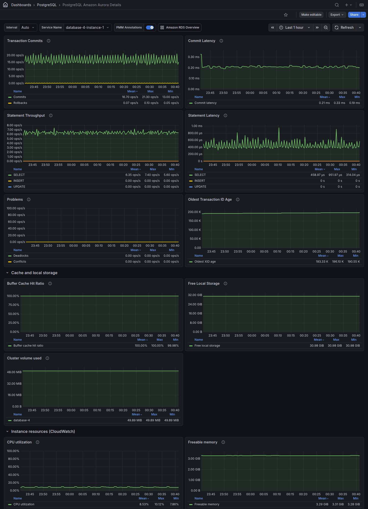

# PostgreSQL Amazon Aurora Details

This dashboard shows the performance of one Amazon Aurora PostgreSQL instance. The **Service Name** list contains only Aurora PostgreSQL services. To see all the instances of a cluster, open the [Amazon RDS overview](../../use/amazon-rds-overview.md) page with the **Amazon RDS Overview** link at the top of the dashboard. Click a service there to open it here.

Panels that read Amazon CloudWatch metrics need the instance to be added to PMM through **Inventory > Add service > Amazon RDS**. See [Connect Amazon RDS instance](../../install-pmm/install-pmm-client/connect-database/aws.md).

The statement and replica lag graphs read the Aurora functions `aurora_stat_dml_activity()` and `aurora_replica_status()`. They need the `rds_superuser` role that [Connect PostgreSQL](../../install-pmm/install-pmm-client/connect-database/postgresql.md) asks you to grant to the PMM user. If a PMM Client on another host monitors the instance, upgrade that PMM Client to the same release as PMM Server.

## Transaction Commits

This graph shows the transactions committed and rolled back per second, from `pg_stat_database`.

## Commit Latency

This graph shows the average commit latency that Amazon CloudWatch reports for the instance (`CommitLatency`).

## Statement Throughput

This graph shows the `SELECT`, `INSERT`, `UPDATE` and `DELETE` statements per second, summed over the databases of the instance.

## Statement Latency

This graph shows the average time to run a `SELECT`, `INSERT`, `UPDATE` or `DELETE` statement. Latency spikes often mean that the instance is overloaded. A statement type that the instance didn't run during an interval shows a latency of 0.

## Problems

This graph shows events that are zero in normal operation:

* **Deadlocks**: deadlocks detected per second.

* **Conflicts**: queries per second that a reader cancelled because they conflicted with changes replayed from the writer.

## Oldest Transaction ID Age

This graph shows the transaction ID age of the oldest database. Autovacuum freezes old rows to keep it down. If it nears about 2.1 billion, Aurora PostgreSQL turns read-only to prevent transaction ID wraparound.

## Cache and local storage

This row is expanded by default. It has these graphs:

* **Buffer Cache Hit Ratio**: the percentage of requests that the Aurora buffer cache served (CloudWatch `BufferCacheHitRatio`).

* **Free Local Storage**: the local storage available to the instance for temporary files and logs (CloudWatch `FreeLocalStorage`).

* **Cluster volume used**: the bytes used by the Aurora cluster volume (CloudWatch `VolumeBytesUsed`). AWS publishes this metric irregularly, so the graph can be up to about 3 hours behind.

## Instance resources (CloudWatch)

This row is expanded by default. Its graphs read Amazon CloudWatch metrics, which don't need Enhanced Monitoring and are about 10 minutes behind. The **IOPS** and **Throughput** graphs show the write activity of the instance:

| Graph | CloudWatch metrics |
|-------|--------------------|
| **CPU utilization** | `CPUUtilization` |
| **Freeable memory** | `FreeableMemory` |
| **Database connections** | `DatabaseConnections` |
| **IOPS** | `ReadIOPS`, `WriteIOPS` |
| **Throughput** | `ReadThroughput`, `WriteThroughput` |
| **Network throughput** | `NetworkReceiveThroughput`, `NetworkTransmitThroughput` |
| **Disk queue depth** | `DiskQueueDepth` |
| **Swap usage** | `SwapUsage` |

## Replication (needs a reader)

This row is collapsed by default. Its graphs are empty unless the cluster has a reader. It has these graphs:

* **Replica Lag**: the replication lag of each reader behind the writer, from `aurora_replica_status()` on the selected instance. It shows the cluster's readers even when PMM monitors only the writer.

* **Aurora Replica Lag (CloudWatch)**: the replication lag that a reader reports (CloudWatch `AuroraReplicaLag`), and the largest lag of the cluster's readers that the writer reports (`AuroraReplicaLagMaximum`).
