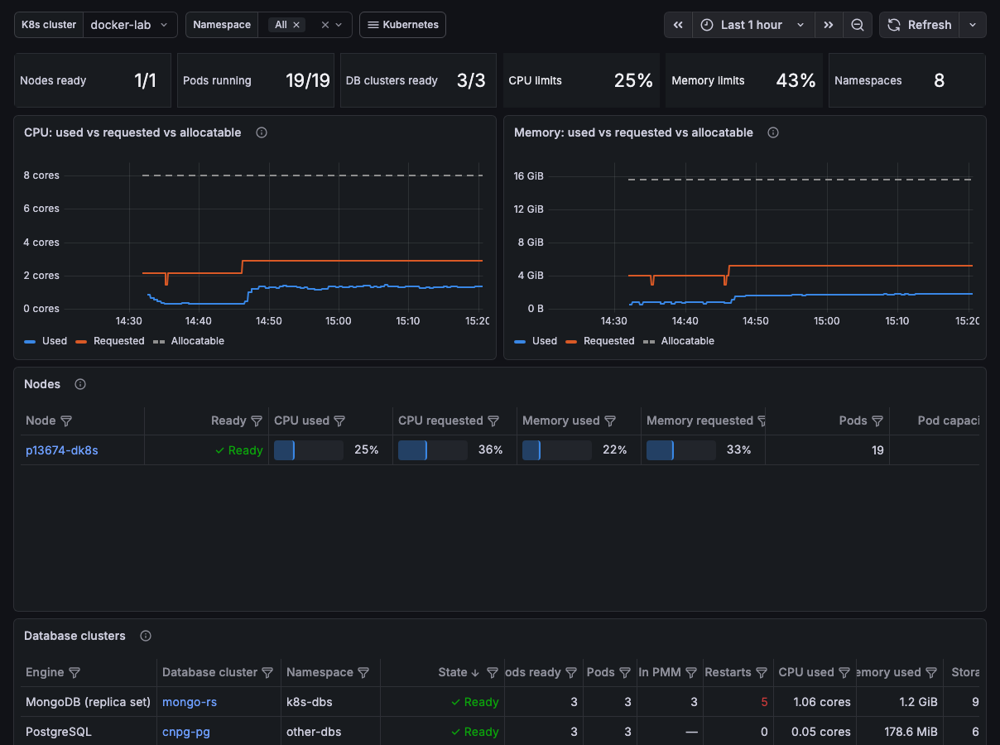

# Kubernetes Cluster Summary

This dashboard shows one Kubernetes cluster: its nodes, the database clusters that run in it, its namespaces, storage and pods. Use the **Namespace** selector to narrow every panel to some namespaces.

## Header

The tiles at the top show how many nodes are ready, how many pods are running, how many database clusters are ready, the CPU and memory limits as a share of what the nodes can allocate, and the number of namespaces. Select a tile to open the matching list.

## CPU and memory

**CPU: used vs requested vs allocatable** and **Memory: used vs requested vs allocatable** compare what the pods use, what they request from the scheduler, and what the nodes can allocate to pods. Allocatable is the node capacity minus what the system reserves. New pods can't be scheduled once the requests reach allocatable, even if usage is low.

## Nodes

Lists every node with its readiness, CPU and memory used and requested, and pod count. Select a node to open the **Kubernetes Node** dashboard.

## Database clusters

Lists every database cluster in the selected namespaces, with its engine, state, pods ready, pods monitored by PMM, restarts, resource use and storage. Select a name to open the [Database Cluster on Kubernetes](kubernetes_monitor_db_clusters_managed.md) dashboard.

## Namespaces

Shows the pods, CPU and memory used, requested and limited in each namespace.

## Pods that need attention

Lists the pods that are not ready, can't be scheduled, are waiting (for example in `CrashLoopBackOff` or `ImagePullBackOff`), or restarted in the selected time range, with the reason of their last termination.

## Pods

Lists every pod in the selected namespaces, not only database pods. Filter a column from its header, or select a pod or node to open its dashboard.

## Storage

The storage tiles show how many persistent volume claims (PVCs) are bound, how much storage they request, the fullest volume and the fullest node disk. **Persistent volume claims** lists every PVC with its storage class, phase, size, use and free space.

Volumes on a shared node disk, such as the `local-path` storage class, report no usage of their own. For them, PMM shows the node disk that they share.
