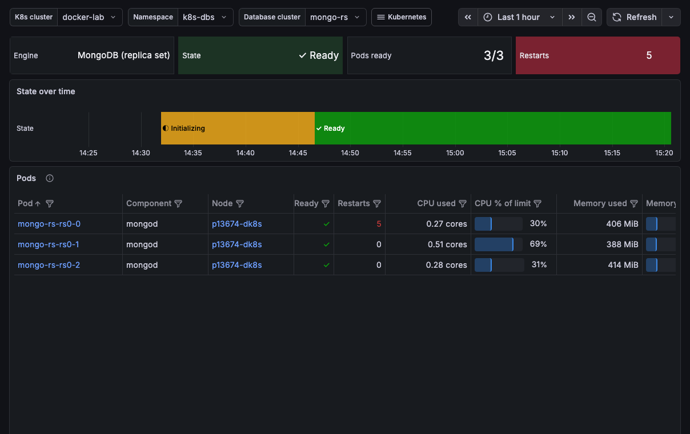

# Database Cluster on Kubernetes

This dashboard shows one database cluster that runs on Kubernetes: its state over time, its pods, their resource use and their volumes.

## How PMM finds database clusters

PMM recognizes database pods by their container image, whichever operator, Helm chart or StatefulSet created them:

| Engine | Image name contains |
|---|---|
| MySQL | `mysql`, `mariadb`, `percona-server`, `percona-xtradb` |
| MongoDB | `mongo` |
| PostgreSQL | `postgres`, `spilo`, `timescale`, `postgis` |
| Valkey | `valkey`, `redis` |

Pods that share the `app.kubernetes.io/instance` label form one database cluster, together with their proxies, poolers and other helpers. Pods without that label are grouped by the StatefulSet or other controller that owns them.

## State

For clusters managed by Percona Operator for MongoDB, Percona Operator for PostgreSQL or Percona Operator for MySQL (based on Percona XtraDB Cluster or Percona Server), the state comes from the operator's custom resource: **Ready**, **Initializing**, **Paused** or **Error**. For other clusters, PMM derives the state from pod readiness:

- **Ready**: every pod is ready
- **Degraded**: some pods are not ready
- **Down**: no pod is ready

The header shows the engine, the current state, the pods that are ready and the restarts in the selected time range. **State over time** shows when the state changed.

## Pods

Lists the pods of the cluster with their component, node, readiness, restarts, the reason of their last termination, their CPU and memory as a share of their limit, and CPU throttling. Select a pod to open the **Kubernetes Pod** dashboard. If PMM monitors the pod, the **PMM** column opens its PMM dashboard.

## Resource use

**CPU — % of limit, per pod** and **Memory — % of limit, per pod** show each pod's busiest container against its own limit. At 100%, the container is throttled (CPU) or killed for running out of memory. Containers without a limit are left out.

**CPU used, per pod** and **Memory used, per pod** show every pod of the cluster, including proxies, config servers and orchestrators, with or without a limit.

**Network** shows the traffic received (above zero) and sent (below zero) by each pod. **Disk I/O** shows the bytes written (above zero) and read (below zero) by each pod's containers.

## Storage

**Persistent volume claims** lists the volumes of the cluster. **Storage full, per PVC** shows how full each volume is. For a volume on a shared node disk, such as the `local-path` storage class, it shows the node disk instead.
