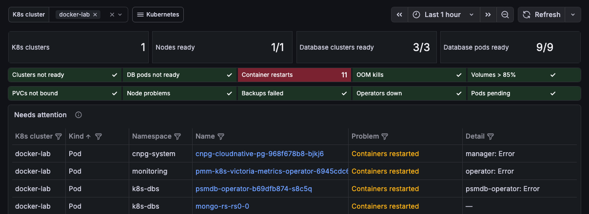

# Monitor Kubernetes

!!! caution "Important"
    This feature is still in [Technical Preview](../../reference/glossary.md#technical-preview) and is subject to change. We recommend that early adopters use this feature for testing purposes only.

PMM shows the health of your Kubernetes clusters and of the database clusters that run in them. The Kubernetes dashboards recognize MySQL, MongoDB, PostgreSQL and Valkey databases from any operator, Helm chart or StatefulSet.

## How it works

A collector in each Kubernetes cluster sends the cluster's metrics to PMM:

- kube-state-metrics: the state of nodes, pods, volumes and Percona operator custom resources
- kubelet and cAdvisor: the CPU, memory, network and disk use of each container, and volume usage
- node-exporter: the CPU, memory, disk and network use of each node

Every series carries the `k8s_cluster_id` label, which is the cluster's name in PMM. The **Kubernetes** menu appears in PMM within five minutes after the first `kube_node_info` series from kube-state-metrics arrives.

The following table shows which clusters PMM can monitor:

| PMM deployment | Cluster | Setup |
|---|---|---|
| PMM HA | The cluster that PMM HA runs in | None: the `pmm-ha` Helm chart includes the collector |
| PMM Server in Docker or Podman | Any cluster that can reach PMM Server | [Install the collector](#install-the-collector) |
| PMM HA | Another cluster | Not supported yet |

## Monitor the cluster that runs PMM HA

PMM HA reports the Kubernetes cluster that it runs in. The cluster's name in PMM is the Helm release name. To use another name, set the `k8sClusterId` value when you install or upgrade the `pmm-ha` chart. If you change the name later, the cluster's history stays under the old name.

## Install the collector

Install the collector in each Kubernetes cluster that you want to monitor from a PMM Server that runs in Docker or Podman. The collector is the VictoriaMetrics `victoria-metrics-k8s-stack` Helm chart with the values on this page. It sends metrics to PMM and runs no storage, alerting or Grafana of its own.

### Prerequisites

Before you start, make sure that:

- you have `kubectl` and Helm, with cluster-admin access to the cluster
- the cluster can reach PMM Server over HTTPS
- you have a PMM service account token with the **Admin** role, see [Generate a service account and token](../../api/authentication.md#generate-a-service-account-and-token)

PMM rejects metrics sent with a **Viewer** or **Editor** token.

### Install

To install the collector:
{.power-number}

1. Create a namespace and store the token in a secret:

    ```sh
    kubectl create namespace pmm-monitoring
    kubectl -n pmm-monitoring create secret generic pmm-token --from-literal=token=<TOKEN>
    ```

2. Save the following values as `pmm-k8s-values.yaml`. Replace `<PMM_SERVER>` with the address of PMM Server and `<CLUSTER_NAME>` with a name for this cluster. The name must be unique among the clusters that report to this PMM Server.

    ??? example "pmm-k8s-values.yaml"

        ```yaml
        # Sends this cluster's metrics to PMM for the Kubernetes dashboards.
        # Chart: vm/victoria-metrics-k8s-stack 0.97.0. Replace <PMM_SERVER> and <CLUSTER_NAME>.

        external:
          vm:
            write:
              url: https://<PMM_SERVER>/victoriametrics/api/v1/write
              bearerTokenSecret: {name: pmm-token, key: token}
              # Remove when PMM Server has a certificate the cluster trusts.
              tlsConfig: {insecureSkipVerify: true}

        vmagent:
          spec:
            externalLabels:
              # The cluster's name in PMM; unique per cluster.
              k8s_cluster_id: <CLUSTER_NAME>

        # One node label instead of all of them: keeps series under VictoriaMetrics' label limit.
        kubelet:
          vmScrape:
            spec:
              relabelConfigs:
                - sourceLabels: [__meta_kubernetes_node_name]
                  targetLabel: node
                - sourceLabels: [__metrics_path__]
                  targetLabel: metrics_path
                - targetLabel: job
                  replacement: kubelet

        kube-state-metrics:
          # Percona operator custom resources: database cluster state.
          customResourceState:
            enabled: true
            config:
              kind: CustomResourceStateMetrics
              spec:
                resources:
                  - groupVersionKind: {group: pxc.percona.com, version: v1, kind: PerconaXtraDBCluster}
                    labelsFromPath: {name: [metadata, name], namespace: [metadata, namespace]}
                    metricNamePrefix: kube_pxc
                    metrics:
                      - name: status_state
                        help: "PXC state"
                        each:
                          type: StateSet
                          stateSet: {labelName: state, path: [status, state], list: [unknown, ready, initializing, error, paused]}
                  - groupVersionKind: {group: psmdb.percona.com, version: v1, kind: PerconaServerMongoDB}
                    labelsFromPath: {name: [metadata, name], namespace: [metadata, namespace]}
                    metricNamePrefix: kube_psmdb
                    metrics:
                      - name: sharding_enabled
                        help: "Sharding enabled"
                        each:
                          type: Gauge
                          gauge: {path: [spec, sharding, enabled]}
                      - name: status_state
                        help: "PSMDB state"
                        each:
                          type: StateSet
                          stateSet: {labelName: state, path: [status, state], list: [stopping, ready, initializing, error, paused]}
                  - groupVersionKind: {group: pgv2.percona.com, version: v2, kind: PerconaPGCluster}
                    labelsFromPath: {name: [metadata, name], namespace: [metadata, namespace]}
                    metricNamePrefix: kube_pg
                    metrics:
                      - name: status_state
                        help: "PG state"
                        each:
                          type: StateSet
                          stateSet: {labelName: state, path: [status, state], list: [stopping, ready, initializing, error, paused]}
                  - groupVersionKind: {group: ps.percona.com, version: v1, kind: PerconaServerMySQL}
                    labelsFromPath: {name: [metadata, name], namespace: [metadata, namespace]}
                    metricNamePrefix: kube_ps_mysql
                    metrics:
                      - name: status_state
                        help: "PS MySQL state"
                        each:
                          type: StateSet
                          stateSet: {labelName: state, path: [status, state], list: [stopping, ready, initializing, error, paused]}
          # Pod and PVC labels that map pods to their database cluster.
          metricLabelsAllowlist:
            - pods=[app.kubernetes.io/component,app.kubernetes.io/instance,app.kubernetes.io/managed-by,app.kubernetes.io/name,app.kubernetes.io/part-of]
            - persistentvolumeclaims=[app.kubernetes.io/component,app.kubernetes.io/instance,app.kubernetes.io/managed-by,app.kubernetes.io/name,app.kubernetes.io/part-of]
          rbac:
            extraRules:
              - apiGroups: [apiextensions.k8s.io]
                resources: [customresourcedefinitions]
                verbs: [list, watch]
              - apiGroups: [pxc.percona.com]
                resources: [perconaxtradbclusters]
                verbs: [list, watch]
              - apiGroups: [psmdb.percona.com]
                resources: [perconaservermongodbs]
                verbs: [list, watch]
              - apiGroups: [pgv2.percona.com]
                resources: [perconapgclusters]
                verbs: [list, watch]
              - apiGroups: [ps.percona.com]
                resources: [perconaservermysqls]
                verbs: [list, watch]
        # PMM stores, alerts and shows the data: no local storage, alerting or Grafana.
        vmsingle: {enabled: false}
        alertmanager: {enabled: false}
        vmalert: {enabled: false}
        grafana: {enabled: false}
        defaultDashboards: {enabled: false}
        defaultRules: {enabled: false}
        # Control-plane metrics are not used by the dashboards.
        kubeApiServer: {enabled: false}
        kubeControllerManager: {enabled: false}
        kubeDns: {enabled: false}
        coreDns: {enabled: false}
        kubeEtcd: {enabled: false}
        kubeScheduler: {enabled: false}
        kubeProxy: {enabled: false}
        # Scrape only what this chart defines, not every ServiceMonitor already in the cluster.
        victoria-metrics-operator:
          operator:
            disable_prometheus_converter: true
        ```

3. Install the chart:

    ```sh
    helm repo add vm https://victoriametrics.github.io/helm-charts/
    helm repo update vm
    helm install pmm-k8s vm/victoria-metrics-k8s-stack --version 0.97.0 -n pmm-monitoring -f pmm-k8s-values.yaml
    ```

4. In PMM, go to **Kubernetes > Overview**. Within two minutes, the **K8s cluster** selector lists `<CLUSTER_NAME>`.

If the cluster already runs a VictoriaMetrics operator, add `victoria-metrics-operator: {enabled: false}` to the values so that the chart uses the existing operator.

### Remove the collector

To stop sending metrics, uninstall the chart and delete its namespace:

```sh
helm uninstall pmm-k8s -n pmm-monitoring
kubectl delete namespace pmm-monitoring
```

Helm leaves the VictoriaMetrics custom resource definitions (`*.operator.victoriametrics.com`) in the cluster. Delete them only if no other VictoriaMetrics operator uses them.

## Link pods to PMM services

The database dashboards and the **Kubernetes Pod** dashboard show whether PMM monitors each database pod, and link to its PMM dashboard. They match the PMM service name `<namespace>-<pod>`, which the Percona operators use when you enable PMM Client in the database cluster.

## Kubernetes dashboards

The dashboards are in the **Kubernetes** menu and in the **Kubernetes** dashboard folder:

- **Kubernetes Overview**: totals, problem counts, and a **Needs attention** list of every object with a problem
- **Kubernetes Clusters** and **Database Clusters on Kubernetes**: every cluster, database cluster and database pod, across clusters
- [Kubernetes Cluster Summary](kubernetes_cluster_summary.md): the nodes, database clusters, namespaces, storage and pods of one cluster
- [Database Cluster on Kubernetes](kubernetes_monitor_db_clusters_managed.md): the state, pods, resource use and volumes of one database cluster
- **Kubernetes Pod**: the containers of one pod, their CPU and memory against requests and limits, throttling, network, disk and volumes
- **Kubernetes Node**: the CPU and memory of one node against what it can allocate, its pods, filesystem, network and disk

Select a problem count on the overview to see the affected objects.


