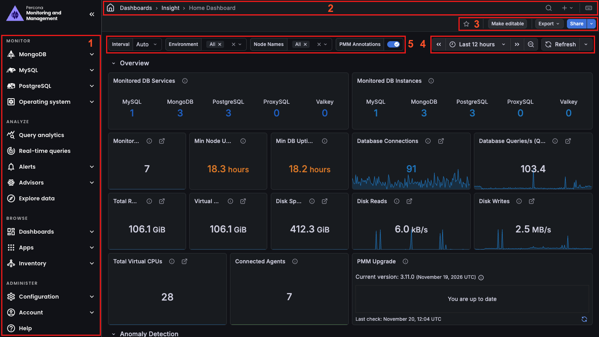

# UI components

This section explains how to access the interface, navigate the layout, and use the various controls within PMM.

Here's how the UI is laid out, and what the controls do:

1. [Main menu](#1-main-menu) (also called the side menu)
2. [Top navigation bar](#2-top-navigation-bar)
3. [Dashboard actions](#3-dashboard-actions)
4. [View controls](#4-view-controls)
5. [View selectors](#5-view-selectors)

## 1. Main menu

The main menu groups its entries under four sections: **Monitor**, **Analyze**, **Browse** and **Administer**. **Account** and **Help** follow the last section.

Some entries appear only when they apply. A database appears under **Monitor** only when PMM monitors at least one service of that type, and **PMM HA** appears only when PMM runs as a High Availability cluster. Your role and the PMM settings decide which other entries you see.

| Icon | Name | Section | What you can do |
|:----:|------|---------|-----------------|
| :simple-mongodb: | MongoDB | Monitor | View dashboards for MongoDB performance monitoring. |
| :simple-mysql: | MySQL | Monitor | View specialized dashboards for MySQL database performance monitoring. |
| :simple-postgresql: | PostgreSQL | Monitor | Access PostgreSQL-specific monitoring dashboards and metrics. |
| :material-database: | Valkey | Monitor | View dashboards for Valkey and Redis performance monitoring. |
| :material-monitor-dashboard: | Operating system | Monitor | Monitor server-level metrics including CPU, memory, disk, and network performance. |
| :material-chart-timeline-variant: | Query analytics | Analyze | Analyze database queries over time, identify slow queries, optimize performance, and troubleshoot issues. |
| :material-radar: | Real-time queries | Analyze | Watch the operations that run on your MongoDB services right now. See [Real-time Query Analytics](../../use/qan/QAN-realtime-analytics.md). |
| :material-bell-outline: | Alerts | Analyze | Create and manage [alerts](../../alert/index.md) that notify you when metrics exceed thresholds. |
| :material-earth: | Advisors | Analyze | Run health assessment checks on your databases and view recommendations for improving performance. |
| :material-compass-outline: | Explore data | Analyze | Investigate metrics without creating dashboards, for example with custom [PromQL](https://prometheus.io/docs/prometheus/latest/querying/basics/) queries. |
| :material-toolbox-outline: | Diagnostics | Analyze | Run diagnostic scripts on your database hosts and send the results to your Percona Support case. See [Support diagnostics](../../apps/support-diagnostics.md). |
| :material-view-grid-outline: | Dashboards | Browse | Browse all dashboards, create [folders](../../use/dashboards-panels/manage-dashboards/create-folders.md), import dashboards, create playlists, and manage snapshots. |
| :material-apps: | Apps | Browse | Open [Operations for MongoDB](../../use/mongodb-operations.md) and [MySQL Backups](../../apps/mysql-backup.md), and manage your [database backups](../../backup/index.md) and storage locations. |
| :material-flask-outline: | Inventory | Browse | View and manage all monitored nodes, services, and agents registered in PMM. Check database and agent status, organize services by clusters, and add or remove monitored instances. |
| :material-server-network: | PMM HA | Administer | Check the health of your PMM High Availability cluster. |
| :material-cog-outline: | Configuration | Administer | Configure PMM settings, check for updates, and manage organizations, users, teams, service accounts, and access roles. |
| :material-account-circle-outline: | Account | | Manage your user profile settings, change your password, set notification preferences, and configure your personal PMM experience. |
| :material-help-circle-outline: | Help | | Access PMM documentation, community forums, and support resources. Export diagnostic logs for troubleshooting and view version information. |

To open your home dashboard, click the PMM logo at the top of the menu. To collapse the menu to icons, click :material-chevron-double-left: next to the logo. In the collapsed menu, an entry with sub-pages opens them in a panel next to it.

## 2. Top navigation bar

The top bar helps you navigate and understand your current location:

- **Dashboard title and breadcrumbs**: Shows your current location and navigation path
- **Search**: Quickly find any dashboard by name
- **Enable kiosk mode**: Displays the current dashboard in full-screen view, hiding the sidebar and navigation elements. Press Esc to exit.
- **View shortcuts**: Access frequently used commands
- **Quick actions menu** — Provides shortcuts to common tasks without navigating through the sidebar

## 3. Dashboard actions

- **Star**: Mark the dashboard as a favorite for quick access.
- **Make editable**:  Unlock the dashboard for editing. Built-in dashboards are read-only by default.
- **Export**: Download the dashboard as a JSON file for backup or import into another PMM instance. 
- **Share**: Share dashboards or panels via direct or shortened links, or export panels as rendered PNG images.

## 4. View controls

Customize how you view your dashboard data:

- **Time range selector**: Focus on specific time periods (last hour, day, week)
- **Refresh button**: Manually update dashboard data or set automatic refresh intervals

## 5. View selectors

Filter your monitoring data using these contextual options:

- **Interval**: Control the data granularity (Auto, 1m, 5m, etc.)
- **Environment**: Focus on specific deployment environments
- **Node Names**: Filter metrics to specific servers
- **PMM Annotations**: Toggle visibility of important events on your timelines

These selectors change based on the dashboard you're viewing, showing only relevant options.
