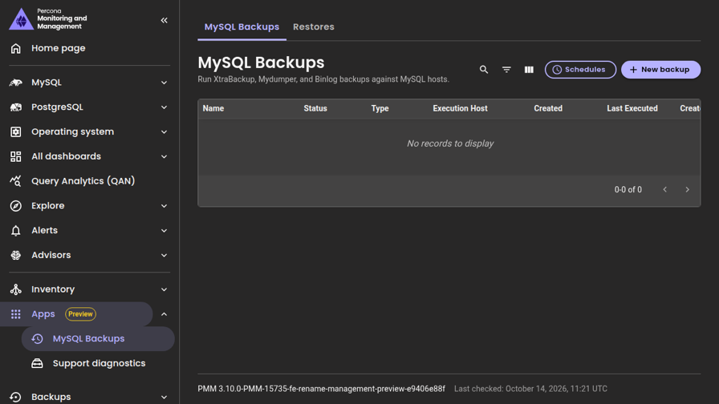
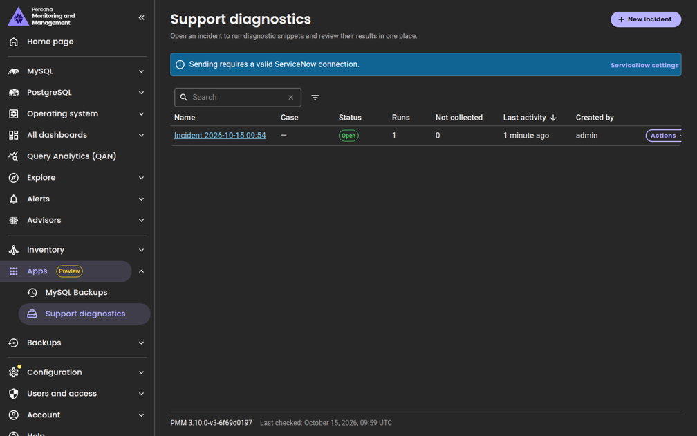

# Percona Monitoring and Management 3.10.0
**Release date**: 22 October 2026

Percona Monitoring and Management (PMM) is an open source database monitoring, management, and observability solution for MySQL, PostgreSQL, MongoDB, Valkey and Redis. PMM empowers you to:

- monitor the health and performance of your database systems
- identify patterns and trends in database behavior
- diagnose and resolve issues faster with actionable insights
- manage databases across on-premises, cloud, and hybrid environments

## 📋 Release summary

PMM 3.10.0 makes PMM HA Cluster generally available with OpenShift support, in-place upgrades, backup and restore. It also adds the first database management Apps, native ARM64 support for PMM Server, MySQL 9.7 support, and a new MongoDB Unused Indexes dashboard.

This release also includes security fixes, multiple improvements, and bug fixes across all deployments.

### PMM HA Cluster is now generally available

PMM 3.10.0 completes the HA Tech Preview introduced in PMM 3.6.0 with the features and improvements needed to run HA reliably in production:

- [Backup and restore](../install-pmm/backup-restore-HA-clustered.md) for your entire HA installation to S3-compatible storage or a shared volume, on demand or on a schedule. Restore into the same cluster or a new namespace for disaster recovery.
- [Built-in alert rules](../alert/templates_list.md#pmm_ha_alerts) for no active leader, split-brain, leader flapping, unreachable nodes, quorum at risk, and persistent volumes over 80% full.
- OpenShift support for versions 4.19 to 4.22, including ROSA with hosted control planes, alongside Amazon EKS 1.33 to 1.36. [Check which platform versions each Helm chart version supports](../install-pmm/HA-clustered.md#check-if-your-platform-is-supported).
- [In-place Helm upgrades](../pmm-upgrade/upgrade_helm_ha.md) with a single `helm upgrade` command, supported starting with PMM 3.10.0 and `percona/pmm-ha` chart 1.8.0. PMM Server replicas restart one at a time, so monitoring is only briefly interrupted while a new leader takes over.
- [Flexible scaling](../install-pmm/install-HA-clustered.md#scale-pmm-server-replicas) to 1, 3, or 5 PMM Server replicas, with Helm validation that rejects even counts.
- [Multi-namespace deployments](../install-pmm/install-HA-clustered.md#install-pmm-ha-into-multiple-namespaces) on the same cluster.
- Multiple [fixes](#fixed-issues-ha) and [improvements](#improvements-ha) for HA Cluster.

- Improved [PMM HA Health Overview](../reference/dashboards/dashboard-ha-health-overview.md) dashboard with alive and expected instance counts, leader and primary roles, and resource usage panels:

    

For help with lost Raft quorum, leader election problems, and component logs, [troubleshoot PMM HA Cluster issues](../troubleshoot/ha_issues.md).

### Built-in alerts for PMM's own components

PMM monitors its own components and alerts you when one stops responding, so you can act before gaps appear in your monitoring data. Four [built-in alert rules](../alert/templates_list.md#pmm_component_alerts) warn you when:

- **VictoriaMetrics** components fail, to avoid gaps in your metrics
- **ClickHouse** is down, to protect your Query Analytics (QAN) data
- **Grafana** instances fail in a PMM HA Cluster, to keep your dashboards available
- **Query Analytics API** is down, to make sure QAN stays up-to-date

The new rules are turned on automatically on every PMM Server, including when you upgrade.

To get started, [configure a contact point](../alert/contact_points.md) and [customize the rules or turn them off](../alert/built_in_alerts.md).

### Database management apps: MySQL Backups and Support diagnostics

!!! warning "Tech Preview"
    This feature is not production-ready. Use for testing and feedback only.

PMM has always been about monitoring your databases. Now, it enables you to manage them too. This release introduces PMM's first database management apps, letting you run operations on your hosts directly from PMM, without SSH access.

With this initial integration, you can run MySQL backups and send diagnostic results to your Percona Support case. Both apps are available under **Apps** in the sidebar. More apps will follow in future releases.

#### MySQL Backups

Schedule and run MySQL backups for services in your PMM inventory using XtraBackup, Mydumper, or Binlog, restore from any saved backup, and track job status, backup type, and execution history.

This app runs alongside the existing MySQL backup feature in **Backups > All backups** and is intended to replace it in a future release. Backups made in one do not appear in the other.

#### Support diagnostics

Run targeted diagnostic scripts on your monitored hosts and send the results directly to your Percona Support case in ServiceNow, without SSH access or manual file uploads.

To get started, [set up Apps](../apps/deploy-pmm-extensions.md) to enable the new **Apps** menu. For programmatic access, see the [Apps API](https://percona-pmm.readme.io/reference/extensions-tasks-overview).

### MongoDB Unused Indexes dashboard

Go to **Dashboards > MongoDB > [MongoDB Unused Indexes](../reference/dashboards/dashboard-mongodb-unused-indexes.md)** to spot unused indexes directly in PMM, without running manual queries against each node. The dashboard shows indexes with zero accesses since the last `mongod` restart, along with access trends and a least-used index ranking across clusters, replica sets, nodes, and databases. Requires the `indexstats` collector on the MongoDB exporter.

### Override alert thresholds for individual nodes

If you have the PMM **Admin** role, you can now set a custom alert threshold for a specific node without editing the alert rule or creating a new one. One rule still covers all nodes, but each node can use its own sensitivity. A node with an override uses its own threshold, and the others keep the rule's default.

Templates that support overrides show a **Dynamic** badge in **Alerts > Templates**. Currently, only the built-in [Node high CPU load](../alert/templates_list.md#os_alerts) template supports this, but you can add override support to your own custom templates. More built-in templates will support overrides in future releases.

To get started, see [Override alert thresholds for individual nodes](../alert/alert-thresholds.md).

### Environment filter for MySQL Replication Summary

The [MySQL Replication Summary](../reference/dashboards/dashboard-mysql-replication-summary.md) dashboard now includes an **Environment** filter, consistent with other PMM dashboards. Use it to quickly narrow replication data to a specific environment when working with a large number of replication sets across multiple environments.

### MySQL 9.7 support and monitoring improvements

PMM 3.10.0 adds support for Oracle MySQL 9.7 and Percona Server 9.7 with changes that also improve MySQL 8.0 and newer monitoring:

- **Service Summary reports** now work on MySQL 9.x hosts where `mysqldump` is not installed.
- **InnoDB redo log panels** in [MySQL InnoDB Details](../reference/dashboards/dashboard-mysql-innodb-details.md) now render correctly across all supported MySQL versions, including MySQL 5.7, Percona Server 5.7, and MariaDB.
- The [InnoDB redo log sizing advisor](../advisors/checks/innodb_redo_logs_not_sized_correctly.md) now correctly evaluates redo log capacity on MySQL 8.0.30 and newer.
- **Backups of MySQL 9.7** are no longer rejected with an incompatible-XtraBackup error. Use a Percona XtraBackup release from the same series as your server, for example PXB 9.7.x for MySQL 9.7.x.
- **Top Tables by Rows Read** and **Top Tables by Rows Changed** in [MySQL Table Details](../reference/dashboards/dashboard-mysql-table-details.md) now show data on Community MySQL.
- **AHI Miss Ratio** in [MySQL InnoDB Details](../reference/dashboards/dashboard-mysql-innodb-details.md) now correctly shows the miss ratio on short time ranges.
- **Query Cache panels** across [MySQL Instances Overview](../reference/dashboards/dashboard-mysql-instances-overview.md) and [MySQL Instance Summary](../reference/dashboards/dashboard-mysql-instance-summary.md) now show a notice on MySQL 8.0 and newer instead of silently showing no data.

#### Changes to be aware of

- The Checkpoint Age limit series is now labeled **Redo Log Capacity / Max Checkpoint Age**. The same workload reports a lower percentage on MySQL 8.0.30 and newer, so compare a server against itself over time rather than against a server on a different version.
- On MySQL 5.7 and Percona Server 5.7, the redo log checkpoint age metric is no longer exported while the server reports a placeholder value. Panels and alerts that relied on the placeholder now see a gap instead.

### Added support and deprecations

#### Native ARM64 support for PMM Server

You can now run PMM Server natively on ARM64 hosts, such as AWS Graviton instances, without x86_64 emulation. The `percona/pmm-server:3` image now includes an ARM64 build, and Docker pulls the one that matches your host automatically.

To get started, [install PMM Server with Docker](../install-pmm/install-pmm-server/deployment-options/docker/index.md) on your ARM64 host.

PMM [Apps](../apps/index.md) is only available for amd64 and cannot be deployed on ARM64 hosts.

#### Removed support for Debian 11 (Bullseye)

Debian 11 reached the end of its long-term support on 31 August 2026, so PMM Client no longer ships packages for it. Existing PMM Client installations on Debian 11 keep working, but don't receive further updates.

To keep getting PMM Client updates, upgrade the host to Debian 12 or later, then [reinstall PMM Client](../install-pmm/install-pmm-client/package_manager.md).

## 📈 Improvements

### Improvements for all deployments

- [PMM-15659](https://perconadev.atlassian.net/browse/PMM-15659): Added [Operations for MongoDB](../use/mongodb-operations.md), an early-access feature for managing your MongoDB fleet directly from PMM. Operations for MongoDB gives you a single view of all your MongoDB clusters, services, and nodes, and lets you install Percona Server for MongoDB on empty nodes without SSH access. To try it, complete the [prerequisites](../use/mongodb-operations.md#prepare-pmm-server) and [deploy PMM Extensions](../apps/deploy-pmm-extensions.md).
- [PMM-14919](https://perconadev.atlassian.net/browse/PMM-14919): The [`pmm-admin inventory change agent`](../use/commands/pmm-admin/inventory.md#pmm-admin-inventory-change-agent) reference now covers every agent type you can change in place, including MySQL, PostgreSQL, ProxySQL, Valkey, Amazon RDS, Azure, and external agents, with the flags each one accepts.
- [PMM-14912](https://perconadev.atlassian.net/browse/PMM-14912): You can now override the alert threshold of a rule for individual nodes from **Inventory > Nodes**, without editing the template or duplicating the rule. Requires the **Admin** role. See [Dynamic alert thresholds](../alert/alert-thresholds.md).
- [PMM-8076](https://perconadev.atlassian.net/browse/PMM-8076): PMM Server now runs natively on ARM64. The `percona/pmm-server:3` image includes an ARM64 build, so you no longer need x86_64 emulation on ARM64 hosts. See [Hardware and system requirements](../install-pmm/plan-pmm-installation/hardware_and_system.md#pmm-server).
- [PMM-15460](https://perconadev.atlassian.net/browse/PMM-15460): Removed PMM Client packages for Debian 11 (Bullseye), which reached the end of its long-term support on 31 August 2026. To keep getting updates, upgrade to Debian 12 or later.
- [PMM-15071](https://perconadev.atlassian.net/browse/PMM-15071): Added the [MongoDB Unused Indexes](../reference/dashboards/dashboard-mongodb-unused-indexes.md) dashboard for identifying indexes with zero accesses since the last `mongod` restart. Requires the `indexstats` collector.

- [PMM-15205](https://perconadev.atlassian.net/browse/PMM-15205): Introduced the Apps section, adding [MySQL Backups](../apps/mysql-backup.md) and [Support diagnostics](../apps/support-diagnostics.md) as the first management apps in PMM.

- [PMM-15195](https://perconadev.atlassian.net/browse/PMM-15195): Added support for Oracle MySQL 9.7 and Percona Server 9.7, with dashboard updates and [InnoDB redo log sizing advisor](../advisors/checks/innodb_redo_logs_not_sized_correctly.md) fixes that also benefit MySQL 8.0 and newer deployments.
- [PMM-14956](https://perconadev.atlassian.net/browse/PMM-14956): Get notified when part of PMM Server stops responding, with four [built-in alert rules](../alert/templates_list.md#pmm_component_alerts) for VictoriaMetrics, ClickHouse, Grafana, and the Query Analytics API that are turned on automatically when you upgrade.
- [PMM-14912](https://perconadev.atlassian.net/browse/PMM-14912): You can now override the alert threshold of a rule for individual nodes from **Inventory > Nodes**, without editing the template or duplicating the rule. Requires the **Admin** role. See [Dynamic alert thresholds](../alert/alert-thresholds.md).
- [PMM-15071](https://perconadev.atlassian.net/browse/PMM-15071): Added the [MongoDB Unused Indexes](../reference/dashboards/dashboard-mongodb-unused-indexes.md) dashboard for identifying indexes with zero accesses since the last `mongod` restart. Requires the `indexstats` collector.
- [PMM-15104](https://perconadev.atlassian.net/browse/PMM-15104): The **Queries** panel on the [PostgreSQL Instances Overview](../reference/dashboards/dashboard-postgresql-instances-overview.md) dashboard has been renamed to **Top slow queries** and now shows your worst-performing queries sorted by average execution time, instead of thousands of rows sorted by timestamp. New columns show when a query peaked, how many times it ran, and its average execution time per call.
- [PMM-14848](https://perconadev.atlassian.net/browse/PMM-14848): Your query text filter and page size in **Query Analytics > Real-Time** now survive page refreshes, so you no longer lose your view when the page reloads. When sharing a link with a teammate, they now also land on the same query text filter and page size you had set, not just the same cluster or service.
- [PMM-13932](https://perconadev.atlassian.net/browse/PMM-13932): Added an **Environment** filter to the [MySQL Replication Summary](../reference/dashboards/dashboard-mysql-replication-summary.md) dashboard to quickly narrow replication data to a specific environment.
- [PMM-15189](https://perconadev.atlassian.net/browse/PMM-15189): Added documentation for starting and stopping Real-Time Analytics (RTA) on MongoDB services from the command line. See [pmm-admin inventory add agent rta-mongodb-agent](../use/commands/pmm-admin/inventory.md#pmm-admin-inventory-add-agent-rta-mongodb-agent) and [pmm-admin inventory remove agent](../use/commands/pmm-admin/inventory.md#pmm-admin-inventory-remove-agent).
- [PMM-15295](https://perconadev.atlassian.net/browse/PMM-15295): PMM Server now warns you at startup if Nomad is enabled but no [public address is set](../reference/nomad.md#set-a-public-address), making it easier to diagnose why Nomad isn't starting.
- [PMM-15460](https://perconadev.atlassian.net/browse/PMM-15460): Removed PMM Client packages for Debian 11 (Bullseye), which reached the end of its long-term support on 31 August 2026. To keep getting updates, upgrade to Debian 12 or later.
- [PMM-15172](https://perconadev.atlassian.net/browse/PMM-15172): After you upgrade PMM Server outside the UI, for example with Docker, Podman, or Helm, open PMM browser tabs now reload automatically to load the new version.

### Improvements for HA deployments

- [PMM-13858](https://perconadev.atlassian.net/browse/PMM-13858): Added optional [backup and restore](../install-pmm/backup-restore-HA-clustered.md) for PMM HA Cluster. Back up PostgreSQL, ClickHouse, VictoriaMetrics, PMM Server data, and the encryption key to S3-compatible storage or a shared volume, on demand or on a schedule. You can restore in place or into another namespace for disaster recovery.
- [PMM-14735](https://perconadev.atlassian.net/browse/PMM-14735): You can now [upgrade PMM HA Cluster](../pmm-upgrade/upgrade_helm_ha.md) to new PMM releases with `helm upgrade`, supported starting with PMM 3.10.0 and `percona/pmm-ha` chart 1.8.0.
- [PMM-14956](https://perconadev.atlassian.net/browse/PMM-14956): PMM HA Cluster now creates five [built-in alert rules](../alert/templates_list.md#pmm_ha_alerts) that warn you when the cluster has no leader, splits into separate clusters, keeps switching leaders, loses a node, or is one node away from stopping.
- [PMM-15616](https://perconadev.atlassian.net/browse/PMM-15616): PMM HA Cluster also creates a [built-in alert rule](../alert/templates_list.md#pmm_ha_alerts) that warns you when a persistent volume is more than 80% full, before VictoriaMetrics, ClickHouse, or PostgreSQL run out of disk space.
- [PMM-14738](https://perconadev.atlassian.net/browse/PMM-14738): PMM HA Cluster now supports scaling to 1, 3, or 5 PMM Server replicas. The Helm chart now validates that replica counts are odd (required for Raft quorum) and rejects even values at install and upgrade time.
- [PMM-15149](https://perconadev.atlassian.net/browse/PMM-15149): You can now [run several PMM HA Cluster instances](../install-pmm/install-HA-clustered.md#install-pmm-ha-into-multiple-namespaces) on the same Kubernetes cluster, each in its own namespace, for example a disaster recovery target next to production.
- [PMM-10785](https://perconadev.atlassian.net/browse/PMM-10785): Alerts are still evaluated when a PMM Server node fails, so you keep getting notified during failovers and rolling upgrades.
- [PMM-14754](https://perconadev.atlassian.net/browse/PMM-14754): PMM now blocks deletion of PMM Server nodes in an HA cluster from [Inventory](../use/dashboard-inventory.md#remove-items-from-the-inventory) in both the UI and the API. Previously, you could accidentally remove a running replica from monitoring without actually stopping it. Use `helm upgrade` to scale replicas instead.
- [PMM-13860](https://perconadev.atlassian.net/browse/PMM-13860): The improved [PMM HA Health Overview](../reference/dashboards/dashboard-ha-health-overview.md) dashboard, available from **PMM HA > Overview**, now shows alive and expected instances, leader and primary roles, and restarts for each HA component.
- [PMM-14731](https://perconadev.atlassian.net/browse/PMM-14731): Raft consensus metrics are now exposed for PMM HA Cluster, so you can track leader elections and quorum state over time. The built-in HA alert rules use these metrics.
- [PMM-15462](https://perconadev.atlassian.net/browse/PMM-15462): PMM HA Cluster now uses the latest VictoriaMetrics, ClickHouse, and PostgreSQL operators, including Percona Operator for PostgreSQL 3.0.0. If you're upgrading an existing HA cluster, see [Upgrade the operators](../pmm-upgrade/upgrade_helm_ha.md#upgrade-the-operators).

## 🔒 Security updates

### Grafana port 3000 bypassed nginx authentication ([PMM-15602](https://perconadev.atlassian.net/browse/PMM-15602))

Fixed an issue where Grafana was reachable on port 3000 without authentication, bypassing nginx. Grafana now only accepts connections through nginx.

### HAProxy statistics page reachable without authentication in PMM HA Cluster ([PMM-15662](https://perconadev.atlassian.net/browse/PMM-15662))

Fixed an issue where the HAProxy statistics page could be reached from outside the cluster without authentication when HAProxy was exposed through a `LoadBalancer` or `NodePort` service. The page is now read-only and available only inside the cluster.

### Grafana kept the default credentials in PMM HA Cluster ([PMM-15400](https://perconadev.atlassian.net/browse/PMM-15400))

Fixed an issue where fresh installations with the default Helm chart value `secret.create: false` didn't set Grafana's admin password. Grafana kept the default `admin/admin` credentials, and the `pmm-token-init` job failed with a 401 error.

### Remaining third-party security risks

PMM includes third-party components with known vulnerabilities that couldn't be fixed in this release. Percona assessed each one, and the affected dependencies will be updated as fixes become available.

An affected dependency in PMM doesn't mean that its vulnerable code is reachable. Exposure depends on the features you turn on, your network access, and your deployment. Use the details for each finding to assess your own deployment. They don't prove that every finding is impossible to exploit.

#### HTTP/2 denial of service in Nomad and the ClickHouse data source ([CVE-2026-78669](https://nvd.nist.gov/vuln/detail/CVE-2026-78669))

##### Affected component

- Nomad in PMM Server, with `golang.org/x/net` v0.59.0
- Grafana, with `golang.org/x/net` v0.55.0
- The Grafana ClickHouse data source plugin, with `golang.org/x/net` v0.58.0 and Go 1.26.5

The dependency fix is in `golang.org/x/net` v0.60.0. The Go standard library fix is in Go 1.26.9 or 1.27.2.

##### How this affects PMM

An attacker who can reach an affected HTTP/2 server can cause a denial of service by sending too many SETTINGS frames. [Nomad is turned off by default](../reference/nomad.md). Grafana listens on loopback by default, and you reach it through nginx. These defaults limit exposure, but don't prove that every affected HTTP/2 code path is unreachable.

##### Mitigating factors

The following factors reduce the risk:

- Leave Nomad turned off unless you need it.
- If you turn on Nomad, allow network access to it only from trusted PMM nodes.
- Keep Grafana and plugin backend ports unreachable from untrusted networks.

##### Remediation plan

Nomad, Grafana, and the ClickHouse data source plugin need `golang.org/x/net` v0.60.0 or later. Go 1.26.9 or 1.27.2 fixes this HTTP/2 issue in the standard library. The plugin needs Go 1.26.10, 1.27.3, or later, to also fix the [certificate validation finding](#certificate-validation-in-the-clickhouse-data-source-cve-2026-111943). Updating Go doesn't update the separate `golang.org/x/net` dependency.

#### kin-openapi authentication bypass and denial of service

Grafana includes `github.com/getkin/kin-openapi` v0.133.0, which has the following findings:

- [GHSA-r277-6w6q-xmqw](https://github.com/advisories/GHSA-r277-6w6q-xmqw): critical-severity authentication bypass when `ValidationHandler.Load()` defaults to `NoopAuthenticationFunc`. Fixed in v0.144.0.
- [CVE-2026-76905](https://nvd.nist.gov/vuln/detail/CVE-2026-76905): denial of service through malformed multipart request bodies. Fixed in v0.141.0.
- [CVE-2026-77354](https://nvd.nist.gov/vuln/detail/CVE-2026-77354): excessive resource consumption when decoding `deepObject` query parameters. Fixed in v0.142.0.
- [CVE-2026-100349](https://nvd.nist.gov/vuln/detail/CVE-2026-100349): nil-pointer dereference during response validation. Fixed in v0.146.0.
- [CVE-2026-100352](https://nvd.nist.gov/vuln/detail/CVE-2026-100352): improper handling of non-finite numeric values. Fixed in v0.148.0.
- [CVE-2026-100354](https://nvd.nist.gov/vuln/detail/CVE-2026-100354): unbounded recursion during schema validation. Fixed in v0.149.0.

##### Affected component

The Grafana binary in PMM Server.

##### How this affects PMM

These findings apply to applications that use the affected OpenAPI validation functions. A matching dependency version alone doesn't show that Grafana calls those functions on a request path that an attacker can reach. Because Grafana listens on loopback by default, port 3000 isn't reachable from outside, but this doesn't replace authorization in the application.

##### Mitigating factors

The following factors reduce the risk:

- Keep Grafana behind nginx, and don't change its loopback binding to expose port 3000.
- Allow access to PMM only from trusted users and networks.

##### Remediation plan

Grafana needs `github.com/getkin/kin-openapi` v0.149.0 or later to fix all six findings.

#### Compression dictionary denial of service in Grafana ([CVE-2026-63209](https://nvd.nist.gov/vuln/detail/CVE-2026-63209))

##### Affected component

The Grafana binary in PMM Server, which includes `github.com/klauspost/compress` v1.18.5. The fix is in v1.18.7.

##### How this affects PMM

A crafted S2 compression dictionary can crash a process when it's passed to `s2.NewDict()` and then processed by `Dict.Encode()`. A matching dependency version doesn't show that Grafana accepts attacker-controlled dictionaries through this code path.

##### Mitigating factors

The following factors reduce the risk:

- Allow access to PMM only from trusted users and networks.
- Set container resource limits to reduce the impact of resource exhaustion attacks. These limits don't prevent the crash described in this advisory.

##### Remediation plan

Grafana needs `github.com/klauspost/compress` v1.18.7 or later and a rebuild. Percona builds its Grafana fork from source, so it can add and test this update without waiting for an upstream Grafana release.

#### Other high-severity findings in Grafana dependencies

The report lists more high-severity findings in libraries that Grafana includes:

- **Apache Thrift**: [CVE-2026-43871](https://nvd.nist.gov/vuln/detail/CVE-2026-43871), denial of service through an infinite loop. Installed version: v0.23.1-0.20260429145742-d2acd3c49e58. Fixed in v0.24.0.
- **Grafana Tempo**: [CVE-2026-21728](https://nvd.nist.gov/vuln/detail/CVE-2026-21728), denial of service through large queries, and [CVE-2026-28377](https://nvd.nist.gov/vuln/detail/CVE-2026-28377), disclosure of an S3 encryption key through a status endpoint. Installed version: v1.5.1-0.20251027222923-cbe5f845dc7b. Fixed in the Tempo 2.x series, including v2.10.3 for the disclosure.
- **Prometheus**: [CVE-2026-42151](https://nvd.nist.gov/vuln/detail/CVE-2026-42151), disclosure of an Azure OAuth client secret through the configuration API. Installed version: v0.305.3. Fixed in v0.311.3.
- **Go SSH library**: [CVE-2026-56854](https://nvd.nist.gov/vuln/detail/CVE-2026-56854), authentication bypass when source address restrictions aren't enforced. Installed version: `golang.org/x/crypto` v0.52.0. Fixed in v0.55.0.
- **Go DNS library**: [CVE-2026-46600](https://nvd.nist.gov/vuln/detail/CVE-2026-46600), denial of service through invalid DNS record parsing. Installed version: `golang.org/x/net` v0.55.0. Fixed in v0.56.0.
- **Go text library**: [CVE-2026-56851](https://nvd.nist.gov/vuln/detail/CVE-2026-56851) and [CVE-2026-56852](https://nvd.nist.gov/vuln/detail/CVE-2026-56852), denial of service through text processing. Installed version: `golang.org/x/text` v0.37.0. Fixed in v0.41.0 and v0.39.0.
- **gRPC-Go**: [GHSA-hrxh-6v49-42gf](https://github.com/advisories/GHSA-hrxh-6v49-42gf), xDS RBAC and HTTP/2 vulnerabilities, [CVE-2026-84304](https://nvd.nist.gov/vuln/detail/CVE-2026-84304), denial of service through HTTP/2 DATA frame fragmentation, and [CVE-2026-84445](https://nvd.nist.gov/vuln/detail/CVE-2026-84445), denial of service through malformed RPC requests. Installed version: v1.80.0. Version v1.83.2 fixes all three.

##### Affected component

The Grafana binary in PMM Server.

##### How this affects PMM

PMM uses VictoriaMetrics as its metrics backend, not a standalone Prometheus server. A Prometheus library finding in Grafana doesn't show that the affected Prometheus configuration API is exposed. The Tempo backend, SSH server, and xDS RBAC findings also require that functionality to be turned on and reachable. The scan doesn't show that it is.

The DNS and text processing findings require the affected functions to process triggering input. Because Grafana listens on loopback, it isn't directly reachable from the network, but this doesn't prove that input passed through nginx can't reach the affected code.

##### Mitigating factors

The following factors reduce the risk:

- Restrict access to PMM, and don't expose internal component ports.
- Review any custom Tempo, Azure OAuth, SSH, or xDS configuration against the linked advisories.
- Set container resource limits to reduce the impact of resource exhaustion attacks.

##### Remediation plan

Grafana needs dependency updates or compatible backports for the affected libraries. The report lists the upstream fixes, but this release candidate still includes the affected versions. Percona needs to add and test these changes in its Grafana build.

#### Go standard library vulnerabilities in the ClickHouse data source

The Grafana ClickHouse data source plugin is built with Go 1.26.5. The report lists the following high-severity standard library findings:

- [CVE-2026-33818](https://nvd.nist.gov/vuln/detail/CVE-2026-33818): excessive recursion during ASN.1 decoding
- [CVE-2026-39821](https://nvd.nist.gov/vuln/detail/CVE-2026-39821): incorrect Punycode label processing
- [CVE-2026-46600](https://nvd.nist.gov/vuln/detail/CVE-2026-46600): invalid DNS record parsing
- [CVE-2026-56853](https://nvd.nist.gov/vuln/detail/CVE-2026-56853): denial of service in unencrypted HTTP/2 connections
- [CVE-2026-56858](https://nvd.nist.gov/vuln/detail/CVE-2026-56858): cross-site scripting in HTML templates
- [CVE-2026-56859](https://nvd.nist.gov/vuln/detail/CVE-2026-56859): excessive recursion during XML decoding
- [CVE-2026-56860](https://nvd.nist.gov/vuln/detail/CVE-2026-56860): denial of service during URL path resolution
- [CVE-2026-56862](https://nvd.nist.gov/vuln/detail/CVE-2026-56862): denial of service during TLS KeyUpdate processing
- [CVE-2026-78667](https://nvd.nist.gov/vuln/detail/CVE-2026-78667): denial of service through HTTP Range headers
- [CVE-2026-78669](https://nvd.nist.gov/vuln/detail/CVE-2026-78669): denial of service through HTTP/2 SETTINGS frames
- [CVE-2026-97031](https://nvd.nist.gov/vuln/detail/CVE-2026-97031): denial of service through TLS Encrypted Client Hello processing

##### Affected component

The Grafana ClickHouse data source plugin in PMM Server.

##### How this affects PMM

The plugin queries ClickHouse for Grafana users. These findings require specific HTTP, TLS, DNS, template, or decoder code paths to process triggering input. Their presence in the plugin doesn't show that a PMM dashboard query can reach every path.

##### Mitigating factors

The following factors reduce the risk:

- Restrict access to PMM and to the data source configuration.
- Keep ClickHouse and plugin backend ports unreachable from untrusted networks.
- When you configure external connections, use trusted ClickHouse endpoints and keep TLS certificate verification on.

##### Remediation plan

The plugin needs a rebuild with Go 1.26.10, 1.27.3, or later to fix these findings and the [certificate validation finding](#certificate-validation-in-the-clickhouse-data-source-cve-2026-111943). It also needs `golang.org/x/net` v0.60.0 or later. PMM ships a prebuilt upstream plugin, so the fix depends on an upstream plugin release that includes both changes.

#### Certificate validation in the ClickHouse data source ([CVE-2026-111943](https://nvd.nist.gov/vuln/detail/CVE-2026-111943))

##### Affected component

The Grafana ClickHouse data source plugin in PMM Server, which is built with Go 1.26.5. The fix is in Go 1.26.10 or 1.27.3.

##### How this affects PMM

This finding concerns specific intermediate certificates that are no longer trusted. The Go fix adds a denylist for these certificates to `crypto/x509` verification. It doesn't affect TLS certificate validation in general.

Exposure depends on the plugin's outbound TLS connections and trust configuration, including external ClickHouse connections. A plaintext connection to localhost doesn't use this TLS verification. The scan alone doesn't show whether a deployment can accept an affected certificate chain.

##### Mitigating factors

The following factors reduce the risk:

- Use trusted ClickHouse endpoints, and keep TLS certificate verification on for external connections.
- Keep the container's CA trust store up to date. This doesn't replace the Go certificate denylist fix.

##### Remediation plan

Use an upstream plugin build compiled with Go 1.26.10, 1.27.3, or later. Updating PMM's own Go binaries or the Go installation in the container doesn't change the standard library built into the prebuilt plugin.

#### How to reduce risk

To lower your exposure in the meantime:

- Allow access to PMM only from trusted networks and users.
- Keep the number of PMM administrators small, and enforce strong authentication.
- Leave optional services turned off unless you need them, and restrict their network access when you turn them on.
- Set resource limits on PMM containers where possible.

## ✅ Fixed issues

### Fixes for all deployments
- [PMM-15322](https://perconadev.atlassian.net/browse/PMM-15322): Fixed an issue where [Valkey and Redis instances that require TLS](../install-pmm/install-pmm-client/connect-database/valkey-redis.md) reported no metrics, because the `--tls-ca`, `--tls-cert`, `--tls-key` and `--tls-skip-verify` options of `pmm-admin add valkey` were accepted but not applied. Existing services start reporting metrics after you upgrade PMM Server, without re-adding them.
- [PMM-15599](https://perconadev.atlassian.net/browse/PMM-15599): Fixed the X.509 example in the [MongoDB connection topic](../install-pmm/install-pmm-client/connect-database/mongodb.md#step-3-add-mongodb-service-to-pmm). It no longer asks for a username and password, because with X.509 authentication MongoDB identifies PMM by its client certificate.
- [PMM-15060](https://perconadev.atlassian.net/browse/PMM-15060): Fixed the **Uptime** panel in the [VictoriaMetrics Agents Overview](../reference/dashboards/dashboard-victoriametrics-agents-overview.md) dashboard showing overlapping, unreadable node labels when monitoring many nodes. The panel now shows 8 nodes per page with page controls at the bottom, and lists nodes that are down first.

- [PMM-15260](https://perconadev.atlassian.net/browse/PMM-15260): PMM Client deployed in Docker or Kubernetes now keeps its monitored services across container restarts and image upgrades. Update your deployment using the revised [Docker](../install-pmm/install-pmm-client/docker.md) and [Kubernetes](../install-pmm/install-pmm-client/kubernetes.md) setup guides.
- [PMM-15067](https://perconadev.atlassian.net/browse/PMM-15067): Fixed the **Alerts** menu item missing from the left navigation when Grafana anonymous access was enabled.
- [PMM-15019](https://perconadev.atlassian.net/browse/PMM-15019): You can now update the environment variables passed to the MongoDB exporter without re-adding the service. Previously, `--agent-env-vars` was only available when adding a new service. The `change agent` command now supports it as well. See [Pass environment variables to the exporter](../use/commands/pmm-admin/inventory.md#pass-environment-variables-to-the-exporter).
- [PMM-15191](https://perconadev.atlassian.net/browse/PMM-15191): Fixed [`pmm-admin inventory change agent`](../use/commands/pmm-admin/inventory.md#pmm-admin-inventory-change-agent) silently applying changes and returning **Internal server error** when the agent ID belonged to a different type than specified. PMM now rejects the request with an error naming both agent types and leaves the agent unchanged. Also fixed `PMM_ENABLE_INTERNAL_PG_QAN=false` being treated as `true` and the variable blocking changes to other agents on PMM Server.
- [PMM-15092](https://perconadev.atlassian.net/browse/PMM-15092): Fixed the **InnoDB Row Reads** panel in the [MySQL InnoDB Details](../reference/dashboards/dashboard-mysql-innodb-details.md) dashboard where the series name in the legend appeared blank. The series now correctly shows as **Rows**.

- [PMM-15204](https://perconadev.atlassian.net/browse/PMM-15204): The CSV export in **Query Analytics > Real-Time** now includes all available query data fields instead of a fixed set of columns, including two new ones in this release: `service_id` and `query_text`. Your exports will always reflect the latest query fields available in your PMM version.

- [PMM-14908](https://perconadev.atlassian.net/browse/PMM-14908): Fixed the **Replication Delay Details** section of the [MySQL Group Replication Summary](../reference/dashboards/dashboard-mysql-group-replication-summary.md) dashboard incorrectly including asynchronous replication nodes in mixed replication environments, making it harder to identify actual Group Replication lag. The section now shows only Group Replication nodes, giving you a clean view of replication delay without noise from unrelated nodes.
- [PMM-15362](https://perconadev.atlassian.net/browse/PMM-15362): Fixed [`--disable-collectors`](../use/commands/pmm-admin/inventory.md#disable-collectors-for-node-exporter) having no effect on collectors that `node_exporter` runs by default, such as `cpu`, `diskstats` and `meminfo`. These collectors now stop as expected on Linux nodes with PMM Client 3.0.0 or later, including any you had disabled before upgrading.

- [PMM-15091](https://perconadev.atlassian.net/browse/PMM-15091): Fixed the **Total Performance** panels in the [Disk Details](../reference/dashboards/dashboard-disk-details.md) dashboard showing approximately twice the actual IOPS and throughput on hosts using Linux software RAID. If your dashboards showed inflated disk performance figures on RAID hosts, they will now report accurate values.

- [PMM-15206](https://perconadev.atlassian.net/browse/PMM-15206): Fixed the **Host** filter in **Query Analytics > Real-Time** not matching some host values. The filter now matches any host that contains the text you enter.

- [PMM-15240](https://perconadev.atlassian.net/browse/PMM-15240): Fixed the **Cluster** filter on the **PostgreSQL Replication Overview** dashboard having no **All** option, which hid standalone (non-Patroni) PostgreSQL nodes. The filter now defaults to **All**.

- [PMM-15627](https://perconadev.atlassian.net/browse/PMM-15627): Fixed alert descriptions ignoring line breaks. Multi-line descriptions now keep their formatting.

- [PMM-15363](https://perconadev.atlassian.net/browse/PMM-15363): Fixed the **MongoDB Sharded Cluster Summary** and **MongoDB ReplSet Summary** dashboards showing "No Data" for Load Average when the metric value is a valid `0`. The issue affected idle or lightly loaded nodes, where zero is a real reading, not a missing one.

- [PMM-15302](https://perconadev.atlassian.net/browse/PMM-15302): Fixed the **SSH key** tab incorrectly showing in **Configuration > Settings** on non-AMI deployments. The tab now appears only on AWS AMI. On other deployment types, configure SSH access directly on the host or container. See [SSH key](../install-pmm/install-pmm-server/deployment-options/virtual/ssh.md).

- [PMM-15431](https://perconadev.atlassian.net/browse/PMM-15431): PMM Client now [recovers automatically when `pmm-agent` stalls](../troubleshoot/config_issues.md#monitoring-stops-while-pmm-agent-is-running) during a configuration change (for example, after you add services), instead of silently stopping metrics and Query Analytics data until you restart it manually. Upgrade PMM Client to get the fix.
- [PMM-14262](https://perconadev.atlassian.net/browse/PMM-14262): Fixed an issue where the **Total Redo Log Space** and **Total Log Space** panels on the [MySQL InnoDB Details](../reference/dashboards/dashboard-mysql-innodb-details.md) dashboard showed incorrect or inconsistent redo log capacity values. Both panels now show the actual redo log capacity configured on the monitored MySQL instance. This fix also updates the redo log size advisor to prevent false alerts on instances where the redo log is already correctly sized.

- [PMM-15691](https://perconadev.atlassian.net/browse/PMM-15691): Fixed an issue where MySQL 8.0.30 and later created an unbounded number of time series as redo log files rotated, which could stall VictoriaMetrics ingestion. PMM now drops the per-file redo log series while retaining aggregated redo I/O metrics.

- [PMM-15632](https://perconadev.atlassian.net/browse/PMM-15632): Fixed an issue where the **New alert rule from template** button didn't appear on the **Alert rules** page when rules already existed, so the direct URL was the only way to reach that page. Because PMM now creates built-in alert rules on every PMM Server, the button was missing for everyone.

- [PMM-15525](https://perconadev.atlassian.net/browse/PMM-15525): Fixed an issue where opening an unknown URL in PMM showed a blank page with unstyled text. PMM now shows a 404 page with a link back to Home.

### Fixes for HA deployments

- [PMM-15487](https://perconadev.atlassian.net/browse/PMM-15487): Fixed an issue where the PMM UI returned 502 errors when Grafana stopped on the leader replica, even though other replicas were healthy.

- [PMM-15617](https://perconadev.atlassian.net/browse/PMM-15617): Fixed an issue where PostgreSQL ran out of connections with many monitored services, causing dashboards to fail after a leader switch.

- [PMM-14787](https://perconadev.atlassian.net/browse/PMM-14787): Fixed an issue where data retention settings had no effect in PMM HA Cluster. Set the retention period with the `percona/pmm-ha` Helm chart value `dataRetentionDays`, which now applies to both metrics and Query Analytics data. In PMM HA Cluster, the **Data retention** field under **Configuration > Settings > Advanced Settings** is read-only. For details, see [Adjust data retention](../install-pmm/install-HA-clustered.md#adjust-data-retention-and-other-settings). This resolves the HA part of [PMM-14670](https://perconadev.atlassian.net/browse/PMM-14670), reported in [PMM 3.6.0](3.6.0.md).

- [PMM-14979](https://perconadev.atlassian.net/browse/PMM-14979): Fixed an issue where monitoring could stop in PMM HA Cluster because each PMM Server node created its own encryption key. All nodes now share one key. If you run PMM HA with Docker, make sure that every node has the same key before you upgrade, or some nodes won't start. See [Upgrade an existing Docker HA cluster](../admin/security/data_encryption.md#upgrade-an-existing-docker-ha-cluster).

- [PMM-15501](https://perconadev.atlassian.net/browse/PMM-15501): Fixed an issue where fresh installations failed when the Helm chart value `secret.create` was set to `true`, because the chart looked for the `pmm-secret` Secret before it created it.

- [PMM-15436](https://perconadev.atlassian.net/browse/PMM-15436): Fixed an issue where installations with the Helm chart value `secret.create` set to `true` failed if an existing `pmm-secret` didn't contain `PMM_CLICKHOUSE_USER`. PMM now uses the default `clickhouse_pmm` user instead.

- [PMM-15423](https://perconadev.atlassian.net/browse/PMM-15423): Fixed an issue where the **Namespace** filter on the [PMM HA Health Overview](../reference/dashboards/dashboard-ha-health-overview.md) dashboard listed every namespace in the Kubernetes or OpenShift cluster instead of only the namespaces that run PMM HA.

- [PMM-15395](https://perconadev.atlassian.net/browse/PMM-15395): Fixed an issue where the cluster never formed a quorum if the Helm release wasn't named `pmm-ha`.

- [PMM-15394](https://perconadev.atlassian.net/browse/PMM-15394): Fixed an issue where HAProxy didn't start unless every PMM replica was healthy.

- [PMM-15393](https://perconadev.atlassian.net/browse/PMM-15393): Fixed an issue where, when the HAProxy replica count exceeded the number of worker nodes, the extra replicas stayed `Pending`, while Helm still reported the upgrade as successful.

- [PMM-14734](https://perconadev.atlassian.net/browse/PMM-14734)/[PMM-15420](https://perconadev.atlassian.net/browse/PMM-15420): Fixed an issue where the HA status badge always showed **Healthy**, even when follower or leader pods were deleted or not ready. The badge now reflects the actual cluster state.

- [PMM-15227](https://perconadev.atlassian.net/browse/PMM-15227): Fixed an issue where PMM Server pods removed by scaling down still appeared in the PMM UI.

- [PMM-14678](https://perconadev.atlassian.net/browse/PMM-14678): Fixed an issue where database dashboards didn't show metrics for services added with `pmm-admin`. Dashboards now work regardless of how the service was registered.

- [PMM-14665](https://perconadev.atlassian.net/browse/PMM-14665): Fixed an issue where the node list for adding a service included PostgreSQL database instance nodes. The list now shows only PMM HA nodes.

- [PMM-14680](https://perconadev.atlassian.net/browse/PMM-14680): Fixed an issue where PostgreSQL database instance nodes and services showed an incorrect `pmm-` prefix in their names.

- [PMM-15304](https://perconadev.atlassian.net/browse/PMM-15304): Fixed an issue where PMM Server nodes were registered as **Generic** type in Inventory instead of **Container**. This applies only to new registrations, and existing deployments keep their current node type.

- [PMM-15426](https://perconadev.atlassian.net/browse/PMM-15426): Fixed an issue where PMM HA Cluster failed to install on OpenShift. You can now deploy it on [supported OpenShift versions](../install-pmm/HA-clustered.md#check-if-your-platform-is-supported), including ROSA with hosted control planes.

- [PMM-15565](https://perconadev.atlassian.net/browse/PMM-15565): Fixed an issue where `helm upgrade` failed on OpenShift with a conflict on the `gfuser-credentials` Secret.

- [PMM-15445](https://perconadev.atlassian.net/browse/PMM-15445): Fixed an issue where `helm upgrade` failed with a `field is immutable` error for the `pmm-token-init` Job. If you still see this error with an older chart version, [delete the Job and retry the upgrade](../troubleshoot/upgrade_issues.md#pmm-ha-helm-upgrade-fails-with-field-is-immutable).

- [PMM-15274](https://perconadev.atlassian.net/browse/PMM-15274): Fixed an issue where PMM HA Cluster showed a "PMM updates are disabled" error, although you [upgrade PMM HA Cluster with Helm](../pmm-upgrade/upgrade_helm_ha.md) and not from the PMM UI.

- [PMM-15461](https://perconadev.atlassian.net/browse/PMM-15461): Fixed an issue where database query and connection panels failed to load when PMM HA Cluster monitored more than 150 databases.

- [PMM-15679](https://perconadev.atlassian.net/browse/PMM-15679): Fixed an issue where the **Nodes** and **Services** pages in **Inventory** failed to load with a 504 Gateway Timeout error after a leader switchover when PMM monitored hundreds of databases.

- [PMM-15685](https://perconadev.atlassian.net/browse/PMM-15685): Fixed an issue where CPU and memory usage went up in all PMM HA Cluster pods after a leader switchover when PMM monitored hundreds of databases.

- [PMM-15556](https://perconadev.atlassian.net/browse/PMM-15556): Fixed an issue where the **Alert rules** page showed errors when loading rules on PMM HA Cluster, on both OpenShift and Amazon EKS.

- [PMM-15422](https://perconadev.atlassian.net/browse/PMM-15422): Fixed an issue where Azure databases added to PMM HA Cluster showed a **Failed** monitoring status, because their Azure database exporter kept restarting.

## 🔶 Known issues

### Special characters in database passwords prevent PMM Server from starting ([PMM-15446](https://perconadev.atlassian.net/browse/PMM-15446))

PMM Server doesn't start if the password for its ClickHouse, PostgreSQL, or VictoriaMetrics database contains `%`. The VictoriaMetrics password also can't contain `!`, `*`, or `'`. This mainly affects PMM HA Cluster and deployments with external databases, where you set these passwords yourself.

Use only letters and numbers in these passwords. The PMM admin password is not affected.

### Some nodes stop sending metrics after a PMM Client upgrade ([PMM-15773](https://perconadev.atlassian.net/browse/PMM-15773))

After you upgrade PMM Client, some nodes can stop sending metrics, and CPU usage on PMM Server goes up. This happens when the vmagent on a node can't start after the upgrade.

To fix an affected node, stop any `vmagent` and `pmm-agent` processes left over from before the upgrade, then restart `pmm-agent`.

### Operations for MongoDB needs a manual connection to PMM Extensions ([PMM-15772](https://perconadev.atlassian.net/browse/PMM-15772))

In PMM 3.10.0, PMM Server doesn't connect to PMM Extensions automatically. Until you [connect them manually](../use/mongodb-operations.md#prepare-pmm-server), you can't turn on Operations for MongoDB and **MongoDB > Operations** doesn't appear in the sidebar.

### Operations for MongoDB monitors installs on the wrong port ([PMM-15764](https://perconadev.atlassian.net/browse/PMM-15764))

If you install a replica set with Operations for MongoDB on a port other than `27017`, PMM still registers the service for monitoring on port `27017`, so monitoring doesn't work. Keep the default port `27017` for installs.

## 🚀 Ready to upgrade to PMM 3.10.0?

- [New installation](../quickstart/quickstart.md)
- [Upgrading from PMM 3](../pmm-upgrade/index.md)
- [Upgrading from PMM 2](../pmm-upgrade/migrating_from_pmm_2.md)
