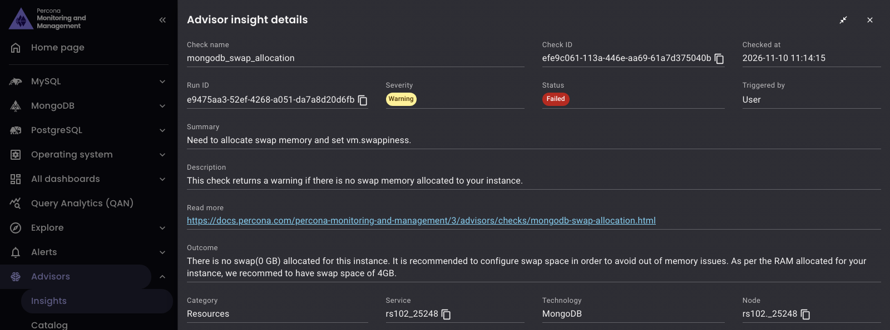
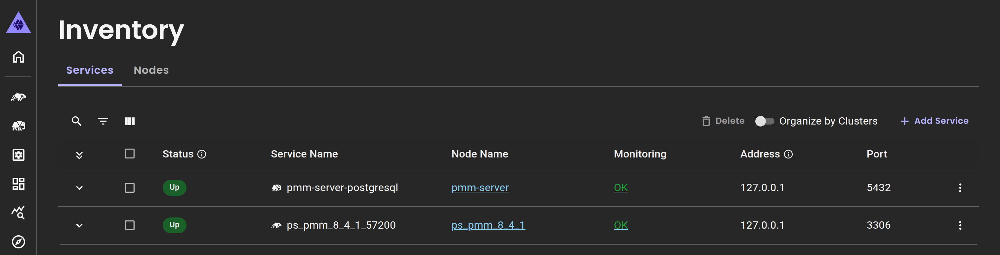
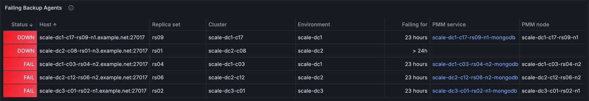

# Percona Monitoring and Management 3.11.0

**Release date**: 26 November 2026

Percona Monitoring and Management (PMM) is an open source solution for monitoring and managing MySQL, PostgreSQL, MongoDB, Valkey, and Redis databases, on premises or in the cloud.

## 📋 Release summary

PMM 3.11.0 introduces alerts on slow queries from Query Analytics data, smarter Advisors that run on schedule and email their results, and a native PMM UI Inventory page.

This release also adds the `pmm-admin update` command, deprecates PostgreSQL 14 in PMM Server and VictoriaMetrics downsampling, and includes security fixes for ClickHouse and nginx, along with improvements and bug fixes across all deployments.

## ✨ Release highlights

### Alert on slow queries with Query Analytics data

In addition to alerting you about server and database health based on the metrics it collects, PMM can now also alert you about query performance, based on the query data you see in Query Analytics.

The new built-in [**QAN slow queries**](../alert/templates_list.md#qan_alerts) template covers the most common case: it alerts you when the slowest query on a MySQL, PostgreSQL or MongoDB service runs longer than 10 seconds.

To get started, [set up alerts on Query Analytics data](../alert/alert_rules.md#set-up-query-performance-alerts) using the built-in template or your own.

### Smarter Advisors that run on schedule, email results and suggest fixes

You no longer need to open PMM to find out what Advisors found. [Schedule checks](../advisors/schedule-advisor-checks.md) to run when it suits your team, on the services that matter to you, and PMM can [email you a report](../advisors/advisors.md#get-advisor-results-by-email) after each run.

For anything the built-in checks don't cover, [write your own checks](../advisors/develop-advisor-checks.md) and test them on a service before you save them.

When you need to follow up on an issue, the new **Insights** page shows which services it affects, when it was found and, for most built-in checks, how to fix it:

#### What changes when you upgrade

Upgrading to PMM 3.11.0 changes your existing Advisor settings, dashboards and API calls:

- Schedules replace run intervals. By default, the **All checks daily** schedule runs every check at 06:00 UTC. If you used custom intervals, [recreate them as schedules](../advisors/schedule-advisor-checks.md#create-a-schedule).
- All checks run again, including the ones that you turned off. [Turn them off again](../advisors/advisors.md#turn-off-checks-that-dont-apply) in **Advisors > Catalog**.
- **Advisors > Insights** replaces the Advisor panels on the **Home** and **Environments Overview** dashboards. Review findings there instead.
- New endpoints replace some Advisor API endpoints. If your scripts call the Advisor API, [switch to the new endpoints](https://percona-pmm.readme.io/v3/reference/release-notes-3-11-0).

#### One version check for each database

When a database needs an upgrade, Advisors now give you one clear finding instead of several overlapping ones. The separate checks for newer versions, end of life and known vulnerabilities are replaced with a single version check for each database: [MySQL version check](../advisors/checks/mysql-version.md), [MongoDB version check](../advisors/checks/mongodb-version.md) and [PostgreSQL version check](../advisors/checks/postgresql-version-check.md).

Each check tells you whether a newer version is available, and whether your current version has reached end of life (EOL) or reaches it within six months. The finding also explains why an upgrade matters and gives you what you need to plan it, such as what changes in the newer version, how long your current version is supported, or which security fixes your version is missing.

This release also fixes six other MongoDB and PostgreSQL checks that failed or gave wrong results on default setups.

##### What to expect after you upgrade

After you upgrade to PMM 3.11.0, you will see fewer version checks in **Advisors > Catalog** and new errors in **Advisors > Insights**:

- Databases on a version that reached EOL in recent years now show an error. The old checks used outdated EOL dates, so they missed these versions:
    - MySQL 8.0, including Percona Server for MySQL and Percona XtraDB Cluster 8.0
    - MongoDB 5.0, 6.0 and 8.2
    - PostgreSQL 11 to 14
    - MariaDB 10.6
    - Amazon RDS for MySQL versions past standard support, as "end of standard support"
    - MongoDB 4.4 and PostgreSQL 10 and older, which showed a warning until now
- Eight older version checks are removed, and the new check for the same database replaces them:
    - `mongodb_EOL`, `mongodb_cve_version` and `mongodb_unsupported_version`: replaced by the **MongoDB version check**
    - `mysql_unsupported_version_check` and `mysql_version_eol_57`: replaced by the **MySQL version check**
    - `postgresql_cve_check`, `postgresql_eol_check` and `postgresql_unsupported_check`: replaced by the **PostgreSQL version check**

    If you turned off one of these checks, turn off its replacement instead. For example, if you turned off `mongodb_EOL` to stop end-of-life findings for a MongoDB version that you plan to keep, turn off the **MongoDB version check**.

- `mongodb_cve_version` and `postgresql_cve_check` listed specific vulnerabilities (CVEs), but their lists were no longer kept up to date. Instead, when your version is missing security fixes, all three version checks tell you and link to the vendor's security page, where you can see which vulnerabilities affect your version.

### Inventory page now in native PMM UI

PMM has used [its own navigation](3.6.0.md#new-native-pmm-navigation-and-revamped-user-interface) instead of Grafana's menus since 3.6.0, and its pages are gradually moving from Grafana to native PMM UI. [**Inventory**](../use/dashboard-inventory.md) now joins [**Updates**](3.0.0.md#new-upgrade-ui), Help, [**Real-Time Analytics**](3.7.0.md#real-time-query-analytics-rta-for-mongodb), [**Settings**](3.8.0.md#settings-page-now-in-native-pmm-ui) and [**Alerts > Status**](3.9.0.md#alert-status-page-view-alerts-by-node-or-service), which already run there.

You get the same services, nodes and agents, now with:

- filtered views that you can bookmark and share, while your existing bookmarks keep working
- credentials, TLS and query source settings that you can change without removing a service and adding it again
- a simpler layout, with the details and actions of each service and node right in its row:

    

### Change a monitored service from the command line without removing it

Rotating a password or renewing a certificate no longer means removing a service and adding it again, or changing its agents one by one with `pmm-admin inventory change agent`, which PMM 3.7.0 introduced.

With `pmm-admin update`, you change the settings of a monitored service in one command, and PMM applies them to all its agents. The service keeps its ID, so its metrics, Query Analytics history, alerts, and backups stay with it. It works for MySQL, PostgreSQL, MongoDB, Valkey, ProxySQL, HAProxy, and external services, and it changes only the flags that you pass.

Preview a change with `--dry-run` before you apply it. If you change the credentials, TLS settings, or address, PMM first checks the connection to the database, so a wrong value doesn't replace a working one. To get started, [change the settings of a monitored service](../use/commands/pmm-admin/update.md).

### Find failing MongoDB backup agents at a glance

If you manage a large MongoDB fleet, you can now see right away which backup agents need attention. The new **Failing Backup Agents** table on the **MongoDB Backup Details** dashboard lists only the failing agents and how long each one has been failing, so you no longer have to search the **Backup Agent Status** grid for them:

[Find your failing backup agents](../reference/dashboards/dashboard-mongodb-backup-details.md#failing-backup-agents) to get started.

### Added support and deprecations

#### PostgreSQL 14 deprecated in PMM Server

PostgreSQL recently [stopped supporting version 14](https://www.postgresql.org/support/versioning/), so it no longer gets security fixes. Because of this, PMM deprecates PostgreSQL 14 in PMM 3.11.0 and will remove it completely in PMM 3.13.0 (expected January 2027).

##### Impact on the built-in database

PMM already switched the built-in database of PMM Server to PostgreSQL 18 in PMM 3.10.0 and includes PostgreSQL 14 only to migrate existing data when upgrading from PMM 3.9.1 or earlier.

Once PMM 3.13.0 removes PostgreSQL 14, PMM can no longer migrate that data, so it can't upgrade a PMM Server that runs PMM 3.9.1 or earlier directly. If your PMM Server runs PMM 3.9.1 or earlier:

- before PMM 3.13.0: upgrade to PMM 3.11.0 or 3.12.x as usual. Your data moves to PostgreSQL 18 automatically.
- after PMM 3.13.0: [upgrade in two steps](../pmm-upgrade/prepare_postgresql_14_removal.md#if-you-upgrade-after-pmm-3130-is-out). First upgrade to a version from PMM 3.10.0 through 3.12.x, then to PMM 3.13.0 or later.

##### Impact on external databases

PMM 3.13.0 requires PostgreSQL 15 or later for external databases. If you configured PMM Server to use an external PostgreSQL database instead of the built-in one, and it runs an earlier version, upgrade it before you upgrade PMM Server to PMM 3.13.0.

#### VictoriaMetrics downsampling deprecated

PMM 3.11.0 deprecates two features of PMM's own build of VictoriaMetrics: downsampling and reading Prometheus data files. Both keep working in PMM 3.11.0, but PMM 3.12.0 will remove them completely, because it will switch to the official open source release of VictoriaMetrics, which doesn't include them. The switch lets PMM ship VictoriaMetrics fixes without waiting for a PMM-specific build.

Once PMM 3.12.0 is out:

- **Downsampling** (`VM_downsampling_period`): PMM ignores this setting, so new data stays at full resolution and needs more disk space. Data that is already downsampled stays downsampled.
- **Reading Prometheus data files** (`VM_prometheusDataPath`): PMM ignores this setting, so metrics stored in those files no longer appear in PMM.

If you use downsampling, [prepare before you upgrade to PMM 3.12.0](../reference/third-party/victoria.md#prepare-for-the-end-of-downsampling).

## 🔒 Security updates

### nginx HTTP/2 memory corruption ([CVE-2026-123007](https://nvd.nist.gov/vuln/detail/CVE-2026-123007), [-123633](https://nvd.nist.gov/vuln/detail/CVE-2026-123633))

[PMM-15947](https://perconadev.atlassian.net/browse/PMM-15947): Critical severity. PMM Server uses nginx for all connections to the PMM UI and API. An unauthenticated attacker who can reach PMM Server over HTTP or HTTPS could crash nginx, which makes PMM unavailable, or potentially run code on PMM Server.

#### Affected installations

All PMM Server deployments of PMM 3.10.0 and earlier. The risk depends on who can reach PMM Server over HTTP or HTTPS:

- PMM Server reachable only from trusted networks: lower risk.
- PMM Server reachable from untrusted networks or the internet: upgrade as soon as possible.

#### How to fix

Upgrade to PMM 3.11.0. It includes nginx 1.30.7, which has the fixes from the [nginx security advisories](https://nginx.org/en/security_advisories.html). Earlier versions installed nginx from the Oracle Linux packages, which didn't have these fixes yet, so for this release, PMM installs it from the nginx.org stable repository instead.

How you upgrade depends on how you deploy PMM:

- PMM Server on Docker, Podman, AWS or Kubernetes: [upgrade PMM Server](../pmm-upgrade/index.md).
- PMM HA cluster on PMM 3.10.0: [upgrade the `pmm-ha` Helm chart](../pmm-upgrade/upgrade_helm_ha.md).
- PMM HA cluster on PMM 3.9.1 or earlier: you can't upgrade this cluster, because PMM HA was a Tech Preview before PMM 3.10.0 and didn't support upgrades. Instead, [install a new PMM HA cluster](../install-pmm/install-HA-clustered.md) with PMM 3.11.0. The new cluster starts without the monitoring data of the old one.

#### How to reduce risk

Until you upgrade, allow connections to PMM Server only from trusted networks. An attacker needs to reach PMM Server over the network to exploit these vulnerabilities.

### ClickHouse remote code execution ([CVE-2026-116366](https://nvd.nist.gov/vuln/detail/CVE-2026-116366))

CRITICAL severity. An unauthenticated attacker who can reach ClickHouse Server over the network can execute arbitrary code on the server.

#### Affected installations

The risk depends on how you deploy PMM:

- **PMM Server as a single container**: Low risk. ClickHouse accepts connections only from within the container by default.
- **PMM HA**: Affected. Other pods in the cluster can reach ClickHouse. Upgrade as soon as possible.
- **PMM with an external ClickHouse**: Affected if your ClickHouse version doesn't include the fix.

#### Mitigation options

To fix the vulnerability, upgrade to a ClickHouse version that includes the fix. Upgrading keeps your Query Analytics data, but you can't go back to the older ClickHouse version afterwards. To upgrade safely:
{.power-number}

1. Back up PMM Server on [Docker](../install-pmm/install-pmm-server/deployment-options/docker/backup_container.md), [Podman](../install-pmm/install-pmm-server/deployment-options/podman/backup_container_podman.md), [Helm](../install-pmm/install-pmm-server/deployment-options/helm/backup_container_helm.md) or a [PMM HA cluster](../install-pmm/backup-restore-HA-clustered.md#back-up-pmm-ha-cluster).
2. Upgrade, depending on how you deploy PMM:
    - PMM Server as a single container: [upgrade to PMM 3.11.0](../pmm-upgrade/index.md), which includes ClickHouse 26.3.62.3.
    - PMM HA: [upgrade the `pmm-ha` Helm chart](../pmm-upgrade/upgrade_helm_ha.md) to version 1.9.0, which installs PMM 3.11.0 and includes ClickHouse Altinity Stable 26.3.60.10002. The upgrade restarts the ClickHouse and ClickHouse Keeper pods one at a time, and Query Analytics keeps collecting data.
    - PMM with an external ClickHouse: upgrade your ClickHouse to a fixed release, such as 26.3.62.3 or a later 26.3 release. To find the fixed release for your version, check the [ClickHouse security changelog](https://clickhouse.com/docs/resources/changelogs/security-changelog).

### Go standard library HTTP/1 server crash ([CVE-2026-97054](https://nvd.nist.gov/vuln/detail/CVE-2026-97054))

Fixed in `pmm-managed`, `pmm-agent`, `pmm-admin`, `qan-api2`, and `vmproxy` by rebuilding on Go 1.27.4.

### Grafana anonymous access exposed PMM features ([PMM-15339](https://perconadev.atlassian.net/browse/PMM-15339))

When [Grafana anonymous access](../install-pmm/install-pmm-server/deployment-options/docker/env_var.md#supported-external-variables) was turned on, visitors who weren't signed in could also use PMM features such as Query Analytics. Now they can open only your dashboards.

### Other dependency updates

- [PMM-18742](https://perconadev.atlassian.net/browse/PMM-18742): Updated the Grafana ClickHouse data source plugin to v4.23.5, built with Go 1.27.3. This fixes the high-severity Go vulnerabilities that image scanners reported in v4.21.3, including [CVE-2026-78669](https://nvd.nist.gov/vuln/detail/CVE-2026-78669), [CVE-2026-78661](https://nvd.nist.gov/vuln/detail/CVE-2026-78661) and the standard library findings listed in the [PMM 3.10.0 release notes](3.10.0.md#go-standard-library-vulnerabilities-in-the-clickhouse-data-source).
- [PMM-15766](https://perconadev.atlassian.net/browse/PMM-15766): Updated Grafana to 12.4.14. This fixes the Grafana vulnerabilities listed in the [PMM 3.10.0 release notes](3.10.0.md#remaining-third-party-security-risks), including the critical `kin-openapi` authentication bypass ([GHSA-r277-6w6q-xmqw](https://github.com/advisories/GHSA-r277-6w6q-xmqw)). Security scanners still report [CVE-2026-21728](https://nvd.nist.gov/vuln/detail/CVE-2026-21728) and [CVE-2026-28377](https://nvd.nist.gov/vuln/detail/CVE-2026-28377) (Grafana Tempo), [CVE-2026-116587](https://nvd.nist.gov/vuln/detail/CVE-2026-116587) (`go-jose`), and [CVE-2026-78661](https://nvd.nist.gov/vuln/detail/CVE-2026-78661) (`golang.org/x/net`) in Grafana.
- [PMM-15842](https://perconadev.atlassian.net/browse/PMM-15842): Updated `golang.org/x/net` to v0.62.0 in `pmm-managed`, `qan-api2`, `pmm-agent`, `pmm-admin`, and the MongoDB, MySQL, Node, and PostgreSQL exporters. This fixes [CVE-2026-78661](https://nvd.nist.gov/vuln/detail/CVE-2026-78661).
- [PMM-15225](https://perconadev.atlassian.net/browse/PMM-15225), [PMM-15842](https://perconadev.atlassian.net/browse/PMM-15842): Updated VictoriaMetrics to 1.156.0. This fixes [CVE-2026-78661](https://nvd.nist.gov/vuln/detail/CVE-2026-78661), [CVE-2026-78669](https://nvd.nist.gov/vuln/detail/CVE-2026-78669), [CVE-2026-78667](https://nvd.nist.gov/vuln/detail/CVE-2026-78667), and [CVE-2026-97031](https://nvd.nist.gov/vuln/detail/CVE-2026-97031) in VictoriaMetrics, vmalert, and vmagent.
- [PMM-15761](https://perconadev.atlassian.net/browse/PMM-15761): Rebuilt PMM Server, PMM Client, and PMM Dump on Go 1.27.3. This fixes the certificate validation issue [CVE-2026-111943](https://nvd.nist.gov/vuln/detail/CVE-2026-111943).
- [PMM-18742](https://perconadev.atlassian.net/browse/PMM-18742): Updated [Nomad](../reference/nomad.md) to 2.1.1, which fixes [CVE-2026-78669](https://nvd.nist.gov/vuln/detail/CVE-2026-78669) and the `go-jose/v4` finding for [CVE-2026-116587](https://nvd.nist.gov/vuln/detail/CVE-2026-116587). Security scanners still report CVE-2026-116587 for Nomad's `go-jose/v3`, which has no fixed release.

### Residual security risk

As part of modern software development, complex systems commonly rely on third-party components, and some level of residual risk may remain at release time despite ongoing vulnerability management.

This is particularly the case when vulnerabilities in upstream dependencies are disclosed close to a planned release.

The CVEs below remain present in third-party dependencies included with PMM Server, PMM Client, or the separately packaged PMM Extensions image. Their impact depends on the features you enable, the inputs that reach the affected code, and your deployment's network boundaries. The component details and mitigating factors explain those conditions without treating a package version match as proof of exploitability.

We will continue to monitor upstream disclosures, reassess their impact on PMM, and remediate in future releases.

#### JSON Web Key parsing in Grafana and Nomad ([CVE-2026-116587](https://nvd.nist.gov/vuln/detail/CVE-2026-116587))

##### Affected components

Grafana includes `github.com/go-jose/go-jose/v4` v4.1.4; the upstream fix is in v4.1.6. Nomad in PMM Server and PMM Client includes `github.com/go-jose/go-jose/v3` v3.0.5. The [upstream advisory](https://github.com/go-jose/go-jose/security/advisories/GHSA-mgcc-cww5-fp2q) lists no patched v3 release.

##### PMM-specific context

Crafted RSA parameters in a JSON Web Key (JWK) can cause excessive CPU consumption during parsing, before successful signature verification. Grafana's JWT authentication path uses this parser, but JWT authentication is disabled by default. Enabling it changes the exposure assessment; requiring a valid token afterwards does not prevent the parsing cost.

Nomad also uses go-jose in identity-related code. Its presence does not establish that an untrusted caller can reach the affected parser in your PMM configuration. Review deployments that enable Nomad-backed functionality separately.

##### Mitigating factors

The following factors reduce exposure:

- Keep unused authentication methods and optional services disabled.
- Restrict PMM and Nomad access to trusted networks, and review any custom JWT authentication configuration.

##### Remediation plan

Percona builds its Grafana fork from source, so the available v4.1.6 fix can be integrated and tested without waiting for an upstream Grafana binary release. Nomad's v3 dependency requires an upstream migration or a tested backport; a patched v3 release is not listed. These are different remediation paths, not a shared absence of an upstream fix.

#### HTML parser denial of service in Grafana ([CVE-2026-78661](https://nvd.nist.gov/vuln/detail/CVE-2026-78661))

##### Affected component

The Grafana binary in PMM Server includes `golang.org/x/net` v0.60.0. The fix is available in v0.62.0 or later.

##### PMM-specific context

Crafted HTML can cause excessive CPU and memory consumption if it reaches the affected `html.Parse` or fragment-parsing functions. The dependency version match does not establish an attacker-controlled input path to those functions in PMM.

##### Mitigating factors

The following controls limit exposure and resource exhaustion:

- Restrict access to PMM to trusted networks and users.
- Apply container resource limits where possible; these do not fix the parser or prevent all denial-of-service effects.

##### Remediation plan

The fix is available in `golang.org/x/net` v0.62.0 or later and requires a Grafana dependency update and rebuild. Updating nginx or the Go compiler alone does not update this separately pinned module.

#### Grafana Tempo denial of service and information disclosure ([CVE-2026-21728](https://nvd.nist.gov/vuln/detail/CVE-2026-21728) and [CVE-2026-28377](https://nvd.nist.gov/vuln/detail/CVE-2026-28377))

##### Affected component

The Grafana binary in PMM Server includes `github.com/grafana/tempo` v1.5.1-0.20260427112133-525d1bab07e0, which security scanners flag for both advisories.

##### PMM-specific context

The first concerns unbounded allocations when a Tempo backend processes queries with large limits. The second concerns disclosure of a configured S3 SSE-C key through a Tempo backend's `/status/config` endpoint.

PMM's Grafana uses Tempo protocol types in its data source client. That is not equivalent to running a Tempo backend. A module version match does not demonstrate that either vulnerable backend handler is available inside PMM. A definitive not-affected assessment requires confirmation that the affected code is absent or unreachable in the shipped build.

##### Mitigating factors

The affected functionality depends on a Tempo backend:

- Using Tempo protocol types does not itself expose the Tempo backend query or configuration endpoints.
- An external Tempo service is a separate component; restrict access to its endpoints and assess its configuration independently.

##### Remediation plan

Complete the applicability assessment for the embedded Tempo code before treating these findings as not affected. If you connect Grafana to an external Tempo service, update that service using the [Tempo security advisories](https://grafana.com/security/security-advisories/). The listed fixes include Tempo 2.8.4, 2.9.2, or 2.10.2 for the query issue, and 2.10.3 for the disclosure.

#### OpenSSL QUIC denial of service in PMM Extensions ([CVE-2026-107494](https://nvd.nist.gov/vuln/detail/CVE-2026-107494) and [CVE-2026-124709](https://nvd.nist.gov/vuln/detail/CVE-2026-124709))

##### Affected component

The separate PMM Extensions image includes `libssl3t64`, `openssl`, and `openssl-provider-legacy` version `3.5.9-1~deb13u1`.

##### PMM-specific context

Both advisories concern memory exhaustion in OpenSSL's QUIC implementation, rather than ordinary TLS connections in general. Exposure requires use of the affected QUIC functionality. The installed packages alone do not establish that Extensions exercises those paths.

##### Mitigating factors

The following controls limit exposure:

- Do not enable unused QUIC functionality.
- Restrict network access to Extensions and apply container resource limits.

##### Remediation plan

Update the Extensions image when fixed Debian packages are available. No fixed Debian version is listed in the current package assessment; this does not establish that upstream OpenSSL fixes are unavailable. Confirm the application's QUIC usage before assigning a not-affected status.

#### SQLite memory corruption in PMM Extensions

Tracked as [CVE-2026-119373](https://nvd.nist.gov/vuln/detail/CVE-2026-119373), [CVE-2026-119374](https://nvd.nist.gov/vuln/detail/CVE-2026-119374), and [CVE-2026-119379](https://nvd.nist.gov/vuln/detail/CVE-2026-119379).

##### Affected component

The separate PMM Extensions image includes `libsqlite3-0` version `3.46.1-7+deb13u2`.

##### PMM-specific context

These issues require particular FTS5 operations, a crafted database, or session changesets. The package match does not establish that Extensions accepts those inputs or invokes the affected functionality.

##### Mitigating factors

The following controls limit exposure:

- Do not process untrusted SQLite database files or session changesets.
- Restrict access to Extensions and its persistent storage.

##### Remediation plan

Assess the SQLite features used by Extensions and update its base-image packages when a fixed Debian build is available. No fixed Debian package version is listed in the current assessment.

#### ACL pathname traversal in PMM Extensions ([CVE-2026-54369](https://nvd.nist.gov/vuln/detail/CVE-2026-54369))

##### Affected component

The separate PMM Extensions image includes `libacl1` version `2.3.2-2+b1`.

##### PMM-specific context

Exploitation requires attacker-controlled path components to be processed by a privileged caller using affected pathname-based ACL functions. Extensions runs as the `extensions` user by default. The package match alone does not establish a privileged caller or attacker-controlled path in the application.

##### Mitigating factors

The following defaults and controls reduce exposure:

- Retain the image's non-root user and avoid granting unnecessary privileges.
- Keep application paths and mounted directories inaccessible to untrusted writers.

##### Remediation plan

Review any privileged ACL operations and update `libacl1` when a fixed Debian package is available. No fixed Debian package version is listed in the current assessment.

#### systemd-homed privilege escalation finding in PMM Extensions ([CVE-2026-16742](https://nvd.nist.gov/vuln/detail/CVE-2026-16742))

##### Affected component

Security scanners flag `libsystemd0` and `libudev1` version `257.13-1~deb13u1` in the separate PMM Extensions image.

##### PMM-specific context

The advisory concerns local privilege escalation in `systemd-homed` for a logged-in, homed-managed user. The `systemd-homed` executable is absent from the assessed image. Having the related shared libraries installed is not equivalent to running the affected home-management service.

##### Mitigating factors

The reported attack requires functionality absent from the assessed image:

- The image does not contain the `systemd-homed` executable.
- The image starts Extensions under its non-root `extensions` user.

##### Remediation plan

Retain this applicability distinction in the component assessment and update the base-image libraries through normal maintenance. Reassess if a customized image adds `systemd-homed`.

#### ncurses tool buffer overflow finding in PMM Extensions ([CVE-2025-69720](https://nvd.nist.gov/vuln/detail/CVE-2025-69720))

##### Affected component

Security scanners flag `libtinfo6` version `6.5+20250216-2` in the separate PMM Extensions image.

##### PMM-specific context

The advisory concerns a stack-based buffer overflow in the `infocmp` command-line tool. That executable is absent from the assessed Extensions image. The installed terminal library does not establish the presence of the affected tool.

##### Mitigating factors

The reported attack requires functionality absent from the assessed image:

- The image does not contain the `infocmp` executable.
- The advisory identifies a command-line tool path, not every use of the terminal library.

##### Remediation plan

Keep the base-image library current and reassess if a customized image adds `infocmp`. Do not treat the library package match alone as proof that Extensions contains the vulnerable command.

#### Zstandard information disclosure in PMM Extensions ([CVE-2026-124851](https://nvd.nist.gov/vuln/detail/CVE-2026-124851))

##### Affected component

The separate PMM Extensions image includes `libzstd1` version `1.5.7+dfsg-1`. The listed Debian fix is `1.5.7+dfsg-1+deb13u1`.

##### PMM-specific context

Crafted compressed input can disclose buffer contents when an attacker can observe decompressed output. The dependency match does not establish that Extensions processes attacker-controlled Zstandard data or returns the triggering output.

##### Mitigating factors

The following controls limit exposure:

- Do not decompress data from untrusted sources where possible.
- Restrict access to Extensions and to inputs it processes.

##### Remediation plan

Update `libzstd1` to `1.5.7+dfsg-1+deb13u1` or a later fixed Debian build and rebuild the Extensions image. This fix is already listed; it is not waiting for an unavailable upstream patch.

#### How to reduce your exposure now

While dependency updates and applicability assessments are pending, you can lower your risk by:

- restricting network access to PMM, Extensions, and internal component ports to trusted networks and users
- keeping the number of PMM administrators small and enforcing strong authentication
- leaving unused authentication methods, data sources, and optional services disabled
- applying container resource limits where possible, without treating them as a substitute for dependency updates

## 🧩 API changes

If your scripts or integrations call the PMM API, check whether these changes affect them:

- New Advisor endpoints replace the old ones, and the `advisor_run_intervals` setting and the `interval` field of checks are removed. If your scripts call the Advisor API, [switch to the new endpoints](https://percona-pmm.readme.io/v3/reference/release-notes-3-11-0).

- Requests to the PMM API without credentials now fail, even when Grafana anonymous access is enabled. This is part of the fix for [PMM-15339](https://perconadev.atlassian.net/browse/PMM-15339), which lets visitors who aren't signed in view your dashboards and nothing else.

- With access control enabled, the Query Analytics and metrics query APIs now refuse service account tokens, so automation can't read data that your access roles restrict.

- `GET /v1/ha/nodes` now also lists the PMM HA nodes that are down, with the status `dead` or `left`. If your automation counts the listed nodes to check the cluster health, count only the nodes with the status `alive`.

To find the affected endpoints and update your automation, [check the PMM API release notes](https://percona-pmm.readme.io/v3/reference/release-notes-3-11-0).

## 📈 Improvements

### Alerting and Advisors

- [PMM-15193](https://perconadev.atlassian.net/browse/PMM-15193): The **Expression** panel on the **Alerts > Status** page now shows each step of an alert rule, including the query it runs and the step that fires the alert, so you can see why an alert fired.
- [PMM-15239](https://perconadev.atlassian.net/browse/PMM-15239): The **Alerts > Status** page now groups alert severities into [four bands](../alert/alert_rules.md): **Critical**, **Error**, **Warning** and **Info**. Each band has its own icon and label, so you can tell severities apart without relying on color. The **Severity** filter and sort work by band, and the alert details show the original level, for example **Reported as Emergency**. Alert labels stay the same.
- [PMM-14109](https://perconadev.atlassian.net/browse/PMM-14109): Advisors now email a report after each run, keep a history of insights and runs, [run checks on schedules](#smarter-advisors-that-run-on-schedule-email-results-and-suggest-fixes) instead of fixed intervals, and support custom checks. The upgrade removes the run intervals and some Advisor API endpoints, and enables every check again.

### Inventory and services

- [PMM-15002](https://perconadev.atlassian.net/browse/PMM-15002): The **Inventory** page now runs in [native PMM UI](#inventory-page-now-in-native-pmm-ui), so it looks and works like the rest of the PMM interface. You can also bookmark and share filtered views of your services and nodes, and your existing Inventory bookmarks keep working.
- [PMM-15674](https://perconadev.atlassian.net/browse/PMM-15674): You can now change how PMM monitors a service without removing the service and adding it again, so it keeps its ID and its history. In **Inventory**, [edit the service](../use/dashboard-inventory.md#edit-a-service) to change its credentials, TLS settings, Query Analytics source and options, metrics mode, log level and exporter options, as well as its labels.
- [PMM-14146](https://perconadev.atlassian.net/browse/PMM-14146): You can now [change a monitored service](#change-a-monitored-service-from-the-command-line-without-removing-it) and all its agents with one command, `pmm-admin update`, instead of changing each agent with `pmm-admin inventory change agent`. Changing a service's cluster removes the scheduled backups of every service in its current and its new cluster.
- [PMM-15481](https://perconadev.atlassian.net/browse/PMM-15481): You can now export services from **Inventory > Services** to a [CSV file](../use/dashboard-inventory.md#export-services-to-a-csv-file). Click **Export** to download the selected services, or every service that matches the search and filters. Each row includes the status, the monitoring status, the agents that failed, and the labels of the service.

### MongoDB monitoring

- [PMM-15484](https://perconadev.atlassian.net/browse/PMM-15484): You can now find the broken backup agents without scanning the healthy ones. The new **Failing Backup Agents** table on the [MongoDB Backup Details](../reference/dashboards/dashboard-mongodb-backup-details.md#failing-backup-agents) dashboard lists only the PBM agents in **FAIL** or **DOWN** state.
- [PMM-15595](https://perconadev.atlassian.net/browse/PMM-15595): You can now follow a Percona ClusterSync for MongoDB migration from one dashboard. The new [MongoDB ClusterSync Details](../reference/dashboards/dashboard-mongodb-clustersync-details.md) dashboard shows the source cluster, the sync, and the target cluster side by side, so you can check that the migration is healthy, follow its progress, and find where a slow or stuck sync loses time. It works with ClusterSync 1.0.0 or later. To use it, [add each ClusterSync instance as an external service](../install-pmm/install-pmm-client/connect-database/external.md#monitor-percona-clustersync-for-mongodb), then open **MongoDB > ClusterSync**.
- [PMM-15682](https://perconadev.atlassian.net/browse/PMM-15682): You can now find the MongoDB queries to optimize first from one dashboard. The new [MongoDB Top Queries](../reference/dashboards/dashboard-mongodb-top-queries.md) dashboard ranks queries by time spent, executions, and documents examined, and also lists collection scans, the busiest collections, and the users who run the most queries. Open it from **MongoDB > Top queries**.

### Operations for MongoDB

- [PMM-15805](https://perconadev.atlassian.net/browse/PMM-15805): You can now see why a service is failing in [Operations for MongoDB](../use/mongodb-operations.md#a-service-is-failing). On **MongoDB > Operations > Fleet > Services**, the **Collected** column shows the reason, such as **Database unreachable**, and clicking the service's status shows the full error and what to do about it.
- [PMM-15699](https://perconadev.atlassian.net/browse/PMM-15699): You can now tell who changed what in [Operations for MongoDB](../use/mongodb-operations.md). PMM Extensions records each change under the PMM user who made it and checks that user's role, instead of a shared internal identity. If your scripts call the Operations API for nodes, scans, installs or settings with a username and password, [switch to a service account token](../api/authentication.md#generate-a-service-account-and-token), because those requests now get `401 Unauthenticated`.
- [PMM-15825](https://perconadev.atlassian.net/browse/PMM-15825): Viewer and Editor users can now check MongoDB cluster health in [Operations for MongoDB](../use/mongodb-operations.md), which only Admins could use until now. They can open every page except the install form. Starting or aborting installs, removing node entries and changing settings still need the Admin role, and scanning nodes now needs it too.
- [PMM-15797](https://perconadev.atlassian.net/browse/PMM-15797): [Operations for MongoDB](../use/mongodb-operations.md) now checks the OS release of each node before an install. It blocks a node on an [unsupported release](../use/mongodb-operations.md#supported-os-releases), such as Ubuntu 20.04, and offers only the MongoDB versions that all your selected nodes support. Before, an install onto an unsupported release could put an old MongoDB build on the node or fail partway through.
- [PMM-15806](https://perconadev.atlassian.net/browse/PMM-15806): You can now [search the **Clusters** tab](../use/mongodb-operations.md#view-fleet-health) on **MongoDB > Operations > Fleet** by cluster name and filter it by **Health**, **Type**, and **Environment**. The search and filters are saved in the page URL, so you can share a filtered view. Each cluster shows its type next to its name. The column chooser also adds optional **Type**, **Last seen**, **Max CPU**, and **Min conn. free** columns.

### Security and privacy

- [PMM-14023](https://perconadev.atlassian.net/browse/PMM-14023): Users with basic authentication can no longer set weak passwords. New and changed passwords need at least 12 characters, with uppercase and lowercase letters, a digit and a symbol. Existing passwords keep working until you change them. If your scripts create users or change passwords, for example with `change-admin-password`, [update them to use passwords that meet the requirements](../admin/manage-users/add_users.md#password-requirements).
- [PMM-15891](https://perconadev.atlassian.net/browse/PMM-15891): Your passwords and Grafana secret key are no longer in PMM Server's service environments or configuration files. PMM Server copies them from your environment variables to files that only it can read. To also hide them from the container settings, for example in `docker inspect`, you can now [provide them in files](../admin/security/credentials_as_files.md) instead of environment variables.

    To make sure that PMM Server starts after the upgrade, check your database passwords for spaces or line breaks at the start or end, and [remove them before you upgrade](../admin/security/credentials_as_files.md#remove-whitespace-from-database-passwords).

- [PMM-15908](https://perconadev.atlassian.net/browse/PMM-15908): [Telemetry](../configure-pmm/advanced_settings.md#telemetry) no longer includes the names of your custom Advisor checks or the services that they ran on. For Advisors, it now reports only usage, such as the number of insights for each built-in check, the number of findings in the last 24 hours, and which built-in checks are turned off.

### PMM Server, apps and documentation

- [PMM-15013](https://perconadev.atlassian.net/browse/PMM-15013): The PMM Server Docker image is now about 60 MiB smaller to download, because it no longer includes tools that PMM doesn't use while running. This includes the `dnf` package manager, so if you use `dnf` to install packages inside the container, first install it as root, for example with `docker exec -u root pmm-server microdnf install -y dnf`.
- [PMM-15846](https://perconadev.atlassian.net/browse/PMM-15846): The execution history of PMM Extensions apps, such as **MySQL Backups**, now shows a [warning icon](../apps/mysql-backup.md#spot-incomplete-logs) beside the status of a finished run whose logs were partly or wholly lost before PMM could store them, so you can spot it without opening the run. Hover over or tab to the icon for details.
- [PMM-13820](https://perconadev.atlassian.net/browse/PMM-13820): You can now find every environment variable that PMM Client accepts in the [pmm-agent configuration topic](../use/commands/pmm-agent.md#options-and-environment). The [Docker example](../install-pmm/install-pmm-client/docker.md#add-monitoring-services) for adding services at startup now correctly uses `PMM_AGENT_PRERUN_FILE` for the script file instead of `PMM_AGENT_PRERUN_SCRIPT`, which is meant for commands.

## ✅ Fixed issues

### High availability and server reliability

- [PMM-15785](https://perconadev.atlassian.net/browse/PMM-15785): Fixed an issue in PMM High Availability setups where the [PMM Query Analytics](../use/qan/index.md) dashboard could miss queries or show changing totals. This could happen after installation, a pod restart, or a restore, when the ClickHouse servers that store QAN data ended up with mismatched copies of the data. PMM now checks the copies every 10 minutes and keeps the one with the most data. Data that exists only in the other copies is deleted. You can [check whether your installation is affected](../troubleshoot/ha_issues.md#query-analytics-shows-different-data-on-different-pmm-nodes) and see how much data PMM removed.
- [PMM-15787](https://perconadev.atlassian.net/browse/PMM-15787): Fixed an issue where PMM HA could become unavailable for several minutes even when two of its three nodes were running. This could happen when the cluster first lost one node and then its leader node. The cluster removed the first failed node, so the running nodes couldn't elect a new leader. PMM HA now keeps a node that fails in the cluster, so the running nodes elect a new leader within seconds. Because the node stays in the cluster, the `/v1/ha/nodes` endpoint now also lists it, with the status `dead`. [Check the cluster health](../troubleshoot/ha_issues.md#check-cluster-health) to see which node to bring back.
- [PMM-15910](https://perconadev.atlassian.net/browse/PMM-15910): Fixed an issue where PMM Server could stay unhealthy after an abrupt stop, for example `docker kill`, a host crash or running out of memory. The built-in PostgreSQL database refused to start because of lock files left over from the previous run. PMM Server now removes these files when it starts.
- [PMM-15918](https://perconadev.atlassian.net/browse/PMM-15918): Fixed an issue where PMM Server didn't start after you added your own SSL certificates with the `pmm` or `pmm-ha` Helm chart, or mounted them read-only on Docker. You can now [mount your certificates](../admin/security/ssl_encryption.md#mount-certificates) without making the certificate directory owned by PMM Server.

### Advisors, alerting and Query Analytics

- [PMM-15706](https://perconadev.atlassian.net/browse/PMM-15706): Fixed Advisor checks that used outdated end-of-life (EOL) dates and missed some [database versions that no longer get fixes](#one-version-check-for-each-database). Also fixed six checks that failed or gave wrong results on default setups: the MongoDB [multiple mongod services](../advisors/checks/multiple-mongod-running-in-a-node.md), [swap memory](../advisors/checks/mongodb-swap-allocation.md), [journal](../advisors/checks/mongodb-journal.md), [log level](../advisors/checks/mongodb-log-messages.md) and [maxSessions](../advisors/checks/mongodb-maxSessions.md) checks, and the PostgreSQL [WAL file accumulation](../advisors/checks/postgresql-wal-retention-check.md) check.
- [PMM-15272](https://perconadev.atlassian.net/browse/PMM-15272): Fixed an issue where CPU alerts and dashboards showed about half of the real value after an Amazon RDS blue/green switchover. PMM now ignores the metrics of the old instance, which AWS renames to `<name>-old1`.
- [PMM-15883](https://perconadev.atlassian.net/browse/PMM-15883): Fixed an issue where the [Query Analytics overview](../use/qan/panels/overview.md) table could show results that didn't match the current search, filters or time range when you changed them quickly, for example by changing the time range and then searching before the table reloaded. The table now always shows the results for your latest search, filters and time range, and keeps loading until those results arrive.

### Dashboards

- [PMM-15654](https://perconadev.atlassian.net/browse/PMM-15654): Fixed the [MongoDB Sharded Cluster Summary](../reference/dashboards/dashboard-mongodb-cluster-summary.md) dashboard hiding clusters added without `--environment` when **Environment** is set to **All** and another MongoDB service has an environment set. These clusters now appear under **All**.
- [PMM-15828](https://perconadev.atlassian.net/browse/PMM-15828): Fixed panels on the [MongoDB Sharded Cluster Summary](../reference/dashboards/dashboard-mongodb-cluster-summary.md), [MongoDB ReplSet Summary](../reference/dashboards/dashboard-mongodb-replset-summary.md), and [MongoDB Instances Overview](../reference/dashboards/dashboard-mongodb-instances-overview.md) dashboards that showed wrong values or ignored the **Environment** and **Cluster** filters, such as **Chunk distribution**, **Query Efficiency**, **Availability**, and **Time Since Election**. **DBs** now counts only user databases, the collection panels no longer list the `admin` and `config` databases, and **Chunks Move Events** and **Chunks Split Events** now show the number of events in the last 10 minutes. The service list on [MongoDB MMAPv1 Details](../reference/dashboards/dashboard-mongodb-mmapv1-details.md) now shows MMAPv1 services.
- [PMM-15559](https://perconadev.atlassian.net/browse/PMM-15559): Fixed an issue where the **Netstat: TCP** panel on the [Network Details](../reference/dashboards/dashboard-network-details.md) dashboard showed ever-growing totals instead of current activity. The panel now shows new connections, resets, and retransmits per second, so you can quickly spot spikes. Currently open connections are now shown on a separate scale on the right side of the chart, so you can compare them with new connections, resets, and retransmits. Thanks to Bastian Triller (Placetel) for reporting this and [contributing the fix](https://github.com/percona/pmm/pull/5913).

### Operations for MongoDB and apps

- [PMM-15772](https://perconadev.atlassian.net/browse/PMM-15772): Fixed an issue where you couldn't turn on Operations for MongoDB until you connected PMM Server to PMM Extensions manually. PMM Server now [connects to PMM Extensions automatically](../use/mongodb-operations.md#prepare-pmm-server). If you set `PMM_EXTENSIONS_URL`, `PMM_EXTENSIONS_TOKEN` and `EXTENSIONS_INTERNAL_TOKEN` for PMM 3.10.0, they keep working. If PMM still can't use PMM Extensions, turning on Operations for MongoDB now says why, for example that PMM Extensions is unreachable or rejects PMM's token.
- [PMM-15764](https://perconadev.atlassian.net/browse/PMM-15764): Fixed an issue where a MongoDB replica set that you installed with Operations for MongoDB on a port other than `27017` wasn't monitored, because PMM registered it for monitoring on port `27017`. PMM now monitors the replica set on the port you choose.
- [PMM-15860](https://perconadev.atlassian.net/browse/PMM-15860): Fixed **Automatic node scans** in **MongoDB > Operations > Settings** blocking **Scan** and **Scan all** on the **Nodes** page, and PMM turning automatic scans back on when it restarted. Turning off [**Automatic node scans**](../use/mongodb-operations.md#stop-automatic-scans) now stops only the scans PMM starts on its own: the scheduled scans, the scan after each restart, and the scan when Operations for MongoDB is turned on. The setting stays off until you turn it back on.
- [PMM-15801](https://perconadev.atlassian.net/browse/PMM-15801): Fixed arbiters showing as **mongod** with no member state on **MongoDB > Operations > Fleet**. An arbiter now shows **Arbiter** as its process and, while it's running, **ARBITER** as its member state. The cluster's **Process** column also counts it as an arbiter instead of a **mongod**. If an arbiter isn't in Fleet yet, [add it to PMM without a username and password](../install-pmm/install-pmm-client/connect-database/mongodb.md#step-3-add-mongodb-service-to-pmm).
- [PMM-15776](https://perconadev.atlassian.net/browse/PMM-15776): Fixed the description of the **Connect to MongoDB** option on the **MongoDB > Operations > Settings** page, which said that scans use the credentials PMM already has for your MongoDB services. Scans actually log in with a `.mongodb_uri` file on each MongoDB node. If MongoDB requires authentication and scans don't show the replica set state of your nodes, [create this file on each MongoDB node](../use/mongodb-operations.md#provide-mongodb-credentials-for-scans).
- [PMM-15845](https://perconadev.atlassian.net/browse/PMM-15845): Fixed an issue where forms in PMM Extensions apps, such as **Apps > MySQL Backups**, showed some errors only after you submitted the form, in a banner above the form instead of next to the fields to fix. These errors now appear next to the fields while you fill in the form.

## 🔶 Known issues

### PostgreSQL TLS connections fail when you skip verification and set a CA certificate ([PMM-15940](https://perconadev.atlassian.net/browse/PMM-15940))

If you add a PostgreSQL service with both `--tls-skip-verify` and `--tls-ca-file`, PMM still checks the server certificate against that CA. If the CA didn't sign the certificate, the connection fails. PMM can't collect metrics or Query Analytics data from that service.

To work around this, don't use `--tls-ca-file` with `--tls-skip-verify`.

## 🚀 Ready to upgrade to PMM 3.11.0?

- [New installation](../quickstart/quickstart.md)
- [Upgrading from PMM 3](../pmm-upgrade/index.md)
- [Upgrading from PMM 2](../pmm-upgrade/migrating_from_pmm_2.md)
