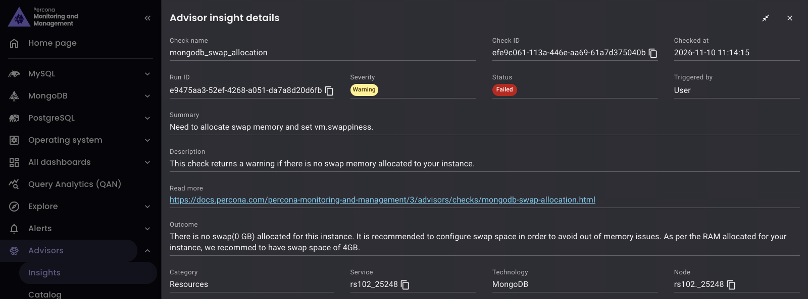
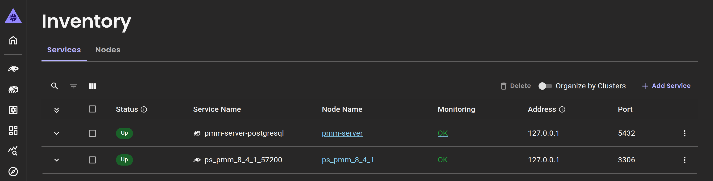

# Percona Monitoring and Management {{VERSION}}

**Release date**: TBD

Percona Monitoring and Management (PMM) is an open source database monitoring, management, and observability solution for MySQL, PostgreSQL, MongoDB, Valkey and Redis. PMM empowers you to:

- monitor the health and performance of your database systems
- identify patterns and trends in database behavior
- diagnose and resolve issues faster with actionable insights
- manage databases across on-premises, cloud, and hybrid environments

## 📋 Release summary

## ✨ Release highlights

### Smarter Advisors that run on schedule, email results and suggest fixes

You no longer need to open PMM to find out what Advisors found. [Schedule checks](../advisors/schedule-advisor-checks.md) to run when it suits your team, on the services that matter to you, and PMM can [email you a report](../advisors/advisors.md#get-advisor-results-by-email) after each run.

For anything the built-in checks don't cover, [write your own checks](../advisors/develop-advisor-checks.md) and test them on a service before you save them.

When you need to follow up on an issue, the new **Insights** page shows which services it affects, when it was found and, for most built-in checks, how to fix it:

#### What changes when you upgrade

Upgrading to PMM 3.11.0 changes your existing Advisor settings, dashboards and API calls:

- Schedules replace run intervals. By default, the **All checks daily** schedule runs every check at 06:00 UTC. If you used custom intervals, [recreate them as schedules](../advisors/schedule-advisor-checks.md#create-a-schedule).
- All checks run again, including the ones that you turned off. [Turn them off again](../advisors/advisors.md#turn-off-checks-that-dont-apply) in **Advisors > Catalog**.
- **Advisors > Insights** replaces the Advisor panels on the **Home** and **Environments Overview** dashboards. Review findings there instead.
- New endpoints replace some Advisor API endpoints. If your scripts call the Advisor API, switch to these endpoints:
    - `GET /v1/advisors/checks` instead of `GET /v1/advisors`
    - `GET /v1/advisors/insights` instead of `GET /v1/advisors/failedServices` and `GET /v1/advisors/checks/failed`
    - The `/v1/advisors/schedules` endpoints instead of the `advisor_run_intervals` setting and the `interval` field of checks

### Inventory page now in native PMM UI

PMM has used [its own navigation](3.6.0.md#new-native-pmm-navigation-and-revamped-user-interface) instead of Grafana's menus since 3.6.0, and its pages are gradually moving from Grafana to native PMM UI. [**Inventory**](../use/dashboard-inventory.md) now joins [**Updates**](3.0.0.md#new-upgrade-ui), **Help**, [**Real-Time Analytics**](3.7.0.md#real-time-query-analytics-rta-for-mongodb), [**Settings**](3.8.0.md#settings-page-now-in-native-pmm-ui) and [**Alerts > Status**](3.9.0.md#alert-status-page-view-alerts-by-node-or-service), which already run there.

You get the same services, nodes and agents, now with:

- filtered views that you can bookmark and share, while your existing bookmarks keep working
- a simpler layout, with the details and actions of each service and node right in its row:

    

## 🔒 Security updates

## 📈 Improvements

- [PMM-15239](https://perconadev.atlassian.net/browse/PMM-15239): The **Alert Status** page now groups alert severities into four bands: **Critical**, **Error**, **Warning** and **Info**. Each band has its own icon and label, so you can tell severities apart without relying on color. The **Severity** filter and sort work by band, and the alert details show the original level, for example **Reported as Emergency**. Alert labels stay the same. For how levels map to bands, see [Alert rules](../alert/alert_rules.md).
- [PMM-15805](https://perconadev.atlassian.net/browse/PMM-15805): The **Services** tab on **MongoDB > Operations > Fleet** now shows why a service is failing. The **Collected** column shows the reason, for example **Database unreachable**, and the service details show the full error, what to do about it, and a link to the scan that failed. A **Down** service whose `mongod` or `mongos` wasn't running at its last scan shows **not running**. The **Clusters** tab now warns when scan results can't be read. For details, see [Operations for MongoDB](../use/mongodb-operations.md#scans).
- [PMM-14109](https://perconadev.atlassian.net/browse/PMM-14109): Advisors now email a report after each run, keep a history of insights and runs, [run checks on schedules](#smarter-advisors-that-run-on-schedule-email-results-and-suggest-fixes) instead of fixed intervals, and support custom checks. The upgrade removes the run intervals and some Advisor API endpoints, and enables every check again.
- [PMM-15002](https://perconadev.atlassian.net/browse/PMM-15002): The **Inventory** page now runs in [native PMM UI](#inventory-page-now-in-native-pmm-ui), so it looks and works like the rest of the PMM interface. You can also bookmark and share filtered views of your services and nodes, and your existing Inventory bookmarks keep working.
- [PMM-15481](https://perconadev.atlassian.net/browse/PMM-15481): You can now export services from **Inventory > Services** to a CSV file. Click **Export** to download the selected services, or every service that matches the search and filters. Each row includes the status, the monitoring status, the agents that failed, and the labels of the service. For details, see [Export services to a CSV file](../use/dashboard-inventory.md#export-services-to-a-csv-file).
- [PMM-15699](https://perconadev.atlassian.net/browse/PMM-15699): **MongoDB > Operations** now calls PMM Extensions as the signed-in user, so PMM Extensions applies that user's role and records configuration changes under their name. API requests for nodes, scans, installs and settings must authenticate with a service account token or a PMM session. A request with a username and password gets `401 Unauthenticated`. For details, see [Operations for MongoDB](../use/mongodb-operations.md).
- [PMM-15825](https://perconadev.atlassian.net/browse/PMM-15825): Every signed-in PMM user can now open **MongoDB > Operations**. Viewers and Editors see every page except the install form. They can't scan nodes, start or abort installs, remove node entries, or change settings: those controls are disabled or hidden for them. Starting a scan now requires the Admin role, as installs already did. For details, see [Operations for MongoDB](../use/mongodb-operations.md).
- [PMM-15797](https://perconadev.atlassian.net/browse/PMM-15797): **MongoDB > Operations** now installs MongoDB only onto OS releases that Percona supports for the chosen version: MongoDB 7.0 onto Ubuntu 22.04 and 24.04 and Rocky Linux 8 and 9, and MongoDB 8.0 onto those and Rocky Linux 10. The **Nodes** page and the install form block a node on any other release, such as Ubuntu 20.04, and name the supported releases. The install form offers only the versions that every selected node supports. Before, an install onto Ubuntu 20.04 put an old MongoDB build on the node, and MongoDB 7.0 on Rocky Linux 10 failed partway through. For details, see [Operations for MongoDB](../use/mongodb-operations.md#check-nodes).
- [PMM-15846](https://perconadev.atlassian.net/browse/PMM-15846): The execution history of PMM Extensions apps, such as **MySQL Backups**, now shows a warning icon beside the status of a finished run whose logs were partly or wholly lost before PMM could store them, so you can spot it without opening the run. Hover over or tab to the icon for details. For more on task logs, see [Monitor backups](../apps/mysql-backup.md#monitor-backups).

## ✅ Fixed issues

- [PMM-15654](https://perconadev.atlassian.net/browse/PMM-15654): Fixed the [MongoDB Sharded Cluster Summary](../reference/dashboards/dashboard-mongodb-cluster-summary.md) dashboard hiding clusters added without `--environment` when **Environment** is set to **All** and another MongoDB service has an environment set. These clusters now appear under **All**.

- [PMM-15801](https://perconadev.atlassian.net/browse/PMM-15801): Fixed an arbiter added to PMM showing no member state and **mongod** as its process on **MongoDB > Operations > Fleet**. An arbiter now shows **Arbiter** as its process, and **ARBITER** as its member state while it is running. The cluster's **Process** summary counts it as an arbiter. For details, see [Operations for MongoDB](../use/mongodb-operations.md).

- [PMM-15776](https://perconadev.atlassian.net/browse/PMM-15776): Fixed misleading help on **MongoDB > Operations > Settings**. **Connect to MongoDB** now says that scans log in with the `.mongodb_uri` file in the home directory of the user pmm-agent runs as, not with the monitoring credentials PMM holds. The **Automatic node scans** setting is removed: turning it off also blocked **Scan** and **Scan all** on the **Nodes** page, and PMM turned it back on at every restart. For details, see [Operations for MongoDB](../use/mongodb-operations.md#provide-mongodb-credentials-for-scans).

- [PMM-15845](https://perconadev.atlassian.net/browse/PMM-15845): Fixed an issue where forms in PMM Extensions apps checked some rules that involve several fields only after you submitted the form, and then showed the error in a banner without marking a field. These rules are now checked while you fill in the form. For example, in **Apps > MySQL Backups**, choosing a GPG **Encryption format** with neither **Encrypt backup** nor **Encrypt after backup completes** turned on shows the error on both switches, and the backup isn't created until you fix it. For details, see [Encrypt backups](../apps/mysql-backup.md#encrypt-backups).

- [PMM-18742](https://perconadev.atlassian.net/browse/PMM-18742): Updated the Grafana ClickHouse data source plugin to v4.23.4, built with Go 1.27.3. This fixes the high-severity Go vulnerabilities that image scanners reported in v4.21.3, including [CVE-2026-78669](https://nvd.nist.gov/vuln/detail/CVE-2026-78669) and the standard library findings listed in the [PMM 3.10.0 release notes](3.10.0.md#go-standard-library-vulnerabilities-in-the-clickhouse-data-source).

- [PMM-18742](https://perconadev.atlassian.net/browse/PMM-18742): Updated [Nomad](../reference/nomad.md) to 2.1.1, which fixes [CVE-2026-78669](https://nvd.nist.gov/vuln/detail/CVE-2026-78669) and the `go-jose/v4` finding for [CVE-2026-116587](https://nvd.nist.gov/vuln/detail/CVE-2026-116587). Security scanners still report CVE-2026-116587 for Nomad's `go-jose/v3`, which has no fixed release.

- [PMM-15772](https://perconadev.atlassian.net/browse/PMM-15772): Fixed an issue where you couldn't turn on Operations for MongoDB until you connected PMM Server to PMM Extensions manually. PMM Server now connects to PMM Extensions automatically. If you set `PMM_EXTENSIONS_URL`, `PMM_EXTENSIONS_TOKEN` and `EXTENSIONS_INTERNAL_TOKEN` for PMM 3.10.0, they keep working. If PMM still can't use PMM Extensions, turning on Operations for MongoDB now says why, for example that PMM Extensions is unreachable or rejects PMM's token. For details, see [Operations for MongoDB](../use/mongodb-operations.md#prepare-pmm-server).

- [PMM-15559](https://perconadev.atlassian.net/browse/PMM-15559): Fixed an issue where the **Netstat: TCP** panel on the [Network Details](../reference/dashboards/dashboard-network-details.md) dashboard showed ever-growing totals instead of current activity. The panel now shows new connections, resets, and retransmits per second, so you can quickly spot spikes. Currently open connections are now shown on a separate scale on the right side of the chart, so you can compare them with new connections, resets, and retransmits.

## 🔶 Known issues

## 🚀 Ready to upgrade to PMM {{VERSION}}?

- [New installation](../quickstart/quickstart.md)
- [Upgrading from PMM 3](../pmm-upgrade/index.md)
- [Upgrading from PMM 2](../pmm-upgrade/migrating_from_pmm_2.md)
