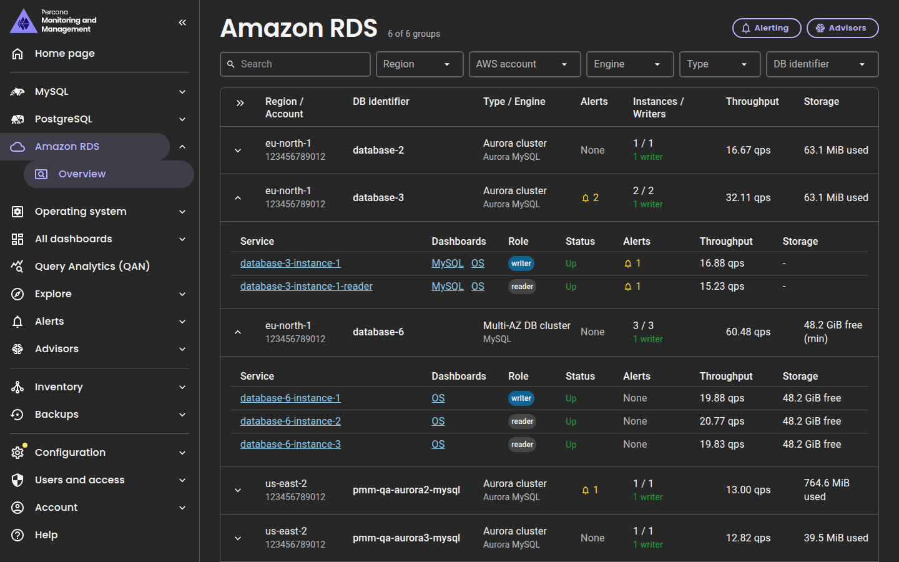

# Amazon RDS overview

The **Amazon RDS** page lists every Amazon RDS and Aurora database that PMM monitors, so you can check their health in one place and open the dashboards of each instance. It covers Aurora MySQL, Aurora PostgreSQL, RDS for MySQL, RDS for MariaDB and RDS for PostgreSQL.

To open the page, go to **Amazon RDS > Overview** in the side menu. The menu appears when PMM monitors at least one Amazon RDS node, and users with the Viewer role see it too. The page refreshes its data every minute.

## Prerequisites

To see your databases on the page, make sure that:

- You added the instances through **Inventory > Add service > Amazon RDS**, as described in [Connect Amazon RDS instance](../install-pmm/install-pmm-client/connect-database/aws.md). Instances added with `pmm-admin add mysql` or `pmm-admin add postgresql` don't run on an Amazon RDS node, so the page doesn't list them.
- The PMM Client that monitors the instances is the same version as PMM Server. Its `rds_exporter` reads the cluster, AWS account, engine and read replica source of each instance from AWS. For the PMM Client built into PMM Server, upgrading PMM Server is enough. If you attached the instances to a PMM Client on another host, upgrade that PMM Client.

You don't need to change any IAM permissions. PMM lists the instances it has no AWS details for under **AWS info unavailable**.

## Groups

The page shows one row per group of instances. The **Type / Engine** column shows how PMM grouped them:

| Type | Instances in the group |
|------|------------------------|
| **Aurora cluster** | The instances of an Aurora DB cluster |
| **Multi-AZ DB cluster** | The instances of a Multi-AZ DB cluster |
| **Replication group** | A primary instance and its read replicas, named after the primary |
| **Instance** | A standalone instance, without a cluster or read replicas |
| **Unavailable** | The instances that PMM has no AWS details for, per region and engine, under **AWS info unavailable**. For example, instances monitored by an older PMM Client |

The other columns of a group are:

| Column | What it shows |
|--------|---------------|
| **Region / Account** | The AWS region, with the AWS account below it |
| **DB identifier** | The cluster identifier, or the identifier of the primary or standalone instance |
| **Type / Engine** | The group type from the previous table, with the database engine below it: Aurora MySQL, Aurora PostgreSQL, MySQL, MariaDB or PostgreSQL |
| **Alerts** | The number of firing alerts of the instances. See [Alerts](#alerts) |
| **Instances / Writers** | How many instances have their exporter connected to the database, out of the instances that PMM monitors, for example **2 / 3**. Below it, the number of writer instances, normally **1 writer**. **no writer** and more than one writer show in a warning color. **unknown** means that the instances don't report their role |
| **Throughput** | For Aurora MySQL, MySQL and MariaDB, the queries per second (qps). For Aurora PostgreSQL and PostgreSQL, the transactions per second (tps): commits plus rollbacks |
| **Storage** | For Aurora, the cluster volume used. For other engines, the free storage space; a group shows its lowest instance, marked **(min)** |

AWS publishes the Aurora cluster volume irregularly, so that value can be up to about 3 hours old.

## Instances

Click the arrow at the start of a group to list its instances, writers first. The arrows in the table header expand or collapse all groups. The columns of an instance are:

| Column | What it shows |
|--------|---------------|
| **Service** | The service name, followed by the AWS instance identifier when it differs from the service name, and the region when it differs from the group's. Click it to open the main dashboard of the engine: [MySQL Amazon Aurora Details](../reference/dashboards/dashboard-mysql-amazon-aurora-details.md) for Aurora MySQL, [PostgreSQL Amazon Aurora Details](../reference/dashboards/dashboard-postgresql-amazon-aurora-details.md) for Aurora PostgreSQL, [MySQL Instance Summary](../reference/dashboards/dashboard-mysql-instance-summary.md) for MySQL and MariaDB, and [PostgreSQL Instance Summary](../reference/dashboards/dashboard-postgresql-instance-summary.md) for PostgreSQL |
| **Dashboards** | **OS** opens [Node Summary](../reference/dashboards/dashboard-node-summary.md). For Aurora MySQL, **MySQL** opens MySQL Instance Summary |
| **Role** | **writer** or **reader**, from `innodb_read_only` on Aurora MySQL, `read_only` on MySQL and MariaDB, and recovery mode on Aurora PostgreSQL and PostgreSQL. **unknown** means that the exporter doesn't report it |
| **Status** | **Up** when the exporter is connected to the database, **Down** when it isn't. An instance whose exporter stopped reporting shows as **Down** for one hour, and then disappears |
| **Alerts**, **Throughput**, **Storage** | The same values as for a group, for this instance. Aurora instances show **-** for storage, because the cluster volume belongs to the cluster |

All links in the table open in a new tab.

## Alerts

The **Alerts** column shows the number of firing alerts of each group and instance, without silenced alerts. An alert counts for an instance when its `service_name` or `node_name` label names the instance. The color of the number shows the most severe alert. **None** means that no alert is firing, and **-** means that PMM couldn't read the alerts.

Click the number to list the alerts, with their instance and how long they have been firing. Each alert links to the **Instances** tab of its alert rule. **Show all in Alert groups** opens the Grafana **Alert groups** page, filtered to the instances of the group.

The **Alerting** button at the top of the page opens **Alerts > Status**. If [Advisors](../advisors/advisors.md) are enabled, users with the Editor or Admin role also see an **Advisors** button, which opens **Advisors > Advisor insights**.

## Search and filter

Use the toolbar to narrow the list:

- **Search** matches DB identifiers, types, regions, engines, AWS accounts, service names and instance identifiers. A group that matches only through some of its instances opens and shows just those instances.
- **Region**, **AWS account**, **Engine**, **Type** and **DB identifier** each take one or more values.

The number next to the page title shows how many groups match. If no group matches, click **Clear filters**. PMM keeps the search and filters in the page URL, so you can bookmark a filtered view or share it.
