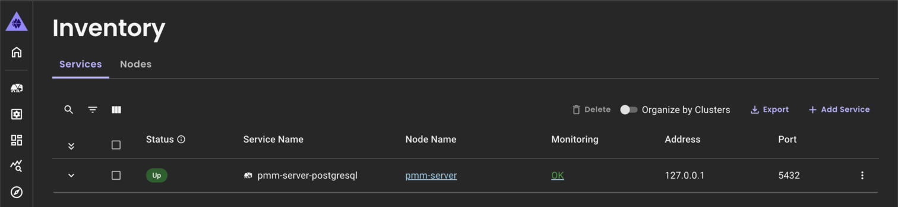
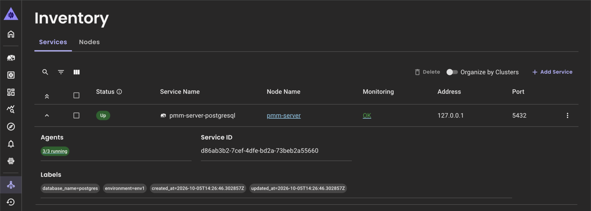
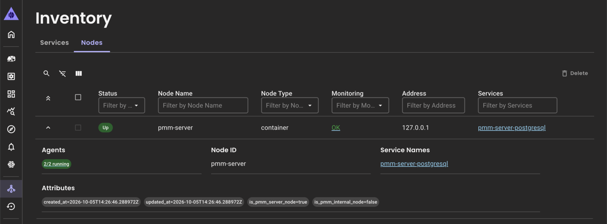
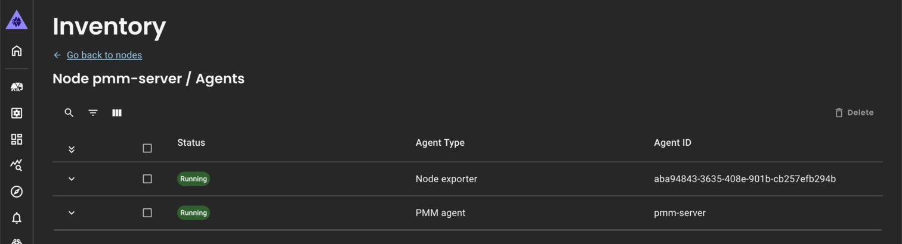
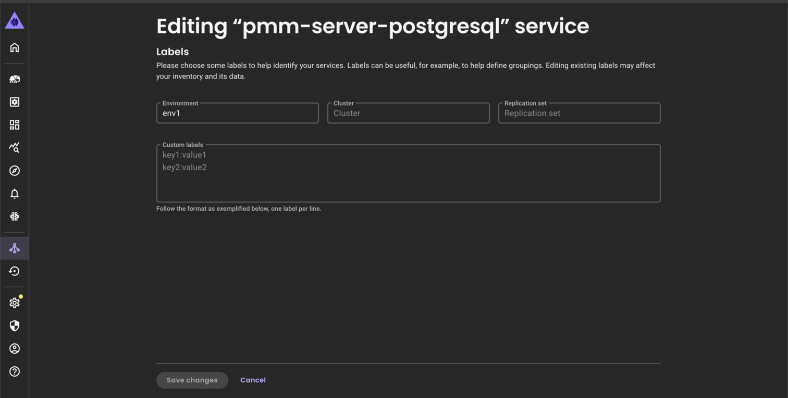

# About PMM Inventory

The **Inventory** page lists every node, service and agent registered in PMM. Use it to check the monitoring status of your databases, edit service labels, and remove the objects that you no longer monitor.

Starting with PMM 3.11.0, **Inventory** is part of the PMM UI instead of a Grafana page. Bookmarks and links to the previous Inventory and service editing pages open the matching new page.

## Open the Inventory page

To open **Inventory**, you need the **Admin** role.

Click **Inventory** in the main menu. The **Services** tab opens. To open a tab directly, go to **Inventory > Services** or **Inventory > Nodes**.

Inventory objects form a hierarchy with the node at the top, then the services and agents assigned to that node. The **Services** and **Nodes** tabs show this hierarchy from each side.

### Find items in a table

The inventory tables and agent lists share the same tools:

- Click :material-magnify: to search all columns.
- Click :material-filter-variant: to filter by individual columns.
- Click :material-view-column: to show or hide columns. The **Service ID** and **Node ID** columns are hidden by default.
- Click a column header to sort by that column.

PMM keeps the search, filters, sort order and page number in the page URL, so you can bookmark or share a filtered view. The tables refresh every 5 seconds.

## Services tab

The **Services** tab lists the monitored services and the nodes that they run on, with the following columns:

| Column | Description |
|--------|-------------|
| **Status** | Whether the database is running. For the possible values, see [Service and node status](#service-and-node-status). |
| **Service Name** | The name of the service, with an icon for the database type. |
| **Node Name** | The node that the service runs on. Click the name to show the node on the **Nodes** tab. |
| **Monitoring** | A summary of the status of the agents that monitor the service. Click the status to open the list of agents. For the possible values, see [Monitoring status](#monitoring-status). |
| **Address** | The IP address or DNS name of the service. For Amazon RDS instances, this is the database endpoint. |
| **Port** | The port that the service listens on. |
| **Service ID** | The unique ID of the service. Hidden by default. |

To add a service, click **Add Service**, or go to **Inventory > Add service**. For details, see [Connect databases](../install-pmm/install-pmm-client/connect-database/index.md).

### Service details

To see more about a service, click :material-chevron-down: at the start of its row. The details show:

- **Agents**: the number of running agents, for example **3/3 running**. Click it to open the list of agents.
- **Service ID**: the unique ID of the service.
- **Labels**: the standard and custom labels of the service, and attributes such as the database version.

To act on a service, click :material-dots-vertical: at the end of its row, then select one of the following:

- **Delete**: removes the service. For details, see [Remove items from the inventory](#remove-items-from-the-inventory).
- **Edit**: opens the service for editing. For details, see [Edit a service](#edit-a-service).
- **Dashboard**: opens the summary dashboard for the service type. External services don't have one.
- **QAN**: opens [Query Analytics](qan/index.md) for the service. Available for MySQL, MongoDB and PostgreSQL services.

### Service and node status

The **Status** column on the **Services** tab shows whether the database is available. The **Nodes** tab uses the same values for nodes. To see these descriptions in PMM, hover over :material-information-outline: in the **Status** column header on the **Services** tab.

| Status | Description |
|--------|-------------|
| **Up** | The database is running. |
| **Down** | The database is not running. |
| **Unknown** | The agent is unavailable, or the database status is incorrect. Check the configuration. |
| **N/A** | PMM can't determine whether the service is available. This happens for external services when the metrics that PMM needs are not available. |

### Monitoring status

The **Monitoring** column summarizes the status of all the agents assigned to a service or node:

- **OK**: all agents are running, or disabled by design.
- **Warning**: one or more agents are disabled.
- **Failed**: one or more agents that must be running are not running.

Some agents are disabled by design, so they don't cause **Warning**. The **Real-Time Analytics MongoDB agent** is disabled when no Real-Time Analytics session runs. A **QAN PostgreSQL pg_stat_statements agent** is disabled when the service uses `pg_stat_monitor` instead.

To see the status of each agent, click the **Monitoring** status. For details, see [View agents](#view-agents).

### Organize services by cluster

Turn on **Organize by Clusters** to group services by their `cluster` label. Services without a cluster appear first, under **Non-clustered services**. Click :material-chevron-down: next to a cluster to show its services. When you search or filter, PMM expands all clusters.

PMM remembers this setting in your browser.

### Service attributes

Each service has the following attributes:

- `service_type`: the database type, for example `mysql`, `postgresql` or `mongodb`.
- `node_id`: the node that the service runs on. This enables you to monitor multiple instances on a single node, with different service names, for example `mysql1-3306` and `mysql1-3307`.
- `version`: the database server version. The version has the following limitations:
    - PMM doesn't capture the version of the internal PostgreSQL database.
    - PMM captures the version only when you add the service with PMM Client 2.41.0 or later.
    - PMM doesn't update the version when you upgrade the database. To update it, remove the service and add it again.

## Nodes tab

The **Nodes** tab lists the nodes that PMM monitors, and the services and agents on each one. It displays the following columns:

| Column | Description |
|--------|-------------|
| **Status** | The status of the node. For the possible values, see [Service and node status](#service-and-node-status). |
| **Node Name** | The name of the node. In a PMM HA Cluster, a **Leader** or **Follower** badge shows the role of each PMM Server node. |
| **Node Type** | The type of node: `generic`, `container`, `remote`, `remote_rds` or `remote_azure_database`. |
| **Monitoring** | A summary of the status of the agents on the node. Click the status to open the list of agents. For the possible values, see [Monitoring status](#monitoring-status). |
| **Address** | The IP address or DNS name of the node. |
| **Services** | The services on the node. If the node has one service, click its name to show the service on the **Services** tab. Otherwise, the column shows the number of services, or **No services**. |
| **Node ID** | The unique ID of the node. Hidden by default. |

If PMM runs as an HA Cluster, turn on **List PMM Server only nodes** to hide all other nodes. **PMM HA > Identify Nodes** in the main menu opens the same view.

### Node details

To see more about a node, click :material-chevron-down: at the start of its row. The details show:

- **Agents**: the number of running agents. Click it to open the list of agents.
- **Node ID**: the unique ID of the node.
- **Service Names**: the services on the node. Click a name to show the service on the **Services** tab.
- **Labels**: the custom labels of the node, if it has any.
- **Attributes**: other properties of the node, such as when it was registered.

To act on a node, click :material-dots-vertical: at the end of its row, then select one of the following:

- **Override alert thresholds**: changes the alert thresholds that apply to this node only.
- **Delete**: removes the node. Not available for PMM Server nodes. For details, see [Remove items from the inventory](#remove-items-from-the-inventory).

### Node attributes

Each node has the following attributes:

- `node_id`: a unique ID, linked to the `machine_id` of the host (from `/etc/machine-id`).
- `node_type`: the type of node, as shown in the **Node Type** column.
- `instance_id`: the AWS RDS instance ID. Only RDS nodes have this attribute.

### Node-service relationship

Services run on nodes and rely on them for resources such as CPU, memory and storage. To see the node that a service runs on, click the name in the **Node Name** column of the **Services** tab.

Knowing which nodes host which services helps you with the following tasks:

- **Resource allocation**: allocate resources to avoid underused or overloaded nodes.
- **Performance optimization**: compare node-level and service-level metrics to find resource limits and bottlenecks.
- **Incident response**: identify which nodes and services an incident affects, and focus your troubleshooting on them.

## View agents

Each binary that runs on a client, such as an exporter or a Query Analytics agent, is an agent. For example, `pmm-agent` manages the other agents on its node, `node_exporter` collects node metrics, and `mysqld_exporter` collects MySQL metrics.

To see the agents of a service or node, click its **Monitoring** status, or the **Agents** badge in its details. The page shows the agents under **Service <name> / Agents** or **Node <name> / Agents**. To return to the inventory, click **Go back to services** or **Go back to nodes**.

The agent list has the following columns:

| Column | Description |
|--------|-------------|
| **Status** | The status of the agent. For the possible values, see [Agent status](#agent-status). |
| **Agent Type** | The type of agent, for example **Node exporter** or **QAN MySQL Performance Schema agent**. |
| **Agent ID** | The unique ID of the agent. |

To see the configuration of an agent, click :material-chevron-down: at the start of its row. The **Properties** section lists the labels and the options of the agent.

### Agent status

The **Status** column of the agent list takes one of the following values:

| Status | Color | Description |
|--------|-------|-------------|
| **Running** | Green | The agent is running. |
| **Starting** | Green | The agent is starting. |
| **Done** | Grey | The agent has been stopped or disabled. |
| **Waiting** | Red | The agent encountered an error and restarts automatically. |
| **Initialization error** | Red | The agent encountered an error when starting. |
| **Stopping** | Red | The agent is stopping. |
| **Unknown** | Red | The agent is not connected, so PMM can't determine its state. |

## Edit a service

You can change the labels of a service. For an Amazon RDS service, you can also change how PMM authenticates to AWS.

To edit a service:
{.power-number}

1. Go to **Inventory > Services**.
2. Click :material-dots-vertical: next to the service, then select **Edit**.
3. In the **Labels** section, change the **Environment**, **Cluster**, **Replication set** or **Custom labels** fields. Enter custom labels as `key:value`, one label per line. To remove a label, clear its field or delete its line.

    

4. If the service is an Amazon RDS instance, select an option under **Authenticate with** in the **Amazon RDS credentials** section: **Access key**, **IAM role** or **Host credentials**. For details, see [Connect Amazon RDS instance](../install-pmm/install-pmm-client/connect-database/aws.md).
5. Click **Save changes**.
6. Review the summary of the changes, then click **Confirm and save changes**. PMM saves the changes and opens the **Services** tab.

A custom label name must start with a letter or an underscore, and contain only letters, digits and underscores. It can't start with two underscores. The label value can't be empty.

### Effect of editing a service

Editing a service can affect the following PMM functions:

- **Alerting**: if an alert rule relies on a label that you change, the alert may not trigger when it should. Update your alert rules after you edit labels.
- **Scheduled backups**: changing the cluster label removes all scheduled backups for the service or cluster. PMM warns you before saving. Recreate your backups after you finish the cluster configuration.
- **Dashboard data**: edited labels apply only to new time series. Existing time series keep the previous labels.
- **Amazon RDS metrics**: changing the credentials restarts the RDS exporter, so expect a short gap in CloudWatch metrics. If you select **Host credentials**, PMM stops storing AWS credentials for the service. If the PMM Client host provides no credentials, monitoring for the service stops.

## Remove items from the inventory

You can remove services, nodes and agents from the inventory. Removal is permanent.

### Remove services

To remove services:
{.power-number}

1. Go to **Inventory > Services**.
2. Select the checkboxes of the services to remove, then click **Delete**. To remove a single service, you can also click :material-dots-vertical: next to it and select **Delete**.
3. To also remove the agents of the services, select **Force mode**.
4. Click **Yes, delete service**, or **Yes, delete services** if you selected more than one.

### Remove nodes

To remove nodes:
{.power-number}

1. Go to **Inventory > Nodes**.
2. Select the checkboxes of the nodes to remove, then click **Delete**. To remove a single node, you can also click :material-dots-vertical: next to it and select **Delete**.
3. To also remove all the agents and services on the nodes, select **Force mode**.
4. Click **Proceed**.

You can't remove PMM Server nodes from the inventory. In a PMM HA Cluster, PMM Server nodes are managed through Helm. To add or remove replicas, [use `helm upgrade`](../install-pmm/install-HA-clustered.md#scale-pmm-server-replicas).

### Remove agents

To remove agents:
{.power-number}

1. Open the agent list of the service or node. For details, see [View agents](#view-agents).
2. Select the checkboxes of the agents to remove, then click **Delete**.
3. To also remove the agents that depend on them, select **Force mode**.
4. Click **Proceed**.
