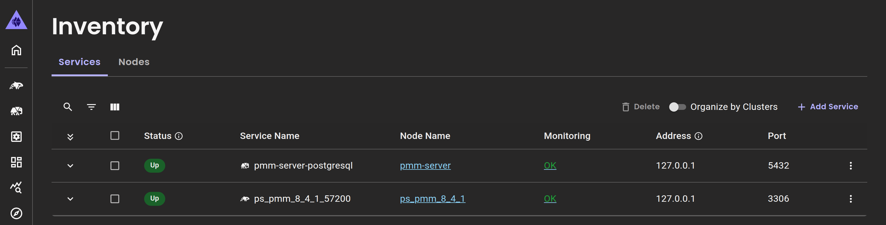
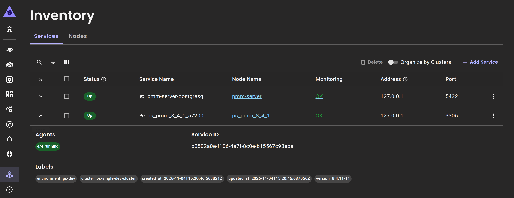
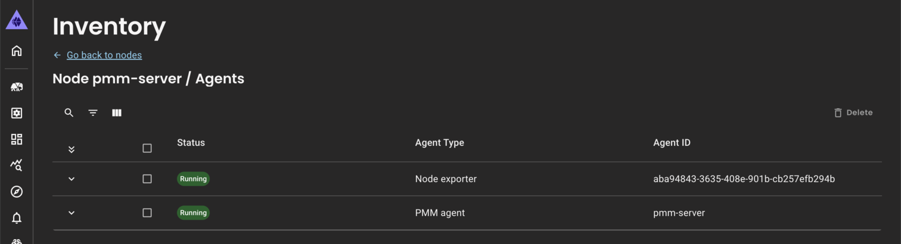
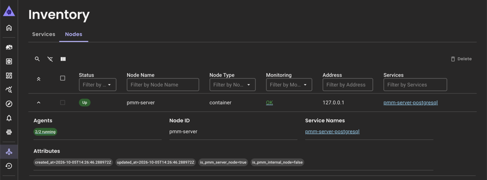
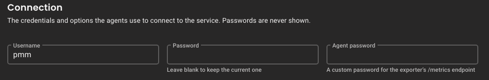

# About PMM Inventory

Use the **Inventory** page to check that PMM monitors your databases, find the services and nodes that you're working on, export your services to a CSV file, change how PMM monitors a service, and remove what you no longer monitor.

**Inventory** lists every node, service and agent registered in PMM. A node hosts services, and the agents on the node collect the data of the node and its services.

## Prerequisites

**Inventory** appears in the main menu only for users with the [Admin role](../admin/roles/index.md). If you manage the services that PMM monitors but don't see **Inventory**, ask a PMM Admin to give you the Admin role.

## Open the Inventory page

Click **Inventory** in the main menu. The **Services** tab opens, with the monitored services and the nodes that they run on. The **Nodes** tab lists the nodes, with the services and agents on each one. 

To open a tab directly, go to **Inventory > Services** or **Inventory > Nodes**.

## Add a service

To start monitoring another database, click **Add Service** on the **Services** tab, or go to **Inventory > Add service**, then [connect your database](../install-pmm/install-pmm-client/connect-database/index.md).

## Check that your databases are monitored

After you add a database, or when its dashboards or Query Analytics show no data, check in **Inventory** whether the database is running and whether PMM collects its data.

To check a service:
{.power-number}

1. Go to **Inventory > Services** and [find the service](#find-services-and-nodes).
2. Check the **Status** column. **Up** means that the database is running. If it shows **Down**, **Unknown** or **N/A**, [find out what the status means](#service-and-node-status).
3. Check the **Monitoring** column. **OK** means that all the agents that collect the data of the service are running, or disabled by design. If it shows **Warning** or **Failed**, click the status to [check the agents](#check-the-agents-of-a-service-or-node), and find the agent that isn't running.
4. Check that the **Address** and **Port** point to your database. PMM connects from the host where the PMM agent of the service runs, so `127.0.0.1` or `localhost` means that host, which isn't always the database host. An empty **Address** with **Port** `0` means that PMM connects through a socket. To change the address, remove the service and add it again.
5. To see the number of running agents, the service ID and the labels of the service, click :material-chevron-down: at the start of its row:

    

    The database **version** among the labels has some limits: PMM captures it only for services added with PMM Client 2.41.0 or later, not for its internal PostgreSQL database, and doesn't update it when you upgrade the database. To update the version, remove the service and add it again.

To check a node, use the **Nodes** tab the same way. It has the same **Status** and **Monitoring** columns.

### What the statuses mean

Use these values to find out what's wrong with a service or node. To see the status descriptions in PMM, hover over :material-information-outline: in the **Status** column header on the **Services** tab.

The **Status** of a service or node shows whether the database or node is available:

- **Up**: the database is running.
- **Down**: the database is not running.
- **Unknown**: the agent is unavailable, or the database status is incorrect. Check the configuration.
- **N/A**: PMM can't determine whether the service is available. This happens for external services when the metrics that PMM needs are not available.

The **Monitoring** status sums up the agents assigned to a service or node:

- **OK**: all agents are running, or disabled by design.
- **Warning**: one or more agents are disabled.
- **Failed**: one or more agents that are expected to run aren't running.

Some agents are disabled by design, so they don't cause **Warning**. The **Real-Time Analytics MongoDB agent** is disabled when no Real-Time Analytics session runs. A **QAN PostgreSQL pg_stat_statements agent** is disabled when the service uses `pg_stat_monitor` instead.

### Check the agents of a service or node

When the **Monitoring** status shows **Warning** or **Failed**, the agent list shows which agent stopped. Each binary that runs on a client, such as an exporter or a Query Analytics agent, is an agent. 

For example, `pmm-agent` manages the other agents on its node, `node_exporter` collects node metrics, and `mysqld_exporter` collects MySQL metrics.

To check the agents:
{.power-number}

1. Click the **Monitoring** status of the service or node, or the **Agents** badge in its details. The page shows the agents under **Service <name> / Agents** or **Node <name> / Agents**:

    

2. Check the **Status** of each agent. **Running** and **Starting** are fine. For the other values, [find out what the agent status means](#agent-status).
3. To see the configuration of an agent, click :material-chevron-down: at the start of its row. The **Properties** section lists the labels and the options of the agent.
4. To return to the inventory, click **Go back to services** or **Go back to nodes**.

The **Status** of an agent is one of these values:

| Status                   | Color | Description                                                   |
| ------------------------ | ----- | ------------------------------------------------------------- |
| **Running**              | Green | The agent is running.                                         |
| **Starting**             | Green | The agent is starting.                                        |
| **Done**                 | Grey  | The agent has been stopped or disabled.                       |
| **Waiting**              | Red   | The agent encountered an error and restarts automatically.    |
| **Initialization error** | Red   | The agent encountered an error when starting.                 |
| **Stopping**             | Red   | The agent is stopping.                                        |
| **Unknown**              | Red   | The agent is not connected, so PMM can't determine its state. |

## Find services and nodes

When PMM monitors many databases, narrow the tables down to the services and nodes that you're working on. Each table and agent list has the same tools:

- click :material-magnify: to search all columns
- click :material-filter-variant: to filter by individual columns
- click :material-view-column: to show or hide columns, such as the **Service ID** and **Node ID** columns, which are hidden by default
- click a column header to sort by that column

PMM keeps the search, filters, sort order and page number in the page URL, so you can bookmark or share a filtered view. The tables refresh every 5 seconds.

To group services by their `cluster` label, turn on **Organize by Clusters** on the **Services** tab. Services without a cluster appear first, under **Non-clustered services**. 

To show the services of a cluster, click :material-chevron-down: next to it. When you search or filter, PMM expands all clusters. PMM remembers this setting in your browser.

### Find the node of a service, or the services of a node

Services run on nodes and rely on them for resources such as CPU, memory and storage. Knowing which node hosts which service helps you avoid underused or overloaded nodes, find resource limits by comparing node and service metrics, and focus your troubleshooting on the nodes and services that an incident affects.

- To see the node that a service runs on, click its name in the **Node Name** column of the **Services** tab.
- To see the services on a node, check the **Services** column of the **Nodes** tab. If the node has one service, click its name to show it on the **Services** tab. To see all its services, click :material-chevron-down: at the start of the node's row and check **Service Names**:

    

If PMM runs as an HA Cluster, to see only the PMM Server nodes, turn on **List PMM Server only nodes** on the **Nodes** tab, or select **PMM HA > Identify Nodes** in the main menu. A **Leader** or **Follower** badge next to each node name shows its role.

### Open the dashboard or Query Analytics of a service

To go from a service to its data, click :material-dots-vertical: at the end of its row, then select:

- **Dashboard** to open the summary dashboard for the service type. External services don't have one.
- **QAN** to open [Query Analytics](qan/index.md) for the service. Available for MySQL, MongoDB and PostgreSQL services.

## Export services to a CSV file

You can download the services as a CSV file, for example to keep an inventory report or to review the services in a spreadsheet.

To export services:
{.power-number}

1. Go to **Inventory > Services**.
2. To export only some services, search or filter the table, or select the checkboxes of the services to export.
3. Click **Export**. PMM downloads the file as `inventory_services_export_{timestamp}.csv`.

If you select services, the file contains only the selected services that match the search and filters. Otherwise, it contains every service that matches the search and filters, in the order of the table. This includes the services on other pages and in collapsed clusters. If no service matches, **Export** is disabled.

### Exported columns

Each row of the file is a service. The columns don't depend on which columns the table shows. The file starts with these columns:

- `service_id`: the unique ID of the service
- `service_name`: the name of the service
- `service_type`: the database type, for example `mysql` or `postgresql`
- `status`: the status of the service, as shown in the **Status** column, for example `Up`
- `monitoring`: the monitoring status, as shown in the **Monitoring** column: `OK`, `Warning` or `Failed`
- `failed_agents`: the agents that cause the `Failed` monitoring status, separated by semicolons. Each agent appears with its type, ID and status, for example `QAN MySQL Slow Query Log agent (<agent ID>): Waiting`. Empty when no agent failed.
- `node_id`: the ID of the node that the service runs on
- `node_name`: the name of the node that the service runs on
- `address`: the address PMM uses to connect to the service, as shown in the **Address** column
- `port`: the port PMM uses to connect to the service, as shown in the **Port** column

The next columns hold the labels and attributes that the service details show under **Labels**. `environment`, `cluster` and `replication_set` come first. The custom labels and the other attributes, such as `version`, follow in alphabetical order. A column appears only when at least one exported service has a value for it. Services without that value have an empty cell.

If a custom label has the same name as a column in the previous table, its column is named `label:<name>`, for example `label:status`.

If a value starts with `=`, `+`, `-`, `@`, a tab or a carriage return, PMM adds an apostrophe (`'`) before it. This prevents spreadsheet applications from running the value as a formula.

If you process the file automatically, match columns by header name rather than by position. The label columns depend on which services you export.

## Edit a service

You can change how PMM monitors a service without removing the service and adding it again. The service keeps its ID, and its metrics and Query Analytics (QAN) history. For an Amazon RDS service, you can also change how PMM authenticates to AWS.

The form opens with the current settings of the service and shows only the settings that apply to its type. They match the settings that `pmm-admin update` changes, except the address of the service and the environment variables of a MongoDB exporter. Depending on the type of service, you can change:

- **Labels**: **Environment**, **Cluster**, **Replication set** and **Custom labels**, and **Group** for an external service
- **Connection**: the username and password that the agents connect with, the **Agent password** of the exporter's `/metrics` endpoint, and connection options such as the **Database** of a PostgreSQL service or the **Authentication mechanism** of a MongoDB service
- **Metrics endpoint**, instead of **Connection** for an external or HAProxy service: the **Scheme**, **Listen port** and **Metrics path** that PMM scrapes, and the HTTP basic auth credentials
- **TLS**: whether the agents connect over TLS, whether they verify the certificate, and the certificates themselves
- **Query Analytics**, for MySQL, MongoDB and PostgreSQL services: the **Query source**, and QAN options such as **Max query length** and **Disable query examples**
- **Metrics**: **Metrics mode**, **Log level**, **Connection timeout (seconds)**, **Disabled collectors**, and the exporter options of the database, such as **Tablestats limit** for MySQL or **Max collections limit** for MongoDB
- **Amazon RDS credentials**, for an Amazon RDS service: how the RDS exporter authenticates to AWS

The **Service** section at the top shows the type, node and address of the service. You can't change them here. To change them, remove the service and add it again.

To edit a service:
{.power-number}

1. Go to **Inventory > Services**.
2. Click :material-dots-vertical: next to the service, then select **Edit**.
3. Change the settings that you need. Enter custom labels as `key:value`, one label per line. To remove a label, clear its field or delete its line.

    PMM never shows passwords, keys or certificates. Their fields start empty: leave a field empty to keep the stored value, or enter a new one to replace it. For example, the **Password** field of a MySQL service:

    

4. If the service is an Amazon RDS instance, select an option under **Authenticate with** in the **Amazon RDS credentials** section: **Access key**, **IAM role** or **Host credentials**. To create an access key or an IAM role for PMM, [set up AWS access for Amazon RDS](../install-pmm/install-pmm-client/connect-database/aws.md).
5. Click **Save changes**.
6. Review the summary of the changes, then click **Confirm and save changes**. PMM saves only the settings that you changed, and opens the **Services** tab.

    When a change affects how PMM connects to the service, or turns on a query source, PMM first checks that it can connect with the new settings. 
    
    If the check fails, PMM shows the error and doesn't save the settings. To save them anyway, for example because the database isn't ready for them yet, select **Skip the connection check** before you click **Confirm and save changes**. The option applies to that save only.

If you changed the Amazon RDS credentials and the save fails, for example because the connection check fails, the credentials stay changed: PMM saves them before the other settings and shows a warning. Fix the error, then save the other settings again.

Start a custom label name with a letter or an underscore, and use only letters, digits and underscores. Don't start it with two underscores, and don't leave the label value empty.

### Query source limits

Some services can't use every query source:

- On an Amazon RDS or Azure node, only the query source that adding the service sets up is available: **Performance Schema** for MySQL and **pg_stat_statements** for PostgreSQL.
- The query source of PMM Server's internal PostgreSQL can't be changed here. To turn its QAN on or off, [monitor PMM Server's internal PostgreSQL](qan/QAN-stored-metrics.md#monitor-pmm-servers-internal-postgresql) instead.
- If you select **pg_stat_monitor** and the database doesn't have the `pg_stat_monitor` extension, PMM uses **pg_stat_statements** instead and shows a warning.

### Effect of editing a service

Editing a service can affect the following PMM functions:

- **Monitoring**: the agents of the service restart with the new settings, so expect a short gap in its metrics and QAN data.
- **Query Analytics**: changing the **Query source** removes the QAN agent of the service and adds a new one. The QAN data that PMM already collected stays.
- **Alerting**: if an alert rule relies on a label that you change, the alert may not trigger when it should. Update your alert rules after you edit labels.
- **Scheduled backups**: changing the cluster label removes all scheduled backups for the service or cluster. PMM warns you before saving. Recreate your backups after you finish the cluster configuration.
- **Dashboard data**: edited labels apply only to new time series. Existing time series keep the previous labels.
- **Amazon RDS metrics**: changing the credentials restarts the RDS exporter, so expect a short gap in CloudWatch metrics. If you select **Host credentials**, PMM stops storing AWS credentials for the service. If the PMM Client host provides no credentials, monitoring for the service stops.

## Change the alert thresholds of a node

When a node needs different alert thresholds from the rest of your fleet, override them for that node only: click :material-dots-vertical: at the end of the node's row on the **Nodes** tab and select **Override alert thresholds**. To choose the thresholds, check how [dynamic alert thresholds](../alert/alert-thresholds.md) work.

## Remove what you no longer monitor

When you stop monitoring a database or a host, remove its services, nodes or agents, so that **Inventory** lists only what PMM monitors. Removal is permanent.

### Remove services

To remove services:
{.power-number}

1. Go to **Inventory > Services**.
2. Select the checkboxes of the services to remove, then click **Delete**. To remove a single service, you can also click :material-dots-vertical: next to it and select **Delete**.
3. To also remove the agents of the services, select **Force mode**.
4. Click **Yes, delete service**, or **Yes, delete services** if you selected more than one.

### Remove nodes

To remove nodes:
{.power-number}

1. Go to **Inventory > Nodes**.
2. Select the checkboxes of the nodes to remove, then click **Delete**. To remove a single node, you can also click :material-dots-vertical: next to it and select **Delete**.
3. To also remove all the agents and services on the nodes, select **Force mode**.
4. Click **Proceed**.

You can't delete PMM Server nodes from **Inventory**. In an HA cluster, Helm manages them, and deleting one would drop it from monitoring without stopping the pod. To add or remove replicas, [use `helm upgrade`](../install-pmm/install-HA-clustered.md#scale-pmm-server-replicas).

### Remove agents

To remove agents:
{.power-number}

1. [Open the agent list](#check-the-agents-of-a-service-or-node) of the service or node.
2. Select the checkboxes of the agents to remove, then click **Delete**.
3. To also remove the agents that depend on them, select **Force mode**.
4. Click **Proceed**.
