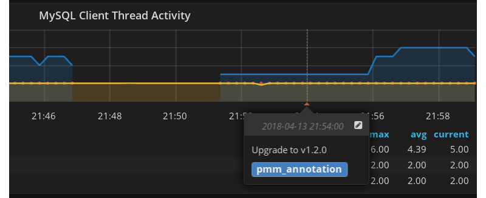

# Annotation in dashboards

Annotations mark a moment in time. They are useful for marking system changes or other significant application events. They can be set globally or for specific nodes or services. Annotations for nodes and services are called scoped annotations.

You create them on the command line with the [`pmm-admin annotate` command](../../commands/pmm-admin/config.md#pmm-admin-annotate), or with the `POST /v1/management/annotations` API endpoint. To scope an annotation, use the `--node`, `--node-name`, `--service`, or `--service-name` flag, or the `node_name` or `service_names` field of the API request.

Annotations show as a vertical dashed line on a dashboard graph. Reveal the annotation text by mousing over the caret indicator below the line.



## Show annotations on dashboards

You turn annotations on or off with the switches in the second row menu bar. Dashboards for nodes and services have two:

- **PMM Annotations**: shows global annotations
- **PMM Annotations: nodes and services**: shows scoped annotations


## Scoped annotations on dashboards

Scoped annotations show when the **PMM Annotations: nodes and services** switch is on, including when the node or service variables are set to **All**. What a dashboard shows depends on its variables:

- A node dashboard shows node annotations.
- A service dashboard shows service annotations.
- A dashboard with both node and service variables shows both.

The other variables on the dashboard, such as environment or region, filter the annotations in the same way that they filter the graphs. If you select one node or one service, the dashboard shows only the annotations of that node or service.

## Access control

Label-based access control (LBAC) applies to scoped annotations on dashboards. Users see the scoped annotations of the nodes and services whose metrics they can see, and no others. For more information, see [Access control in PMM](../../../admin/roles/access-control/intro.md).

## Retention

Scoped annotations show on dashboards for the metrics data retention period. By default, this is 30 days. To change the period, see [Data retention](../../../configure-pmm/advanced_settings.md#data-retention).

## Find the ID of an annotation

Each scoped annotation has an ID. The ID shows in:

- the output of `pmm-admin annotate`
- the `annotation_id` field of the response from the `POST /v1/management/annotations` API endpoint
- the title of the annotation marker on a dashboard, in the form `Annotation <id>`

For example, the following command prints the ID of the new annotation:

```shell
pmm-admin annotate "Schema migration completed" --service-name=mysql-prod
```

```text
Annotation added.
Annotation ID: 17
```

The marker of this annotation is titled `Annotation 17`.

## Delete a scoped annotation

To delete a scoped annotation, call the `DELETE /v1/management/annotations/{annotation_id}` API endpoint. This endpoint is available to users with the Admin role only. For how to authenticate, see [Authentication](../../../api/authentication.md).

For example, to delete the annotation with ID `17`:

```shell
curl -X DELETE -H 'Authorization: Bearer <SERVICE_TOKEN>' https://127.0.0.1/v1/management/annotations/17
```

If PMM deletes the annotation but can't remove it from dashboards, the endpoint returns an `Unavailable` error (HTTP status 503). The annotation then disappears from dashboards within about 5 minutes.

If you delete a scoped annotation with the Grafana annotations API instead, it also disappears from dashboards within about 5 minutes.

## Limitations

Scoped annotations have the following limitations:

- You can't edit or delete a scoped annotation from its marker on a dashboard.
- Users with the Editor role can't delete scoped annotations.

To delete a scoped annotation, see [Delete a scoped annotation](#delete-a-scoped-annotation). Editing scoped annotations is planned for a future release.

## Label limit

PMM adds the labels of the node or service to a scoped annotation, together with labels for the annotation ID, text, and tags. A scoped annotation can have at most 40 labels.

If a node or service carries so many labels that the annotation would exceed this limit, PMM rejects the request and doesn't create the annotation. For example:

```text
Cannot annotate service 'mysql-prod': too many labels: 45 labels, at most 40 are allowed.
```

To fix this error, reduce the number of labels on the node or service, then create the annotation again.
