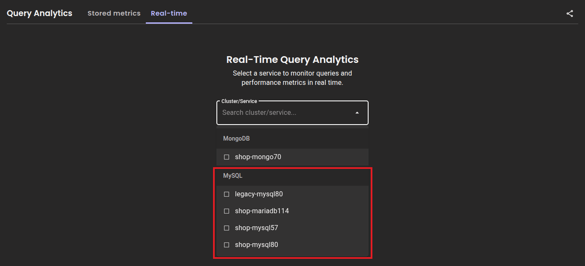
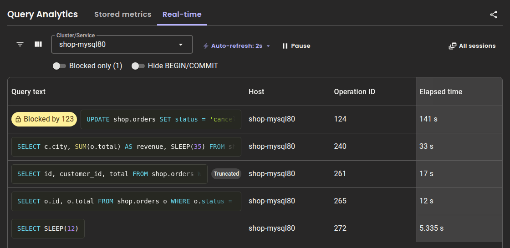
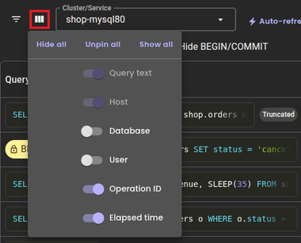
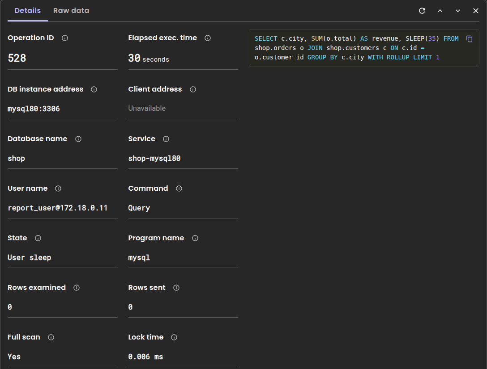
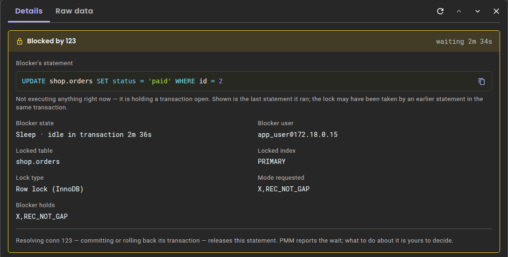
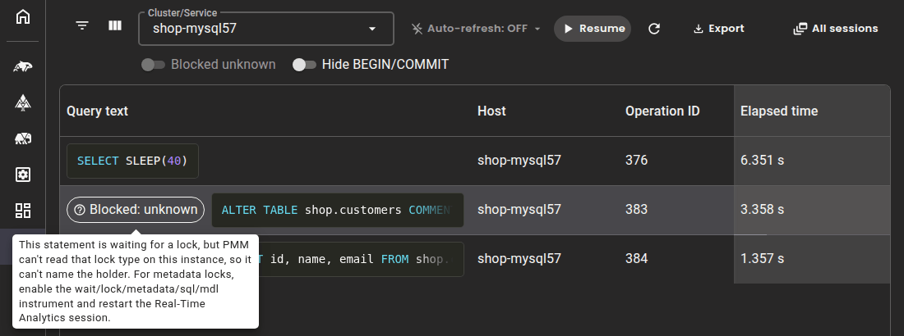
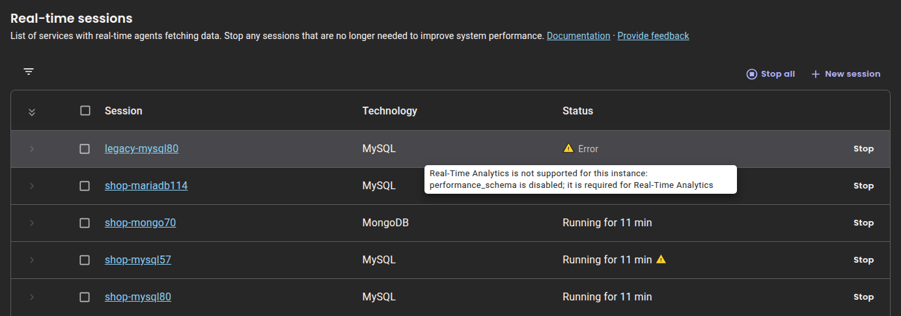

# Real-time Query Analytics for MySQL

Use Real-time Query Analytics (RTA) to see the statements running on your MySQL, Percona Server for MySQL and MariaDB services right now, including which ones are waiting for a lock and what's holding it.

RTA is most useful during an incident. [Query Analytics (QAN) stored metrics](../qan/QAN-stored-metrics.md) record queries only after they finish, so they don't show a runaway `UPDATE`, a schema change stuck behind a forgotten transaction or sessions queued behind a single row. A query that's killed never reaches QAN at all.

RTA updates every 1-5 seconds and keeps data in memory only. Use the **Pause** button to freeze the view for investigation or to export a snapshot.

## Before you start

### Check that your server is supported

RTA supports MySQL, Percona Server for MySQL, MariaDB and MongoDB. This page covers all of them except MongoDB. For MongoDB, RTA shows different data, so [follow the MongoDB instructions](QAN-realtime-analytics.md) instead.

RTA doesn't check the server version. When a session starts, RTA asks the server whether it provides the tables RTA needs. If something is missing, the session reports an error that says what's missing, so you don't end up with an empty view.

How much data RTA shows depends on the server and its default settings:

| Server | What RTA shows | What to do |
| ------ | -------------- | ---------- |
| MySQL 8.0 and later, Percona Server for MySQL 8.0 and later | All data, including blockers for metadata locks and transaction details | Nothing. Everything RTA uses is on by default. |
| MySQL 5.7 | All data except blockers for metadata locks and transaction details. A statement waiting for a metadata lock shows as **Blocked: unknown**. | [Turn on the missing settings](#turn-on-the-missing-performance-schema-settings). |
| MariaDB | Query text, user, database, command, state and elapsed time. Latency, row counts, metadata lock detection and transaction details are missing, and lock modes are [less precise](#get-the-waiting-statements-running-again). | [Turn on the missing settings](#turn-on-the-missing-performance-schema-settings). Lock modes stay less precise. |
| Managed services, such as Amazon RDS for MySQL | Not tested. RTA can work only when `performance_schema` is enabled on the instance. | On Amazon RDS, turn on `performance_schema` in the instance's parameter group. |

### Check the service requirements

RTA needs at least one MySQL service monitored by PMM. If you haven't set one up yet, [connect MySQL to PMM](../../install-pmm/install-pmm-client/connect-database/mysql/mysql.md).

You need:

- **PMM Client 3.11.0 or later** on the monitored host. Run `pmm-admin status` to check.
- **`performance_schema` enabled** on the monitored server. RTA doesn't start without it.
- **The standard PMM monitoring user**. RTA reuses your existing MySQL exporter credentials and needs nothing beyond the grants PMM already documents:

    ```sql
    GRANT SELECT, PROCESS, REPLICATION CLIENT, RELOAD ON *.* TO 'pmm'@'localhost';
    ```

    The `PROCESS` privilege lets RTA read the lock tables. Without it, running queries still appear, but lock information doesn't.

### Check your role

Starting and stopping RTA sessions requires the **Admin** role. Users with other roles can view sessions that an Admin has already started. 

To check what each role can do, [review the standard role permissions](../../admin/roles/index.md).

### Review what data RTA shows

RTA displays statement text as MySQL reports it, which may include:

- literal values in `WHERE` clauses and `INSERT` or `UPDATE` statements
- credentials passed inside a statement
- personal or confidential data used in query conditions

Any PMM user who can open the **Query Analytics > Real-time** page can see this data. Consider your security requirements before you use RTA in production.

RTA displays what the server returns and exposes nothing beyond what `SHOW PROCESSLIST` and the Performance Schema already provide. Connection credentials and TLS material are redacted.

## Get complete data on MariaDB and MySQL 5.7

On MySQL and Percona Server for MySQL 8.0 and later, everything RTA uses is on by default, so you don't need to configure anything. 

On MySQL 5.7 and MariaDB, some Performance Schema settings are off by default, and RTA shows less data until you turn them on.

RTA names each setting that's off when the session starts. To see them, hover over the session status in the sessions list.

### Data missing when Performance Schema settings are off

Each Performance Schema setting controls part of the data RTA shows. Use this list to find out which data you're missing on your server, and which setting brings it back:

- **`events_statements_current` consumer**, off by default on MariaDB: statement latency, lock time, rows examined and sent, temporary table counts, full scan detection, and the last statement of a blocker that's idle in its transaction are missing. 

    Elapsed time is also less precise, because it comes from the process list, which counts whole seconds. A statement that has run for less than a second shows as `0.000 s`.
- **`events_transactions_current` consumer and `transaction` instrument**, off by default on MySQL 5.7 and MariaDB: transaction state, duration and autocommit are missing. This includes the `trx_state`, `trx_latency` and `trx_autocommit` fields in the **Raw data** tab, and how long a metadata lock blocker has been idle in its transaction.
- **`wait/lock/metadata/sql/mdl` instrument**, off by default on MySQL 5.7 and MariaDB: metadata lock detection is missing. A statement queued behind a DDL statement shows as **Blocked: unknown** instead of naming its blocker. RTA recognizes the wait from the statement's state, `Waiting for table metadata lock`, but can't see which connection holds the lock.

On MariaDB without these settings, you still get query text, user, database, command, state and elapsed time.

### Turn on the missing Performance Schema settings

To turn on all the settings RTA uses:
{.power-number}

1. Run these statements on the monitored server:

    ```sql
    UPDATE performance_schema.setup_consumers
       SET ENABLED = 'YES'
     WHERE NAME IN ('events_statements_current', 'events_transactions_current');

    UPDATE performance_schema.setup_instruments
       SET ENABLED = 'YES', TIMED = 'YES'
     WHERE NAME IN ('transaction', 'wait/lock/metadata/sql/mdl');
    ```

2. To keep the settings after the server restarts, add these lines to your MySQL or MariaDB configuration file:

    ```ini
    [mysqld]
    performance_schema = ON
    performance_schema_consumer_events_statements_current = ON
    performance_schema_consumer_events_transactions_current = ON
    performance_schema_instrument = 'transaction=ON'
    performance_schema_instrument = 'wait/lock/metadata/sql/mdl=ON'
    ```

3. Restart the RTA session so the agent picks up the change.

## Start an RTA session

You can start RTA from the PMM UI or from the command line.

=== "From the UI"

    To start monitoring a MySQL service:
    {.power-number}

    1. Go to **Query Analytics** in the sidebar.
    2. Select the **Real-time** tab. If sessions are already running, the tab opens the sessions list. Click **+ New session** there.
    3. Select a MySQL service from the **Cluster/Service** drop-down and click **Start session**. The drop-down groups services by database type.

        

    4. If the sessions list opens, click the service name to open the live query table.

    The live query table appears and starts updating automatically.

    To watch several services at once, for example a primary and its replicas during the same incident, click **+ New session** and start a session for each one.

=== "From the command line"

    To start RTA on a specific MySQL service from the command line:
    {.power-number}

    1. Get the IDs you need:

        ```bash
        # Get your PMM Agent ID
        pmm-admin status

        # Get the MySQL service ID
        pmm-admin inventory list services
        ```

    2. Add the RTA agent. Unlike the UI, this command doesn't reuse the exporter's connection settings, so pass the MySQL user and password:

        ```bash
        pmm-admin inventory add agent rta-mysql-agent <pmm-agent-id> <service-id> <mysql-user> --password='<mysql-password>'
        ```

        If the server requires TLS, also add `--tls` and the certificate options, such as `--tls-ca-file`, `--tls-cert-file` and `--tls-key-file`.

    The output includes the RTA agent ID. Save it, because you need it to stop RTA later.

## Find statements that need attention

Use the live query table to find statements that are slow, stuck or blocking others. Each row is a statement that's running now, shown in **Query text** as the server reports it. The longest-running statements are at the top:



- To check how long a statement has been running, look at **Elapsed time**. Under 10 seconds, it has three decimals, for example `1.500 s`. From 10 seconds on, it's in whole seconds. The column stays pinned to the right edge, so you can see it while you scroll.
- To find out which service a statement is running on, look at **Host**.
- To stop a statement, copy its **Operation ID** and [kill the statement](#stop-a-problematic-query). The operation ID is the connection ID, so consecutive statements on the same connection have the same ID.
- To see which database and user a statement belongs to, click :material-view-column: **Show/Hide columns** and add the **Database** and **User** columns.

    

- To see the statement's state, command, rows examined, rows sent, full scan and program name, click the row and open the **Details** tab.

### Filter the view

On a busy server, the live query table can list many statements at once. Filter it to focus on the ones that matter for the problem you're investigating:

- To see only the statements that are waiting for a lock, turn on **Blocked only**. The count next to the toggle tells you how many there are, even when the filter is off. Statements that RTA couldn't judge, including those labeled **Blocked: unknown**, stay visible when the filter is on, so a statement that may be waiting is never hidden. Hover over the toggle to see why some statements couldn't be judged.
- To hide bare transaction control statements, such as `BEGIN`, `START TRANSACTION`, `COMMIT` and `ROLLBACK`, turn on **Hide BEGIN/COMMIT**. Under a transactional workload, they fill the view and rarely tell you anything.
- To narrow the view to specific services when several sessions are running, select them in **Cluster/Service**.
- To filter the rows by query text, host, database or user, or by a **Min** and **Max** elapsed time, click :material-filter-variant: **Show/Hide filters**. In the **Database** and **User** filters, separate several values with commas to match any of them.

### Control the refresh rate

Use **Auto-refresh** to adjust how often the view updates, from 1 to 5 seconds. The default is 2 seconds. The refresh rate only controls how often your browser reads the data that PMM Server already holds, so a faster refresh adds no load to your database.

PMM Client reads statements from the database at its own collect interval, every 2 seconds by default. To change it:
{.power-number}

1. On the monitored host, run `pmm-admin list` and find the agent ID of the `rta_mysql_agent`.
2. Set the new interval:

    ```sh
    pmm-admin inventory change agent rta-mysql-agent <agent-id> --collect-interval=5s
    ```

RTA marks its own polling queries with a `/* pmm-agent:rta */` comment and leaves them out of Query Analytics for the service, so they don't appear as part of your workload.

### Pause the stream

Click **Pause** to freeze the current view so a statement doesn't disappear on the next refresh. The agent keeps collecting in the background, and **Auto-refresh** shows **OFF**. Pausing also shows two icon buttons next to **Resume**:

- :material-refresh: **Refresh** reads the latest data once, without resuming live updates.
- :material-download: **Export to CSV** downloads the current view, so you can [export RTA data](#export-rta-data).

Hover over an icon to see its name.


## Investigate a query

Click a row to open its **Details** tab. It shows where the statement comes from, what it's doing and how much work it has done so far:



### Check a statement in the Details pane

When you open a row, the view pauses so the statement stays in place while you check it. The **Details** pane shows the statement as it was when you opened it. From the pane:

- To check whether the statement is still running, click :material-refresh: **Refresh** next to the previous and next arrows. If the statement has finished, the pane marks it as no longer running. It doesn't switch to the next statement that the same connection runs.
- To move to the statement above or below, click the previous or next arrow. This also works after the statement has finished.
- To see newer values for the statement, close the pane and open the row again.
- To go back to live updates, close the pane. Updates resume if they were running before you opened the row.

### Find out who sent a statement

When a statement is causing trouble, find the application or person behind it so you can fix it at the source:

- To find the application or host that sent the statement, check **Program name**, **User name** and **Client address** in the **Details** tab.
- To find which part of your schema the statement affects, check **Database name**. If the same table appears again and again in slow statements, it's a hotspot worth indexing.

### Spot inefficient queries

If **Rows examined** is much higher than **Rows sent**, the server is reading much more than it returns. Together with **Full scan**, that usually points to a missing index.

**Lock time** in the **Details** tab is how long the statement has waited for table locks, in milliseconds.

### See the full text of a long statement

When a statement has a **Truncated** label, in the table, in the **Details** tab or in the blocker's statement, RTA shows only its beginning. That's because MySQL keeps only the beginning of a long statement:

- The process list keeps 1024 bytes of a running statement.
- When the `events_statements_current` consumer is on, RTA reads up to `performance_schema_max_sql_text_length` bytes instead. The default is also 1024 bytes.

To see more of long statements:
{.power-number}

1. Turn on the `events_statements_current` consumer, as described in [Turn on the missing Performance Schema settings](#turn-on-the-missing-performance-schema-settings). It's on by default on MySQL and Percona Server for MySQL.
2. Raise `performance_schema_max_sql_text_length` in the MySQL configuration file.
3. Restart the server. You can't change this variable while the server is running.

RTA shows at most 64 KiB of any statement, however much the server keeps.

### View raw data

The **Raw data** tab shows the complete process list row for the statement, exactly as the server reported it, including fields that the **Details** tab doesn't show. Use it when you need something RTA doesn't display, or to confirm what the server actually reported.

## Find out what is blocking a query

When a statement is waiting for a lock, it has a **Blocked by** badge that names the connection holding it up. To see the full picture, click the row and open the **Details** tab:



- **Blocker's statement**: what the blocking connection is running. When the blocker is idle, this is the last statement it ran. That's often the statement that took the lock, but not always, because an earlier statement in the same transaction may have taken it. When the server keeps no text for an idle blocker, the field reads **No current statement (connection idle in transaction)**. This is the default on MariaDB, which records the last statement only when the `events_statements_current` consumer is on.
- **Blocker state**: the blocker's current command. `Sleep` means an open transaction that's sitting idle.
- **Blocker user**: who owns the blocking connection.
- **Locked table** and **Locked index**: what the statements are competing for.
- **Lock type**: **Row lock (InnoDB)** or **Metadata lock (MDL)**.
- **Mode requested** and **Blocker holds**: the lock modes on each side.

**Root** marks a blocker that isn't waiting for anything itself. It's the transaction at the head of the chain, and the one to resolve.

If the blocker is waiting too, the **Details** tab says so. Open that blocker's row to see what's holding it up, and repeat until you reach the **Root**.

### Get the waiting statements running again

Statements that are waiting for a lock continue only when the lock is released. How you release it depends on the lock type. Check **Lock type** in the **Details** tab, then:

- For a **Row lock (InnoDB)**, commit or roll back the blocking transaction. A row lock means that a transaction holds a row another statement needs.
- For a **Metadata lock (MDL)**, end the transaction the DDL statement is waiting for, or cancel the DDL. A metadata lock means that a DDL statement is waiting for every open transaction on a table to finish, and every later statement on that table is queued behind it. This is why an entire table seems to freeze after someone starts a schema change.

A statement waiting for a metadata lock doesn't appear in `SHOW ENGINE INNODB STATUS` or in the InnoDB lock tables, which is why this kind of stall is often misdiagnosed.

To understand a deadlock, compare **Mode requested** and **Blocker holds**. On MySQL and Percona Server for MySQL, the mode tells a wait on a row apart from a wait on the gap before it, for example `X,REC_NOT_GAP` and `X,GAP`. That difference can explain a deadlock that otherwise looks impossible. MariaDB reports only `X` or `S`, so you can't tell these waits apart on MariaDB.

### Find out why a statement shows Blocked: unknown

When RTA can't tell whether a statement is waiting for a lock, it shows **Blocked: unknown** instead of reporting the statement as healthy. 

To find out why, hover over the **Blocked: unknown** label or the **Blocked only** toggle, then select the case that matches what you see:

=== "The label disappears after one refresh"

    The connection moved on. RTA reads running statements and locks with two separate queries. If a connection moves on to its next statement between the two queries, and that statement waits for a lock, RTA doesn't attach the lock to the earlier statement and labels it **Blocked: unknown** instead. The **Blocked only** tooltip counts these statements separately.

    You don't need to fix anything, because the next refresh reads both again.

=== "The label stays, or the toggle shows Blocked unknown"

    RTA can't read one of its lock sources. RTA reads row locks and metadata locks from two separate sources, and only both together prove that a statement isn't waiting. When one source is missing:

    - The **Blocked only** tooltip says that RTA couldn't read it.
    - A statement whose state says it's waiting for that kind of lock, for example `Waiting for table metadata lock`, has a **Blocked: unknown** label. RTA can't name its blocker and doesn't count it in **Blocked only (N)**, but the filter keeps it visible.
    - Other statements that RTA couldn't judge have no label, because most of them aren't waiting at all.
    - If RTA can't judge any statement in the view, the **Blocked only** toggle shows **Blocked unknown** and is disabled. This happens when RTA can read neither source, or when it can read only one and no statement is waiting for that kind of lock.

    

    The most common cause is that the `wait/lock/metadata/sql/mdl` instrument is off, which is the default on MySQL 5.7 and MariaDB. To fix it, [turn on the missing Performance Schema settings](#turn-on-the-missing-performance-schema-settings). To see what else RTA can't collect, hover over the session status in the sessions list, or check the PMM Client log.

## Stop a problematic query

Killing a statement rolls back its transaction, so be careful, especially with writes. To stop a statement:
{.power-number}

1. Click the row to open the **Details** tab.
2. Copy the **Operation ID**.
3. Connect to your MySQL instance and run:

    ```sql
    KILL <operation_id>;
    ```

To clear a lock pile-up, kill the **Root** blocker, not the statements queued behind it.

## Export RTA data

You can export a snapshot of the current view to CSV. This captures statements that are still running and may never appear in QAN. For example, a long-running statement that's killed before it finishes never reaches QAN, because QAN only records queries that finish.

The :material-download: **Export to CSV** icon button is hidden while auto-refresh is on, and appears once you pause.

To export the current view:
{.power-number}

1. Go to **Query Analytics > Real-time**.
2. Click **Pause**.
3. Apply any filters or sort order you want reflected in the export.
4. Click :material-download: **Export to CSV**.

The export includes all records across all pages, follows your filters and sort order, and is saved as `mysql_rta_export_{timestamp}.csv`. The `lock_time_ms` column has the lock time in milliseconds, and `query_text_truncated` says whether the statement text was cut short. When one transaction is blocking a statement, `blocking_conn_id` and `blocking_query` name it, and `blocking_query_truncated` says whether its statement text was cut short.

## Stop an RTA session

Each running session adds load to the monitored database and to PMM Server, so stop sessions you no longer need.

=== "From the UI"

    Click **All sessions** in the **Real-time** view. To stop one session, click **Stop** next to it. To stop several, select them and click **Stop selected**, or click **Stop all**.

=== "From the command line"

    To stop RTA on a service, remove its RTA agent:
    {.power-number}

    1. Find the RTA agent ID:

        ```bash
        pmm-admin inventory list agents
        ```

    2. Remove the agent:

        ```bash
        pmm-admin inventory remove agent <rta-agent-id>
        ```

    This stops RTA for that service but doesn't affect the MySQL exporter or stored QAN metrics.

## Known limitations

RTA reads what MySQL exposes while a statement runs, which has these limits:

- **Rows examined and Rows sent lag behind while a statement is running.** MySQL updates these counters as the statement progresses or only when it ends, so a running statement can report `0` rows examined even after reading millions of rows.
- **A finished statement can stay in the view for up to about 30 seconds on an idle server.** PMM Client sends no update while nothing is running, so the last snapshot stays visible until the data expires.

## Troubleshooting

### Session won't start

Check each requirement:

- **PMM Client version**: 3.11.0 or later. Run `pmm-admin status` on the monitored host. A service monitored by an older PMM Client doesn't appear in the **Cluster/Service** drop-down. Adding the RTA agent with `pmm-admin inventory add agent rta-mysql-agent` or the inventory API fails with an error that names the required version. If an RTA agent was added before its PMM Client reported a version, the sessions list shows the session as **Error** with the same explanation.
- **`performance_schema`**: must be on. Run `SELECT @@performance_schema;`, which must return `1`. This setting applies at server startup, so you can't change it while the server is running.
- **Grants**: the monitoring user needs `SELECT` to start a session, and `PROCESS` to read lock information. To check the full list, [review the service requirements](#check-the-service-requirements).
- **Admin role**: only users with the **Admin** [role](../../admin/roles/index.md) can start or stop sessions.

When a session can't start, its status shows **Error**. Hover over the status in the sessions list to see the reason, which names the check that failed. The Real-time view shows the same reason instead of an empty table.



### No queries appear

RTA shows only statements that are running at the moment of collection. Idle connections and statements that finish between collections never appear. If the server is busy but the view stays empty, lower the PMM Client's collect interval, as described in [Control the refresh rate](#control-the-refresh-rate). **Auto-refresh** only changes how often your browser reads data that's already collected.

### Row counts and full-scan show "Unavailable"

The `events_statements_current` consumer is off, so the server never measured them. This is the default on MariaDB. To turn it on, [get complete data on MariaDB and MySQL 5.7](#get-complete-data-on-mariadb-and-mysql-57).

RTA reports these values as unavailable, not as zero, so a statement that nobody measured is never mistaken for a cheap, well-indexed one. Elapsed time still works, because it falls back to the process list, which counts whole seconds.

### A blocked query doesn't name its blocker

Either the metadata lock instrument is off, as described in [Blocked unknown](#find-out-why-a-statement-shows-blocked-unknown), or the monitoring user doesn't have `PROCESS`. To see what RTA can't collect, hover over the session status in the sessions list.

### Lock information stops updating during a large pile-up

RTA limits how much of the lock graph it collects, because the number of lock relationships grows quickly with the number of waiting statements. During a very large pile-up, RTA describes some waiting statements and not others, and the agent logs a warning. The statements themselves are still listed.

## See also

- [Real-time Query Analytics for MongoDB](QAN-realtime-analytics.md)
- [Real-time Query Analytics for PostgreSQL](QAN-realtime-analytics-postgresql.md)
- [Query Analytics overview](index.md)
- [Connect MySQL to PMM](../../install-pmm/install-pmm-client/connect-database/mysql/mysql.md)
- [Stored metrics for MySQL](mysql.md)
- [Configuration issues](../../troubleshoot/config_issues.md)
