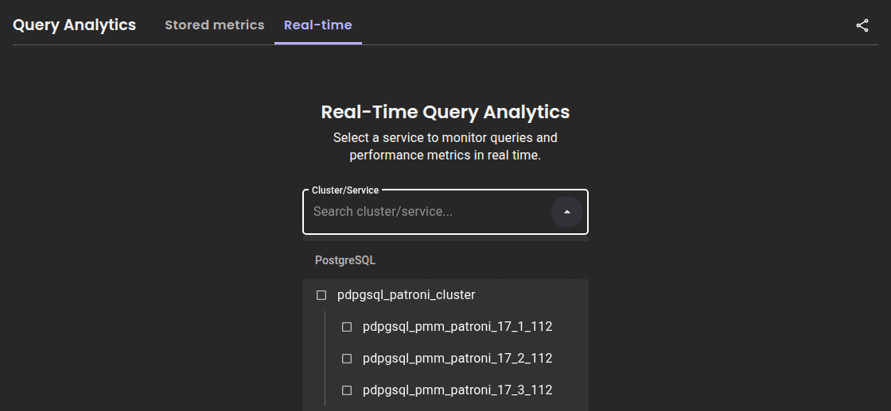
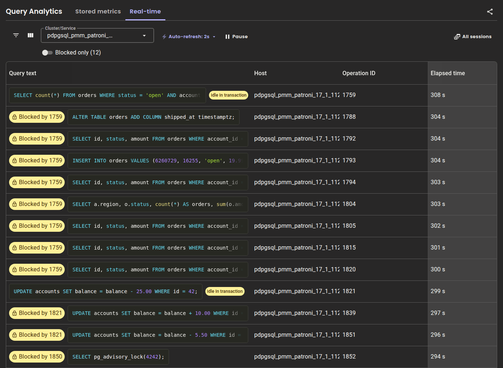
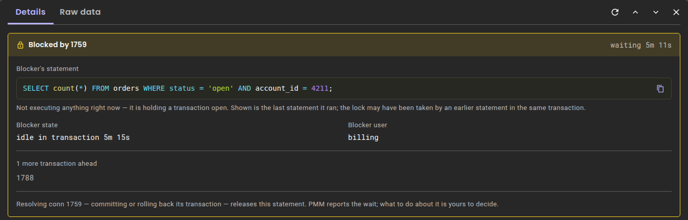
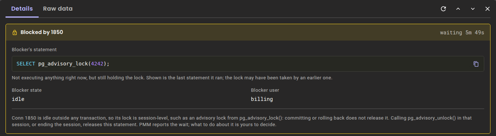
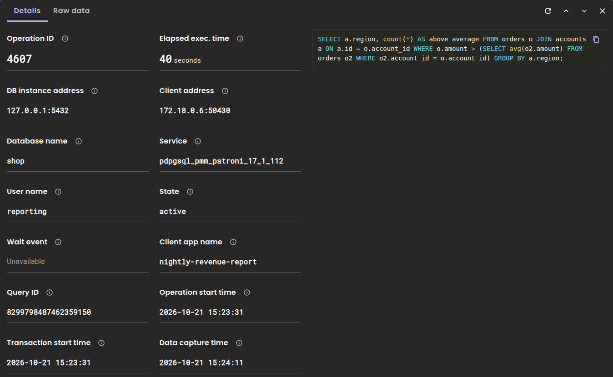
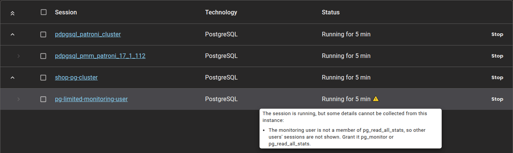

# Real-time Query Analytics for PostgreSQL

!!! warning "Technical Preview"
    Real-time Query Analytics for PostgreSQL is in [Technical Preview](../../reference/glossary.md#technical-preview) and is subject to change. Use it for testing and feedback, not on production or business-critical systems.

While [Query Analytics (QAN) Stored metrics](../qan/QAN-stored-metrics.md) capture queries after they complete, Real-time Query Analytics (RTA) shows you what your PostgreSQL server is executing right now — including which sessions are waiting on a lock, and which session holds it.

This is the view you want during an incident. A runaway `UPDATE`, a migration stuck behind a forgotten transaction, a pile-up of sessions queued behind a single row: QAN shows none of it until the queries finish, and a cancelled query never reaches QAN at all.

RTA reads `pg_stat_activity`, updates every 1-5 seconds and keeps data in memory only. Use the **Pause** button to freeze the view for investigation or to export a snapshot.

## Prerequisites

### Service requirements

RTA requires at least one PostgreSQL service monitored by PMM. If you haven't set this up yet, see [Connect PostgreSQL databases to PMM](../../install-pmm/install-pmm-client/connect-database/postgresql.md).

You need:

- **PMM Client 3.10.1 or later** on the monitored host. Run `pmm-admin status` to check.
- **A monitoring user that can see every session.** RTA reuses the credentials of the service's PostgreSQL exporter or QAN agent. A superuser, which PMM recommends for the monitoring account, sees every session. Any other monitoring user must be a member of `pg_monitor` or `pg_read_all_stats`:

    ```sql
    GRANT pg_monitor TO pmm;
    ```

    Without it, PostgreSQL hides other users' sessions from the monitoring user, and RTA shows only the monitoring user's own sessions.

RTA does not need `pg_stat_statements` or `pg_stat_monitor`. The PostgreSQL service that PMM Server uses for its own data, `pmm-server-postgresql`, is not offered for RTA.

### Role requirements

Starting and stopping RTA sessions requires the **Admin** role. Users with other roles have View-only access to sessions that an Admin has already started. For details, see [Standard role permissions](../../admin/roles/index.md).

## Start an RTA session

To start monitoring a PostgreSQL service:
{.power-number}

1. Go to **Query Analytics** in the sidebar.
2. Select the **Real-time** tab. If sessions are already running, the tab opens the sessions list: click **+ New session** there.
3. Select a PostgreSQL service from the **Cluster/Service** drop-down and click **Start session**. The drop-down groups services by technology, and the services of a cluster under its name.

    

4. If the sessions list opens, click the service name to open the live query table.

The live query table updates automatically.

If you have multiple services registered, click **+ New session** to run sessions simultaneously — useful for watching a primary and its replicas during the same incident. The view shows one technology at a time, so you can't combine PostgreSQL services with MongoDB or MySQL services in one view.

## Read the overview

Each row is one client session that is running a query or holds a transaction open, with the longest-running sessions first. Idle sessions outside a transaction are not listed. A parallel query is listed once, under the session that started it.



The default columns are:

| Column | Meaning |
| ------ | ------- |
| **Query text** | The query as `pg_stat_activity` reports it, with SQL syntax highlighting. For a session idle in transaction, this is the last query it ran |
| **Host** | The service the session is running on |
| **Operation ID** | The backend process ID (`pid`) — the value you pass to `pg_cancel_backend()` and `pg_terminate_backend()` |
| **Elapsed time** | How long the query has been running, for example `1.500 s`. For a session idle in transaction, how long its transaction has been open. Below 10 seconds the value has three decimals; from 10 seconds on, it is in whole seconds |

A session that is idle in transaction carries an **idle in transaction** label. Such a session runs nothing, but it keeps every lock its transaction took, which makes it the most common cause of a lock pile-up.

Click :material-view-column: **Show/Hide columns** to add **Database** and **User**. **Elapsed time** stays pinned to the right edge so it remains visible while you scroll.

State, wait event, application name, query ID and the transaction start time are not table columns. To see them, click the row and open the **Details** tab.

!!! note ""
    **Operation ID is the backend process ID, not a per-query identifier.** Consecutive queries on the same connection share it.

### Filter the view

The toolbar has the following filters:

- **Blocked only** — show just the sessions that are waiting on a lock. The count next to the toggle tells you how many there are without filtering. Sessions that RTA could not judge stay visible when the filter is on, so a session that may be waiting is never hidden.
- **Cluster/Service** — narrow to specific services when several sessions are running.
- :material-filter-variant: **Show/Hide filters** — filter the rows by query text, host, database or user, or by a **Min** and **Max** elapsed time. In the **Database** and **User** filters, separate several values with commas to match any of them.

The **Hide BEGIN/COMMIT** toggle that RTA offers for MySQL is not available for PostgreSQL. A session idle in transaction is often listed by its last query, which can be `BEGIN`, and hiding it would hide the session that holds the lock.

### Control the refresh rate

Use **Auto-refresh** to adjust how often the view updates, from 1 to 5 seconds. The default is 2 seconds. The refresh rate only controls how often your browser reads the data that PMM Server already holds, so a faster refresh adds no load to your database.

The PMM Client queries the database every 2 seconds. For PostgreSQL, this collect interval can't be changed.

RTA's own polling query starts with `WITH pmm_agent_rta AS` and is left out of Query Analytics for the service, so it doesn't appear as part of your workload.

### Pause the stream

Click **Pause** to freeze the current view so a query doesn't disappear on the next refresh. The agent keeps collecting in the background, and **Auto-refresh** shows **OFF**. Pausing also shows two icon buttons next to **Resume**:

- :material-refresh: **Refresh** reads the latest data once, without resuming live updates.
- :material-download: **Export to CSV** downloads the current view. See [Export RTA data](#export-rta-data).

Hover over an icon to see its name.

Opening a row also pauses the view, and closing the **Details** pane resumes live updates if they were running when you opened it. The pane covers the toolbar, so it has its own :material-refresh: **Refresh** button next to the previous and next arrows. The pane shows the session as it was when you opened it: **Refresh** checks whether the query is still running and updates the list that the arrows move through. To see newer values, close the pane and open the row again.

## Find out what is blocking a query

This is what RTA is for. A session waiting on a lock carries a **Blocked by** badge naming the session holding it up. Click the row to open the **Details** tab and see the full picture:



| Field | Meaning |
| ----- | ------- |
| **Blocked by** | The process ID of the session at the head of the chain, and how long this session has been waiting |
| **Blocker's statement** | What the blocking session is running. When the blocker is idle, this is the last query it ran, which is often, but not always, the query that took the lock: an earlier query in the same transaction may have taken it |
| **Blocker state** | The blocker's state, such as `active` or `idle in transaction`, with how long its transaction has been open. For a background process that reports no state, its backend type |
| **Blocker user** | Who owns the blocking session |

RTA asks PostgreSQL which sessions block each waiting session with `pg_blocking_pids()`, and follows the chain to its head. The **Blocked by** badge and the pane name the session at the head of the chain: it is not itself waiting on anything, and it is the one to resolve. Sessions queued for the same lock ahead of this one are listed under **more transactions ahead**, and they clear on their own once the head of the chain is resolved. When several sessions hold the lock independently, the pane marks each of them **Root**, and the waiting session stays blocked until all of them are resolved.

Only waits on heavyweight locks, the locks that `pg_locks` shows, have a blocker. A session waiting on I/O, a lightweight lock or a client is not blocked by another session: the **Wait event** field in the **Details** tab shows what it waits for.

### Who holds the lock

What releases the lock depends on the blocker's state:

- **`active`** — the blocker is still running a query. The lock is released when its transaction ends.
- **`idle in transaction`** — the blocker opened a transaction and stopped sending queries. Committing or rolling back that transaction releases the lock. Until then, every lock the transaction took stays held.
- **`idle`** — the blocker is outside any transaction, so it holds a session-level lock, such as an advisory lock from `pg_advisory_lock()`. Committing or rolling back does not release it. Calling `pg_advisory_unlock()` in that session, or ending the session, does.
- **`prepared transaction`**, with process ID `0` — a transaction prepared with `PREPARE TRANSACTION` holds the lock and belongs to no session. Find it in `pg_prepared_xacts` and run `COMMIT PREPARED` or `ROLLBACK PREPARED` with its `gid`.



### Stop a problematic query

!!! caution "Caution"
    Ending a session rolls back its open transaction. Use carefully, especially for writes.

To stop a query:
{.power-number}

1. Click the row to open the **Details** tab.
2. Copy the **Operation ID**.
3. Connect to your PostgreSQL instance and run one of the following functions:

    ```sql
    -- Cancel the running query and keep the session
    SELECT pg_cancel_backend(<operation_id>);
    -- End the session and roll back its transaction
    SELECT pg_terminate_backend(<operation_id>);
    ```

To clear a lock pile-up, end the **Root** blocker rather than the sessions queued behind it. A blocker that is idle in transaction runs no query to cancel, so end its session with `pg_terminate_backend()`.

## Investigate a query

Click a row to open its **Details** tab. It shows where the query comes from and what the session is doing:



### Trace it to its source

In the **Details** tab, **Client app name**, **User name** and **Client address** identify which application or host sent the query. **Client app name** is the `application_name` that the client sets when it connects. **Database name** tells you which database is affected.

### Spot waits and long transactions

**State** is the session's state in `pg_stat_activity`. **Wait event** shows what the session is waiting for, as `wait_event_type: wait_event`, for example `Lock: transactionid` for a session waiting on another transaction's row lock, or `IO: DataFileRead` for a session reading from disk. It shows **Unavailable** when the session is not waiting.

**Transaction start time** shows when the session's transaction began. A transaction that stays open for long holds its locks and keeps `VACUUM` from removing dead rows.

**Query ID** is PostgreSQL's query identifier, the same value as `queryid` in `pg_stat_statements`. PostgreSQL sets it on PostgreSQL 14 and later when `compute_query_id` is enabled, which is the default when `pg_stat_statements` is loaded. PostgreSQL computes it only after it has opened the tables a query reads, so a query that is still waiting for a lock on one of them has none yet. Without a query ID, the field shows **Unavailable**.

### Long queries are truncated

PostgreSQL keeps only the first `track_activity_query_size` bytes of a query, 1024 by default. A query that was cut short carries a **Truncated** label in the table, in the **Details** tab and in the blocker's statement. To see longer queries, raise `track_activity_query_size` in the PostgreSQL configuration and restart the server, because the setting can't be changed at runtime.

### View raw data

The **Raw data** tab shows the complete `pg_stat_activity` row for the session, exactly as the server reported it — including fields not surfaced in **Details**, such as `backend_start`, `state_change` and `backend_xid`. Use it when you need something RTA does not display, or to confirm what the server actually said.

## Export RTA data

You can export a snapshot of the current view to CSV. This is useful for capturing queries that are still in progress and may never appear in QAN — a long-running query that is cancelled before it completes never reaches QAN, because QAN only records queries that finish.

The :material-download: **Export to CSV** icon button is hidden while auto-refresh is active and appears once you pause.

To export the current view:
{.power-number}

1. Go to **Query Analytics > Real-time**.
2. Click **Pause**.
3. Apply any filters or sort order you want reflected in the export.
4. Click :material-download: **Export to CSV**.

The export includes all records across all pages, respects active filters and sort order, and is saved as `postgresql_rta_export_{timestamp}.csv`. The `operation_id` column holds the backend process ID, and `pg_query_id` holds PostgreSQL's query identifier. `query_text_truncated` says whether the query text was cut short. When one session is blocking a query, `blocking_conn_id` and `blocking_query` name it, and `blocking_query_truncated` says whether its query text was cut short. A negative `pg_query_id` is written with a leading apostrophe (`'`), so that spreadsheet applications don't read it as a formula.

## Known limitations

RTA for PostgreSQL has the following limits:

- **The collect interval is fixed at 2 seconds.** PostgreSQL RTA agents can't be added or changed with `pmm-admin`. Start and stop sessions from the **Real-time** tab or the API.
- **At most 1000 sessions are listed**, the longest-running first. The PMM Client logs a warning when more sessions are active.
- **Large lock pile-ups are described in part.** RTA bounds the blocker information it collects, because a session queued for a lock lists every session queued ahead of it. During a very large pile-up some blocked sessions show only the root of their chain, or no blockers at all, and the PMM Client logs a warning. Such sessions stay visible when **Blocked only** is on.
- **A finished query can stay in the view for up to about 30 seconds on an idle server.** The PMM Client sends no update while nothing is running, so the last snapshot stays visible until the data expires.

## Privacy considerations

!!! caution "Sensitive data may be visible"

    RTA displays query text as PostgreSQL reports it, which may include:

    - literal values in `WHERE` clauses and `INSERT`/`UPDATE` statements
    - credentials passed inside a query, such as a password in `ALTER ROLE`
    - personal or confidential data used in query conditions

    This data is visible to any PMM user who can access the QAN Real-time page. Consider your security requirements before enabling RTA in production.

RTA displays what the server returns and exposes nothing beyond what `pg_stat_activity` already provides to the monitoring user. Connection credentials and TLS material are redacted.

## Troubleshooting

### Session won't start

Check each requirement:

- **PMM Client version**: 3.10.1 or later. Run `pmm-admin status` on the monitored host. A service monitored by an older PMM Client does not appear in the **Cluster/Service** drop-down.
- **Connection**: RTA connects with the credentials of the service's PostgreSQL exporter or QAN agent, so the exporter must be able to connect.
- **Admin role**: only users with the **Admin** [role](../../admin/roles/index.md) can start or stop sessions.

If a session can't start, its status shows **Error**. Hover over the status in the sessions list to see the reason: PMM could not connect to PostgreSQL, or the server could not run the RTA query. The Real-time view shows the same reason instead of an empty table.

### Other users' sessions are missing

The monitoring user is not a superuser and not a member of `pg_read_all_stats`, so PostgreSQL shows it only its own sessions. The session still starts, and its status in the sessions list carries a warning icon. Hover over the status to see the warning:



Grant the monitoring user `pg_monitor` or `pg_read_all_stats`, as described in [Service requirements](#service-requirements), then stop and start the RTA session.

### No queries appear

RTA shows only sessions that are running a query or holding a transaction open at the moment of collection. Idle sessions and queries that finish between collection intervals never appear. If the server is busy but the view stays empty, check that the monitoring user can see other users' sessions, as described in [Other users' sessions are missing](#other-users-sessions-are-missing).

### A waiting query has no Blocked by badge

The session is not waiting on a heavyweight lock. Open the **Details** tab and check **Wait event**: a type other than `Lock`, such as `LWLock`, `IO` or `Client`, means the session waits on something other than another session's lock.

## See also

- [Real-time Query Analytics for MySQL](QAN-realtime-analytics-mysql.md)
- [Real-time Query Analytics for MongoDB](QAN-realtime-analytics.md)
- [Query Analytics overview](index.md)
- [Connect PostgreSQL databases to PMM](../../install-pmm/install-pmm-client/connect-database/postgresql.md)
- [Configuration issues](../../troubleshoot/config_issues.md)
