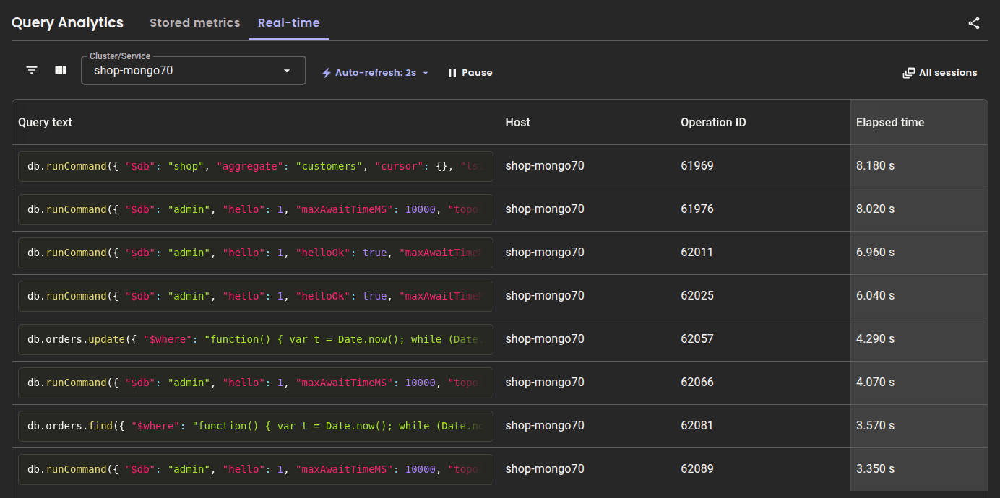
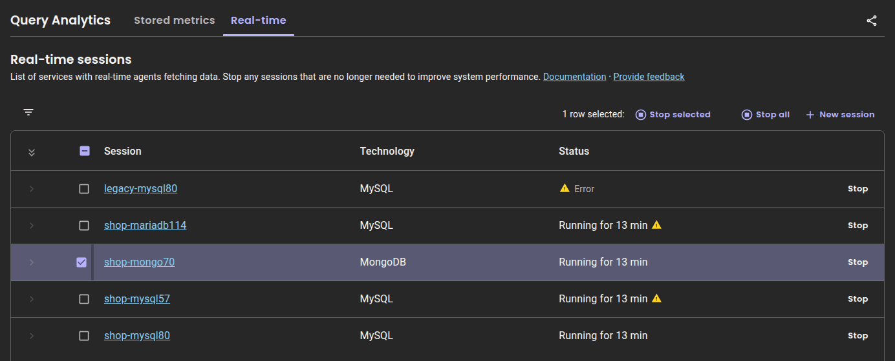
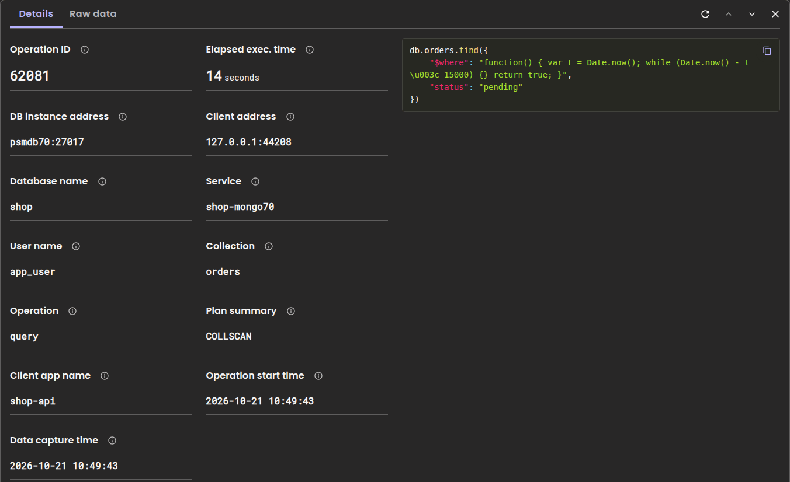
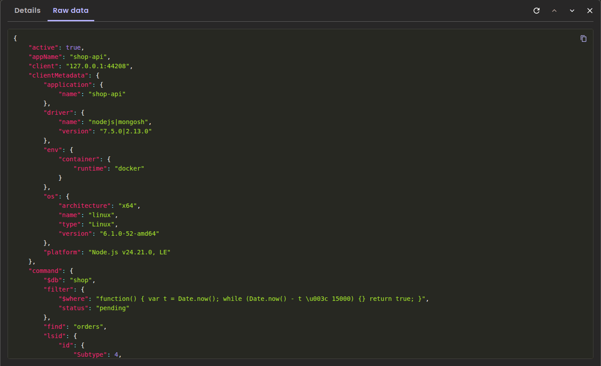

# Real-time Query Analytics for MongoDB

!!! note alert alert-primary ""
    This page covers RTA for MongoDB. For MySQL, Percona Server for MySQL and MariaDB, see [Real-time Query Analytics for MySQL](QAN-realtime-analytics-mysql.md). Support for **PostgreSQL** is planned for a future release.

While [Query Analytics (QAN) Stored metrics](../qan/QAN-stored-metrics.md) capture queries after they complete so you can analyze and optimize past performance, Real-time Query Analytics (RTA) displays queries as they execute. This allows you to identify problematic operations immediately and take action before they affect users.

RTA displays live query data, updated every 1-5 seconds. Data is held in memory only and refreshes with each update.

Use the **Pause** button to freeze the view for investigation or to export a snapshot of the current data.

## Before you start

### Service requirements

RTA requires at least one MongoDB service monitored by PMM. If you haven't set this up yet, see [Connect MongoDB to PMM](../../install-pmm/install-pmm-client/connect-database/mongodb.md).

RTA reuses your existing MongoDB exporter credentials, so you don't need to configure anything else.

### Role requirements

Starting and stopping RTA sessions requires the **Admin** role. Users with other roles have View-only access to sessions that an Admin has already started.
For details on PMM roles, see [Standard role permissions](../../admin/roles/index.md).

## Start an RTA session

You can start RTA from the PMM UI or from the command line.

### From the UI

To start monitoring a MongoDB service:
{.power-number}

1. Go to **Query Analytics** in the sidebar.
2. Select the **Real-time** tab. If sessions are already running, the tab opens the sessions list: click **+ New session** there.
3. Select a MongoDB service from the **Cluster/Service** drop-down and click **Start session**.

The live operations table appears and begins updating automatically:



### From the command line

Use `pmm-admin inventory add agent rta-mongodb-agent` to start RTA on a specific MongoDB service:

```bash
# Unlike the UI, this command does not reuse exporter connection settings.
# For username/password authentication:
pmm-admin inventory add agent rta-mongodb-agent <pmm-agent-id> <service-id> <mongodb-user> --password='<mongodb-password>'
# If TLS is required, also supply --tls and the necessary certificate options,
# such as --tls-ca-file and --tls-certificate-key-file.
```

Get the required IDs with:

```bash
# Get your PMM Agent ID
pmm-admin status

# Get the MongoDB service ID
pmm-admin inventory list services
```

Make sure to [add the MongoDB service](../commands/pmm-admin/add.md#add-mongodb) first if you haven't already. 

The output includes the RTA agent ID. Save it, as you will need it to stop RTA later. For the full flag reference, see [pmm-admin inventory add agent rta-mongodb-agent](../commands/pmm-admin/inventory.md#pmm-admin-inventory-add-agent-rta-mongodb-agent).

## Stop an RTA session

### From the UI

To stop an RTA session, click **All sessions** in the **Real-time** view and click **Stop** next to the session, or click **Stop all** to stop all at once.

### From the command line

Remove the RTA agent to stop Real-Time Analytics for that service:

```bash
# 1. Find the RTA agent ID
pmm-admin inventory list agents

# 2. Remove it
pmm-admin inventory remove agent <rta-agent-id>
```

For the full flag reference, see [pmm-admin inventory remove agent](../commands/pmm-admin/inventory.md#pmm-admin-inventory-remove-agent).


This stops Real-Time Analytics for that service but does not affect the MongoDB exporter or stored QAN metrics. To restart RTA, use `pmm-admin inventory add agent rta-mongodb-agent`.

## Explore the Real-time view

The Real-time view lists the operations that are running now. Use the toolbar to choose services, control updates and export what you see.

### Filter by service

If you have multiple MongoDB services registered, click **+ New session** to run sessions simultaneously. This enables you to monitor multiple replica set members at once or track several services during an incident.

Use the **Cluster/Service** drop-down to focus on specific MongoDB services. You can select multiple services to monitor activity across replica set members. The view shows one technology at a time, so you can't combine MongoDB and MySQL services in one view.

### Read the overview

Each row is one operation currently running. The table lists the longest-running operations first and has the following columns:

| Column | Meaning |
| ------ | ------- |
| **Query text** | The operation's command, reconstructed as a query |
| **Host** | The service the operation is running on |
| **Operation ID** | The operation ID — the value you pass to `db.killOp()` |
| **Elapsed time** | How long the operation has been running, for example `1.500 s`. Below 10 seconds the value has three decimals; from 10 seconds on, it is in whole seconds |

**Elapsed time** stays pinned to the right edge so it remains visible while you scroll.

### Control the refresh rate

Use **Auto-refresh** to adjust how often the view updates, from 1 to 5 seconds. The default is 2 seconds. The refresh rate only controls how often your browser reads the data that PMM Server already holds in memory, so a faster refresh adds no load to your database.

The database is polled by the PMM Client at its own collect interval, 2 seconds by default. To change it, run the following command on the monitored host:

```sh
pmm-admin inventory change agent rta-mongodb-agent <agent-id> --collect-interval=5s
```

Run `pmm-admin list` to find the agent ID of the `rta_mongodb_agent`.

### Pause the stream

Click **Pause** to freeze the current view so an operation doesn't disappear on the next refresh. The agent keeps collecting in the background, and **Auto-refresh** shows **OFF**. Pausing also shows two icon buttons next to **Resume**:

- :material-refresh: **Refresh** reads the latest data once, without resuming live updates.
- :material-download: **Export to CSV** downloads the current view. See [Export RTA data](#export-rta-data).

Hover over an icon to see its name.

Opening a row also pauses the view, and closing the **Details** pane resumes live updates if they were running when you opened it. The pane covers the toolbar, so it has its own :material-refresh: **Refresh** button next to the previous and next arrows. The pane shows the operation as it was when you opened it: **Refresh** checks whether the operation is still running and updates the list that the arrows move through. To see newer values, close the pane and open the row again.

If the operation you opened finishes and you refresh, the **Details** pane keeps showing it and marks it as no longer running. The previous and next arrows still work: they move to the operations above and below the position the finished operation was last seen at.

### Export RTA data

You can export a snapshot of the current RTA view to a CSV file. This is useful for capturing query data that is still in progress and may never appear in QAN.

For example, a long-running query that is killed before it completes never appears in QAN, because QAN only records queries that finish. Exporting the RTA view captures its data at the moment of the snapshot, before it disappears.

The :material-download: **Export to CSV** icon button is hidden while auto-refresh is active and appears once you pause.

To export data:
{.power-number}

1. Go to **Query Analytics > Real-time**.
2. Click **Pause** to freeze the live feed.
3. Apply any filters or sort order you want reflected in the export.
4. Click :material-download: **Export to CSV** to download the file.

The export includes all records across all pages, respects active filters and sort order, and is saved as `mongodb_rta_export_{timestamp}.csv`.

#### Exported fields

The columns are generated from the query data that PMM returns, so the exact set depends on your PMM version. Most column names match the API field names; a few keep shorter established names (`operation_id`, `elapsed_exec_time_sec`, `service`, `user_name`, `data_capture_time` and `raw_query`).

When a PMM version returns additional query data, the new columns are appended after the ones listed below. If you process the file automatically, match columns by header name rather than by position or column count.

A MongoDB export currently contains:

<!-- The CSV columns are built at runtime from the API response, so this list documents the
     current export rather than constraining it. Keep it in sync with the query fields in
     api/realtimeanalytics/v1/query.proto and with the header overrides in
     ui/apps/pmm/src/pages/rta/overview/export/exportRtaQueriesToCsv.ts -->

- `operation_id`: unique identifier for the operation
- `elapsed_exec_time_sec`: how long the operation has been running, in seconds
- `db_instance_address`: address of the MongoDB instance
- `client_address`: address of the client that sent the query
- `database_name`: database the operation is running against
- `service`:  PMM service name
- `user_name`: MongoDB user who issued the query
- `collection`: collection the operation is targeting
- `operation`: type of operation (query, insert, update, command)
- `plan_summary`: query plan summary (for example, `COLLSCAN` or `IXSCAN`)
- `client_app_name`: name of the application that sent the query
- `operation_start_time`: when the database started executing this operation
- `data_capture_time`: when PMM captured this snapshot
- `raw_query`: reconstructed query text
- `service_id`: identifier of the PMM service
- `query_text`: query as shown in the **Query text** column

### Share your view

Click the :material-share-variant: **Share session settings** icon in the page header to copy a link to your clipboard. The link preserves your selected cluster or service filter, query text filter, and page size.

When someone opens your link, they see live data with your filters applied, not the exact operations you were viewing, since RTA data updates continuously.

### View all sessions

Click **All sessions** to see and manage all running RTA sessions, for MongoDB and MySQL alike. From here you can stop one session with **Stop**, select several and click **Stop selected**, or click **Stop all**:



## Monitor and investigate operations

### Find slow operations

To identify operations that are taking too long:
{.power-number}

1. Look at the top of the table, which lists the longest-running operations first. To filter by duration, click :material-filter-variant: **Show/Hide filters** and enter a **Min** or **Max** value under **Elapsed time**.
2. Click an operation to open the **Details** tab, then check **Plan summary** for `COLLSCAN`. This means the query scanned the entire collection, often a sign that an index is missing.

    

Repeated slow queries on the same collection often indicate it needs better indexing.

### Trace an operation to its source

When you spot a problematic operation:
{.power-number}

1. Click the row to open the **Details** tab. 
2. Check **Client app name**, **User name**, and **Client address** to identify which application or server sent the query.
3. Check **Database name** and **Collection** to see which part of your database is affected. 

    If the same collection appears repeatedly in slow operations, it may be a hotspot that needs optimization.

### Understand workload patterns

In the **Details** tab, check the **Operation** field to see what type of action the database is performing: query, insert, update, or command. 

This helps you understand whether slow performance is caused by heavy writes, complex reads, or unexpected administrative commands.

### Check for lock contention

If operations seem stuck, open the **Raw data** tab and look for:

- `waitingForLock: true`: the operation is blocked waiting for a lock
- `locks`: shows which lock types the operation holds



Operations waiting for locks may indicate write contention or long-running operations blocking others.

### Correlate with other events

Use the timestamps in the **Details** tab to connect slow operations with other events:

- **Operation start time**: when the database started executing this operation
- **Data capture time**: when PMM captured this snapshot

Compare these with deployment times, traffic spikes, or alerts to understand what triggered the problem.

### Stop a problematic operation

!!! caution
    Killing operations can leave data in an inconsistent state. Use carefully, especially for Write operations.

If you need to kill a long-running operation:
{.power-number}

1. Click the operation to open the **Details** tab.
2. Copy the **Operation ID** value.
3. Connect to your MongoDB instance and run:

    ```javascript
    db.killOp(<operation_id>)
    ```

### View raw data

The **Details** tab shows a reconstructed version of the query, which may differ slightly from what you originally sent. 

For the complete diagnostic information from MongoDB's currentOp command, click the **Raw data** tab.
The raw data also includes additional information not shown in the **Details** tab, such as driver version, platform details, and the full command structure. This can help identify issues caused by outdated drivers or specific client configurations.

## Privacy considerations

!!! caution "Sensitive data may be visible"

    RTA displays raw query data from MongoDB, which may include:
    
    - filter criteria and update values containing sensitive information
    - user credentials passed in queries
    - personal or confidential data used in query conditions
    
    This data is visible to any PMM user who can access the QAN Real-time page. Consider your security requirements before enabling RTA in production environments.

RTA displays exactly what MongoDB returns and does not expose any additional information beyond what `db.currentOp()` provides.

## Troubleshooting

### No data appears

Click **All sessions** and check that the session's status reads **Running for** a duration. If the status shows **Error**, hover over it to see the reason. Make sure that your database has active queries, because RTA doesn't display operations that finish between collection intervals.

### Some fields show "Unavailable"

Not all operations have all fields. For example, a `hello` command (like a ping) won't have a **Collection**, **User name**, or **Plan summary**.

### The query text looks different from what I sent

MongoDB's `currentOp()` doesn't return the original query text. RTA reconstructs it from the command structure, which may look different from your original query. 

Check the **Raw data** tab to see exactly what MongoDB returned.

### Session won't start

Check the following requirements:

- **PMM Client version**: 3.7.0 or later. Run `pmm-admin status` on the monitored host to check.
- **MongoDB exporter**: Must be configured and running. Go to **PMM Inventory > Services**, select your MongoDB service, and check that the MongoDB exporter shows **Running**.
- **Admin role**: Only users with the **Admin** [role](../../admin/roles/index.md) can start or stop sessions. Users with other roles can view live data from running sessions.

## See also

- [Query Analytics overview](index.md)
- [Connect MongoDB to PMM](../../install-pmm/install-pmm-client/connect-database/mongodb.md)
- [MongoDB dashboards](../../reference/dashboards/dashboard-mongodb-instance-summary.md)
- [Configuration issues](../../troubleshoot/config_issues.md)
