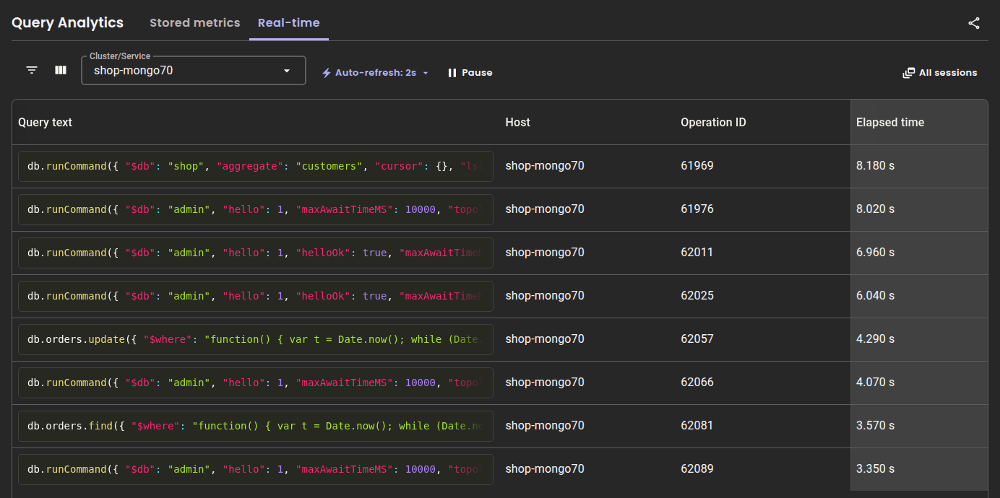
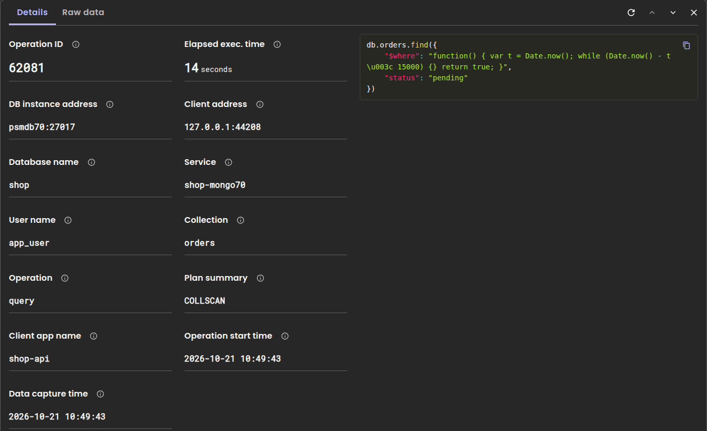
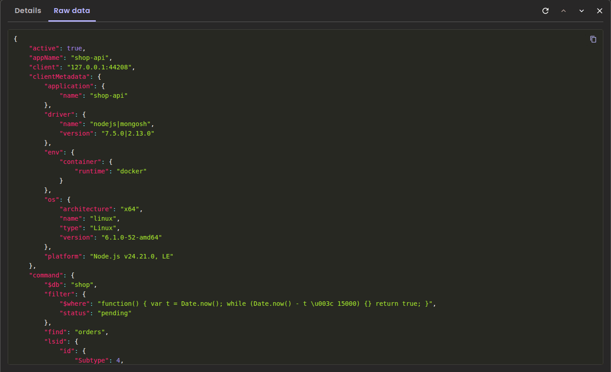
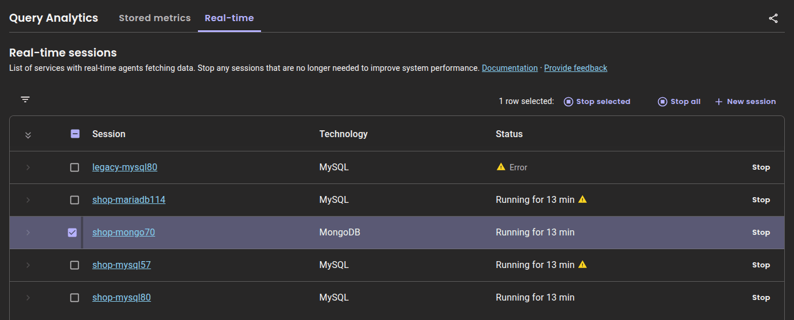

# Real-time Query Analytics for MongoDB

Use Real-time Query Analytics (RTA) to see what your MongoDB services are doing right now. RTA shows the operations that are running, so you can find the ones that are slow, scanning whole collections or waiting for a lock.

RTA also supports MySQL, Percona Server for MySQL, MariaDB and PostgreSQL, but shows different data for them. For those services, follow the [MySQL instructions](QAN-realtime-analytics-mysql.md) or the [PostgreSQL instructions](QAN-realtime-analytics-postgresql.md) instead.

## Choose between RTA and QAN

Use RTA when you're troubleshooting a problem as it happens. For example, if your application slows down or stops responding, RTA shows you the operations that are running, how long they've been running and where they come from.

[Query Analytics (QAN)](../qan/QAN-stored-metrics.md) works differently. It stores metrics for queries after they finish, so you can find slow, frequent or resource-intensive queries and spot trends over time. Because it relies on finished queries, QAN can't show you what's stuck right now.

In short, use QAN to understand query performance over time, and RTA to investigate what's happening right now.

## Prerequisites

### Check the service requirements

RTA needs at least one MongoDB service monitored by PMM. If you haven't set one up yet, [connect MongoDB to PMM](../../install-pmm/install-pmm-client/connect-database/mongodb.md).

You need:

- **PMM Client 3.7.0 or later** on the monitored host. Run `pmm-admin status` to check.
- **A running MongoDB exporter** for the service. RTA reuses its credentials, so you don't need to configure anything else.

### Check your role

Starting and stopping RTA sessions requires the **Admin** role. Users with other roles can view sessions that an Admin has already started.

To check what each role can do, [review the standard role permissions](../../admin/roles/index.md).

### Review privacy implications

RTA displays operations as MongoDB reports them, which may include:

- filter criteria and update values with sensitive information
- credentials passed in queries
- personal or confidential data used in query conditions

Any PMM user who can open the **Query Analytics > Real-time** page can see this data. Consider your security requirements before you use RTA in production.

RTA displays what MongoDB returns and exposes nothing beyond what `db.currentOp()` already provides.

## Start an RTA session

You can start RTA from the PMM UI or from the command line:

=== "From the UI"

    To start monitoring a MongoDB service:
    {.power-number}

    1. Go to **Query Analytics** in the sidebar.
    2. Select the **Real-time** tab. If sessions are already running, the tab opens the sessions list. Click **+ New session** there.
    3. Select a MongoDB service from the **Cluster/Service** drop-down and click **Start session**. If the sessions list opens instead, click the service name to open the live operations table.
    4. (Optional) To watch more services at once, for example all members of a replica set, click **+ New session** and repeat step 3 for each one.

=== "From the command line"

    To start RTA on a specific MongoDB service from the command line:
    {.power-number}

    1. If you haven't already, [add the MongoDB service](../commands/pmm-admin/add.md#add-mongodb).
    2. Get the IDs you need:

        ```bash
        # Get your PMM Agent ID
        pmm-admin status

        # Get the MongoDB service ID
        pmm-admin inventory list services
        ```

    3. Prepare the command that adds the RTA agent. Unlike the UI, this command doesn't reuse the exporter's connection settings, so pass the MongoDB user and password:

        ```bash
        pmm-admin inventory add agent rta-mongodb-agent <pmm-agent-id> <service-id> <mongodb-user> --password='<mongodb-password>'
        ```

    4. If the server requires TLS, add `--tls` and the certificate options to the command, such as `--tls-ca-file` and `--tls-certificate-key-file`.

    5. Run the command. The output includes the RTA agent ID. Save it, because you need it to stop RTA later.

    For all the options, see [pmm-admin inventory add agent rta-mongodb-agent](../commands/pmm-admin/inventory.md#pmm-admin-inventory-add-agent-rta-mongodb-agent).

## Find operations that need attention

When something is slow or stuck, start with the live operations table. It lists the operations running right now, with the longest-running ones at the top, so the most likely causes come first:



To find the operations behind your problem:
{.power-number}

1. Start at the top of the table. An operation with a high **Elapsed time** has been running for a long time and is a likely cause.
2. If you're watching several services, check **Host** to see which one the operation is running on.
3. When you've found the operation, [investigate it](#investigate-an-operation). If it has to stop right away, [kill it](#stop-a-problematic-operation).

### Narrow down the operations

On a busy server, the live operations table can list many operations at once. To narrow it down to the ones behind your problem:
{.power-number}

1. If several sessions are running, select only the services you're investigating in **Cluster/Service**. The view shows one database type at a time, so you can't combine MongoDB services with MySQL or PostgreSQL services in it.
2. To find specific operations, click :material-filter-variant: **Show/Hide filters** and filter by query text, or by a **Min** and **Max** elapsed time.

### Pause the view

If an operation you want to check keeps moving or disappears on the next refresh, pause the view:
{.power-number}

1. Click **Pause**. The view stops updating, but PMM Client keeps collecting in the background.
2. Check the operations you need. To see the latest data without resuming live updates, click :material-refresh: **Refresh**. To keep a copy of what you see, [export it](#export-rta-data).
3. To go back to live updates, click **Resume**.

### Control the refresh rate

Use **Auto-refresh** to adjust how often the view updates. The refresh rate only controls how often your browser reads the data that PMM Server already holds, so a faster refresh adds no load to your database.

PMM Client reads operations from the database at its own collect interval, every 2 seconds by default.

To change the collect interval:
{.power-number}

1. On the monitored host, run `pmm-admin list` and find the agent ID of the `rta_mongodb_agent`.
2. Set the new interval:

    ```sh
    pmm-admin inventory change agent rta-mongodb-agent <agent-id> --collect-interval=5s
    ```

## Investigate an operation

The **Details** tab of an operation shows what it's doing and where it comes from:



To check an operation:
{.power-number}

1. Click the operation's row. The view pauses until you close the pane, so the operation stays in place, and the **Details** tab shows the operation as it was when you clicked it.
2. To check whether the operation is still running, click :material-refresh: **Refresh**. If it has finished, the pane says so.
3. To see newer values for the operation, close the pane and click the row again.

### Find out who sent an operation

Killing a problem operation helps only until it runs again. To fix it at the source, find the application or person behind it:
{.power-number}

1. In the operation's **Details** tab, check **Client app name**, **User name** and **Client address** to find the application and host that sent it.
2. Check **Database name** and **Collection** to see which part of your database it affects. If the same collection keeps showing up in slow operations, it may need better indexing.

### Spot inefficient operations

A slow operation is often doing more work than it should. To find out why, check its **Details** tab:

- To check for a missing index, look at **Plan summary**. `COLLSCAN` means that the operation scanned the whole collection, which often means that an index is missing.
- To check what kind of work it's doing, look at **Operation**: query, insert, update or command. This tells you whether the slowdown comes from heavy writes, complex reads or unexpected administrative commands.

### Find out when an operation started

To connect a slow operation with other events, such as a deployment, a traffic spike or an alert, compare its timestamps in the **Details** tab:

- **Operation start time**: when MongoDB started running the operation
- **Data capture time**: when PMM captured this snapshot

### Check for lock contention

If operations seem stuck, check whether they're waiting for a lock. In the operation's **Raw data** tab, look for:

- `waitingForLock: true`, which means that the operation is waiting for a lock
- `locks`, which shows the lock types the operation holds



Operations waiting for locks often point to write contention, or to a long-running operation that blocks others.

### View raw data

View the raw data when you need a value that the **Details** tab doesn't show, or want to confirm exactly what MongoDB reported. The raw data is the complete `currentOp` document for the operation, including the full command structure, driver version and platform details. These can help you find problems caused by outdated drivers or specific client configurations.

To view it, click the operation's row and open the **Raw data** tab.

## Stop a problematic operation

Killing an operation can leave data in an inconsistent state, so be careful, especially with writes. To stop an operation:
{.power-number}

1. Click the row to open the **Details** tab.
2. Copy the **Operation ID**.
3. Connect to your MongoDB instance and run:

    ```javascript
    db.killOp(<operation_id>)
    ```

## Export RTA data

You can export a snapshot of the current view to CSV. This captures operations that are still running and may never appear in QAN. For example, a long-running operation that's killed before it finishes never reaches QAN, because QAN only records queries that finish.

To export the current view:
{.power-number}

1. Go to **Query Analytics > Real-time**.
2. Click **Pause**.
3. Apply any filters or sort order you want reflected in the export.
4. Click **Export**.

The export includes all records across all pages and is saved as `mongodb_rta_export_{timestamp}.csv`.

### Exported fields

The columns are generated from the query data that PMM returns, so the exact set depends on your PMM version. Most column names match the API field names. A few keep shorter names: `operation_id`, `elapsed_exec_time_sec`, `service`, `user_name`, `data_capture_time` and `raw_query`.

When a PMM version returns additional query data, the new columns are appended after the ones listed below. If you process the file automatically, match columns by header name rather than by position or column count.

A MongoDB export currently contains:

<!-- The CSV columns are built at runtime from the API response, so this list documents the
     current export rather than constraining it. Keep it in sync with the query fields in
     api/realtimeanalytics/v1/query.proto and with the header overrides in
     ui/apps/pmm/src/pages/rta/overview/export/exportRtaQueriesToCsv.ts -->

- `operation_id`: unique identifier for the operation
- `elapsed_exec_time_sec`: how long the operation has been running, in seconds
- `db_instance_address`: address of the MongoDB instance
- `client_address`: address of the client that sent the query
- `database_name`: database the operation is running against
- `service`: PMM service name
- `user_name`: MongoDB user who issued the query
- `collection`: collection the operation is targeting
- `operation`: type of operation (query, insert, update, command)
- `plan_summary`: query plan summary (for example, `COLLSCAN` or `IXSCAN`)
- `client_app_name`: name of the application that sent the query
- `operation_start_time`: when the database started executing this operation
- `data_capture_time`: when PMM captured this snapshot
- `raw_query`: reconstructed query text
- `service_id`: identifier of the PMM service
- `query_text`: query as shown in the **Query text** column

## Share your view

To show a colleague what you're looking at, click :material-share-variant: **Share session settings** in the page header. PMM copies a link that keeps your selected services, query text filter and page size.

The link opens live data with your filters applied, not the exact operations you were viewing, because RTA data updates continuously.

## Stop an RTA session

Each running session adds load to the monitored database and to PMM Server, so stop sessions you no longer need.

=== "From the UI"

    Click **All sessions** in the **Real-time** view. To stop one session, click **Stop** next to it. To stop several, select them and click **Stop selected**, or click **Stop all**:

    

=== "From the command line"

    To stop RTA on a service, remove its RTA agent:
    {.power-number}

    1. Find the RTA agent ID:

        ```bash
        pmm-admin inventory list agents
        ```

    2. Remove the agent:

        ```bash
        pmm-admin inventory remove agent <rta-agent-id>
        ```

    This stops RTA for that service but doesn't affect the MongoDB exporter or stored QAN metrics. To restart RTA, [start a new session](#start-an-rta-session). For all the options, see [pmm-admin inventory remove agent](../commands/pmm-admin/inventory.md#pmm-admin-inventory-remove-agent).

## Troubleshooting

### Session won't start

When a session can't start, its status shows **Error**.

To fix it:
{.power-number}

1. In the sessions list, hover over the **Error** status to see the reason.
2. Check the PMM Client version: run `pmm-admin status` on the monitored host. If PMM Client is older than 3.7.0, upgrade it.
3. Check the MongoDB exporter: go to **Inventory > Services**, find your MongoDB service and check that its MongoDB exporter is running.
4. Check your role: only users with the **Admin** [role](../../admin/roles/index.md) can start or stop sessions. If you're not an Admin, ask one to start the session.
5. Start the session again.

### No operations appear

If the Real-time view stays empty, click **All sessions** and check the session's status. If it shows **Error**, see [Session won't start](#session-wont-start).

If the session is running but the view is still empty, your database may have no operations that run long enough to catch. RTA sees only operations that are running at the moment PMM Client collects, so quick operations that start and finish between two collections never show up. To catch them, lower the collect interval, as described in [Control the refresh rate](#control-the-refresh-rate).

### Some fields show "Unavailable"

Not every operation has every field. For example, a `hello` command, which works like a ping, has no **Collection**, **User name** or **Plan summary**.

### The query text looks different from what I sent

MongoDB's `currentOp()` doesn't return the original query text, so RTA reconstructs it from the command structure. To see exactly what MongoDB returned, check the **Raw data** tab.

## Related topics

- [Real-time Query Analytics for MySQL](QAN-realtime-analytics-mysql.md)
- [Real-time Query Analytics for PostgreSQL](QAN-realtime-analytics-postgresql.md)
- [Query Analytics overview](index.md)
- [Connect MongoDB to PMM](../../install-pmm/install-pmm-client/connect-database/mongodb.md)
- [MongoDB dashboards](../../reference/dashboards/dashboard-mongodb-instance-summary.md)
- [Configuration issues](../../troubleshoot/config_issues.md)
